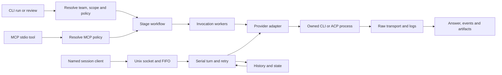

# MCO 0.13.0 architecture and reliability evaluation

## 1. Snapshot, scope, and elapsed-time evidence.

- Repository `mco-org/mco`, checkout `repos/mco-org__mco`, exact commit `7ce642193a127f3fac9c68fb10c5d0198d4e837e`. HEAD is the shallow checkout of the v0.13.0 release preparation commit. The Python project and npm package both declare 0.13.0. [pyproject.toml:5] [package.json:1]
- Start **2026-11-19 17:07:55 UTC**. `git rev-parse HEAD` returned the full pin. `git status --porcelain=v1 --untracked-files=all` returned no entries, and unstaged and staged `git diff --quiet` exited zero. The parent scratch directory has no Git metadata. All cleanliness checks refer to the MCO checkout.
- Finish **2026-11-19 17:38:27 UTC**, 30 minutes 32 seconds after start. Final HEAD matched the exact pin. Porcelain was empty and both diff checks exited zero. Section 9 records the integrity commands and intervening active investigation. The protocol lists nine headings. This report preserves them and adds prioritized improvements and acceptance criteria as section 10.
- Scope covers CLI and MCP coordination, process and provider lifecycles, file-backed workflows, persistent sessions, failure modes, and extension contracts. The bundled calling-agent skill is relevant as a delegation contract. GUI, terminal styling, paid model behavior, provider authentication, and remote compatibility are outside this evaluation.
- Environment was x86_64 Linux 7.2.15 on Btrfs. Tests used Python 3.11.17, 3.12.16, and 3.14.8, Node 26.12.0 and 26.13.1, and the locally cached MCP SDK 1.30.0. A network namespace had an empty routing table. A fresh environment and masked home isolated host account settings. The checkout was mounted read-only. The writable `/tmp` mount was backed by a temporary directory in the assigned workspace. The repo's report-writing gate ran on a separate `git archive HEAD` extraction in that mount. Sections 6 and 9 provide the commands.
- **Assessment.** MCO is a small local broker with useful operational output for short, explicitly selected review invocations. File-backed stages preserve provenance in the simple case. Process ownership, session liveness, artifact ownership, and cancellation become unreliable across abnormal exits, overlapping owners, and transport changes. Several verified paths return successful status with incomplete or unrelated output.

## 2. Core architecture and end-to-end control/data flow.



### Entry points and policy

The source launcher imports `runtime.cli.main`. The installed Python script has the same entry point, and npm normally delegates to the packaged launcher through `python3`. The stdlib runtime avoids an installation dependency on any model SDK. Provider executables own native tools, credentials, permissions, and model access. `mco serve` loads the optional MCP package to expose three stdio tools. [mco:7] [pyproject.toml:28] [bin/mco.js:11] [README.md:92] [runtime/cli.py:2132] [runtime/mcp_server.py:421]

The CLI reads global JSON, then project JSON and YAML, deep-merges mappings, and overlays command arguments. An explicit provider list or ordered alias/model declarations determine the team, with the configured provider list as fallback. Detection remains separate from team selection. The caller supplies intent and confirms the chosen team. `review` and `run` share execution. Review supplies a short default prompt and a read-only profile, and run defaults to write. Permission overrides and model routing are interpreted through provider-specific adapters. [runtime/config.py:327] [runtime/cli.py:2150] [runtime/cli.py:2242] [runtime/cli.py:2296] [runtime/cli.py:1522] [README.md:60]

The CLI resolves requested targets, checks repo containment and allow-list membership, parses aliases, and builds ordered `AgentInvocation` values. It adds optional provider perspectives or fixed review dimensions and can partition a sorted Git-aware file set round-robin. The shim child's working directory is the selected repository. Division assignments enter the prompt. Ordinary target paths travel as `TaskInput.target_paths` and are absent from the sampled shim's argv and prompt. Worktrees, branch ownership, per-provider checkouts, write conflict resolution, and result integration remain caller responsibilities. [runtime/invocation_runtime.py:99] [runtime/invocation_runtime.py:149] [runtime/invocation_runtime.py:194] [runtime/cli.py:469] [runtime/cli.py:515] [runtime/cli.py:538] [runtime/adapters/shim.py:134] [docs/guides/workflows.md:56]

### Invocation supervision and staging

The registry maps twelve built-in IDs to command builders or ACP launchers with shim fallbacks. Configured registrations can name custom command adapters, local-model adapters, or ACP peers. The adapter interface exposes detection, capabilities, start, poll, cancel, and transport decode. `TaskInput` carries execution metadata, `TaskRunRef` carries an in-memory run ID and artifact path, and `TaskStatus` carries attempt state and completion. Public rows are separate dictionaries. [runtime/adapters/__init__.py:22] [runtime/adapters/__init__.py:59] [runtime/contracts.py:19] [runtime/contracts.py:40] [runtime/contracts.py:77] [runtime/invocation_runtime.py:304]

A per-call thread pool submits the stage. A positive parallelism setting caps worker slots, and default zero expands to the team size. A worker starts a daemon thread for `adapter.run()` so it can abandon slow startup, then polls the returned reference. A shim launches an argv vector, places the child in a new process session on POSIX, redirects stdout and stderr to files, and retains a handle keyed by run ID. The worker reads and decodes a stdout snapshot each poll. Raw stdout changes refresh the stall deadline. Provider-specific hard deadlines override the generic invocation deadline. A single monotonic workflow deadline combines with the other deadlines. Cancellation signals a shared event, cancels eligible pending futures, and calls adapter cancellation for active invocations. [runtime/invocation_runtime.py:32] [runtime/invocation_runtime.py:246] [runtime/invocation_runtime.py:333] [runtime/invocation_runtime.py:493] [runtime/invocation_runtime.py:545] [runtime/adapters/shim.py:111] [runtime/platform.py:69]

The scheduler stores results by declaration index and emits events as work finishes. Complete, partial, and failed map to exits 0, 1, and 2. Adapters interpret formal events or process exit. Providers and callers interpret the answer prose. Result mode determines whether Markdown, JSON metadata, and provider evidence persist or the temporary directory is removed after execution. [runtime/invocation_runtime.py:556] [runtime/invocation_runtime.py:605] [runtime/answer_transport.py:13] [runtime/invocation_artifacts.py:63] [runtime/invocation_artifacts.py:84] [docs/contracts/invocation-runtime-v1.md:23]

Parallel mode runs one stage. Chain executes one declaration at a time. It supplies the immediate predecessor's answer through a manifest and marks later dependent failures if a link fails. Debate fans out again over the first stage when a success exists. Synthesis chooses the first matching provider invocation or the first declaration. Its manifest combines run and debate records in declaration order, including missing or failed inputs. Prior answer paths are labeled untrusted. Debate and synthesis build read-only profiles and skip providers without the required declared capability. The topology and declarations are resolved before launch. Prior results determine eligibility for downstream stages. The caller supplies any strategy, stage-specific semantics, or aggregation request in the task instructions. [runtime/invocation_runtime.py:650] [runtime/invocation_runtime.py:691] [runtime/invocation_runtime.py:823] [runtime/invocation_runtime.py:917] [runtime/invocation_runtime.py:953] [docs/contracts/invocation-runtime-v1.md:51]

### Session daemon, MCP, and ACP

A session lives under `.mco/sessions/<name>/`. The manager creates or loads state, launches a detached Python daemon, and waits for a Unix socket pathname and persisted PID. The daemon has one serial worker, a FIFO with ten waiting slots, and per-connection handlers for send, ping, queue, cancel, result, and shutdown. A synchronous send receives a receipt and terminal reply on one socket. A no-wait send receives a receipt, with later lookup in a fifty-result memory window. Cancel applies to the session. Broadcast opens a concurrent task for each active session. [runtime/session/manager.py:23] [runtime/session/manager.py:69] [runtime/session/daemon.py:29] [runtime/session/daemon.py:50] [runtime/session/daemon.py:388] [runtime/session/daemon.py:439] [runtime/session/client.py:64] [runtime/session/client.py:171]

Each turn launches a fresh provider attempt. The worker reloads history, prepends a bounded prefix, and appends a user and assistant line on nonempty success. Resume restarts the daemon with disk history. Queued requests, terminal results, and next request ID live only in memory. Session attempts have their own 900-second wall-time limit after startup. Transient errors can trigger two retries with one- and two-second backoff. The attempt path preserves partial text on normal timeout or cancellation. [runtime/session/state.py:87] [runtime/session/state.py:148] [runtime/session/manager.py:212] [runtime/session/daemon.py:89] [runtime/session/daemon.py:163] [runtime/session/daemon.py:271] [runtime/retry.py:6]

MCP uses explicit built-in providers and shares the one-shot executor. An independent policy resolver supplies timeout, parallelism, and model pins. Async tools call synchronous helpers with `asyncio.to_thread`. The progress bridge schedules invocation events back onto the server loop. An `ok: true` response carries a task result whose nested status conveys operational success or failure. [runtime/mcp_server.py:132] [runtime/mcp_server.py:157] [runtime/mcp_server.py:313] [runtime/mcp_server.py:383] [runtime/mcp_server.py:456] [runtime/mcp_server.py:482]

ACP owns a fresh process and protocol session per invocation. An NDJSON reader routes ID-matched responses, notifications, and peer-initiated requests. The client initializes, opens a session, prompts from a separate thread, and drains updates until idle or a five-second drain window. MCO implements optional filesystem and terminal requests for the peer. The adapter writes accumulated plain text at completion, so the invocation worker uses the plain-text decoder even though a structured ACP decoder exists. [runtime/acp/adapter.py:64] [runtime/acp/adapter.py:151] [runtime/acp/adapter.py:215] [runtime/acp/adapter.py:269] [runtime/acp/transport.py:114] [runtime/acp/client.py:135] [runtime/acp/client.py:238]

## 3. Why the design works and its governing invariants.

1. **Intent and identity are explicit.** Declaration order and aliases survive dispatch, events, and final ordering. Multiple aliases of one provider get distinct run IDs and files under the normal single-owner task directory. File division and perspective prompts are reproducible. [runtime/invocation_runtime.py:108] [runtime/invocation_runtime.py:515] [runtime/invocation_runtime.py:585] [runtime/adapters/shim.py:128]
2. **Independent work stays useful when a peer fails.** Per-future exception handling and separate logs let the caller recover successful answers. Synthesis retains valid run input even when later debate fails. The partial and stalled fixture controls verified these boundaries for ordinary dispatch. [runtime/invocation_runtime.py:556] [runtime/invocation_runtime.py:605] [runtime/invocation_runtime.py:793] [runtime/invocation_runtime.py:944]
3. **The adapter layer absorbs CLI churn.** Codex's sandbox profile, Pi's tool allowlist and paired model routing, Kimi's shipped profiles, and Hermes's mode checks account for different native interfaces. The changelog documents changes in this layer, including version-specific command and decoder fixes. Keeping execution operational limits the amount of provider policy that leaks into aggregation. [runtime/adapters/codex.py:41] [runtime/adapters/pi.py:42] [runtime/adapters/kimi.py:71] [runtime/execution_modes.py:39] [CHANGELOG.md:10]
4. **File references carry provenance.** A manifest binds earlier stage, alias, provider, model, status, and path. Downstream agents can read the complete answer without putting it in argv. The simple chain and debate/synthesis fixtures verified the bytes the consumer read. The invariant requires canonical stage files and exclusive artifact ownership, which controls E and P qualify. [runtime/invocation_runtime.py:650] [runtime/invocation_runtime.py:691] [runtime/invocation_runtime.py:955] [runtime/invocation_artifacts.py:108]
5. **Local state is inexpensive.** Serial turns make history order predictable, and a reconstructed history serves any shim. A healthy daemon normally owns one socket and FIFO. An invocation owner normally owns a handle and finalization. Unexpected worker exceptions, concurrent starts, and restart expose the durability and ownership limits of those assumptions. [runtime/session/daemon.py:241] [runtime/session/daemon.py:537] [runtime/session/state.py:108] [runtime/session/state.py:152] [runtime/invocation_runtime.py:475]

## 4. What it does well and poorly, with source evidence.

### Strengths supported by offline controls

- **Practical fan-out.** The CLI retained declaration order, capped peak at two fixture providers, and preserved independent answers on failure and timeout. Structured output retained valid token counts on request. [runtime/invocation_runtime.py:493] [runtime/invocation_runtime.py:556] [runtime/invocation_runtime.py:608] [runtime/answer_transport.py:46]
- **Useful normal-path guardrails.** Review chooses a read-only provider profile, source scope resolution rejects escapes before dispatch, and JSONL keeps provider diagnostics on stderr. SIGINT cleaned up the cooperative fixture. [runtime/cli.py:1522] [runtime/cli.py:2312] [runtime/cli.py:2384] [runtime/cli.py:2400] [runtime/adapters/shim.py:247]
- **Inspectable execution.** Raw logs, provider records and summaries support diagnosis. The session daemon rejected a full queue explicitly and continued after ordinary cancellation. Turn history supported clean resume. Repo tests exercise real local fakes, including ACP scenarios and SDK schema registration. [runtime/adapters/shim.py:216] [runtime/session/daemon.py:284] [runtime/session/daemon.py:403] [tests/test_acp_conformance.py:30] [tests/test_mcp_server.py:67]

### Reliability findings

| ID | Priority and observation | Root cause and local evidence |
|---|---|---|
| F1 | **High. Accepted requests can strand a live session.** A provider version-read exception and an argv size error each killed the serial worker. Ping and ensure still passed and the daemon accepted another request behind the stale one. | Dispatch and state writes lack a per-turn exception boundary or worker supervisor. Health observes the listener or PID. [runtime/session/daemon.py:241] [runtime/session/daemon.py:271] [runtime/session/daemon.py:362] [runtime/session/manager.py:193] |
| F2 | **High. Session names lack exclusive ownership.** Controlled concurrent starts created two live daemons. Older-owner cleanup removed the newer socket and saved stopped state while the newer daemon remained live. A stale socket led to a caller failure before a later successful bind. A simulated stale PID record made the fallback stop target the recorded test process without a daemon socket. | Check, save, and spawn lack mutual exclusion. Readiness uses pathname existence and PID liveness. Startup and shutdown unlink the name without an ownership check. State writes truncate in place. [runtime/session/manager.py:84] [runtime/session/manager.py:102] [runtime/session/manager.py:237] [runtime/session/daemon.py:549] [runtime/session/daemon.py:633] [runtime/session/state.py:87] |
| F3 | **High. Persistent task ID reuse can corrupt answer identity.** A second CLI invocation removed the first one's files while it was running. Distinct aliases yielded failure. The same alias returned success with the second invocation's answer. | Persistent initialization deletes an existing directory and reuses paths. Open descriptors and later path lookups can refer to different objects. Sequential replacement is an explicit contract test. [runtime/invocation_runtime.py:475] [runtime/invocation_runtime.py:773] [runtime/adapters/shim.py:120] [runtime/adapters/shim.py:208] [tests/test_invocation_runtime.py:503] |
| F4 | **High. Child activity can outlast the reported end.** SIGTERM ended the CLI while its child stayed live. A real ACP peer also survived CLI timeout during initialization, while timeout after startup was reaped. Group TERM left a stubborn grandchild after the leader exited. A valid split UTF-8 sequence triggered failure while its producer was live. | SIGINT is the only cooperative CLI handler. Escalation checks leader liveness, and the worker has no unconditional cleanup after a successful start. Reference publication also has a check-then-publish gap. [runtime/cli.py:2384] [runtime/adapters/shim.py:247] [runtime/platform.py:112] [runtime/invocation_runtime.py:32] [runtime/invocation_runtime.py:352] [runtime/invocation_runtime.py:573] |
| F5 | **High. MCP client cancellation can acknowledge while work continues.** Real SDK cancellation returned an error receipt while the provider kept running. Two calls each honored a per-call limit of one and ran concurrently. | Async tool cancellation lacks a path to the synchronous runtime's stop event. The pool limit is per call. [runtime/mcp_server.py:345] [runtime/mcp_server.py:392] [runtime/mcp_server.py:482] [runtime/invocation_runtime.py:503] |
| F6 | **High. Result and context can disagree with formal output.** JSON returned a revised answer while the live deltas and invocation Markdown retained its draft. ACP flattened a fixture's explicit final answer, text-delta content, and usage into an empty successful response. | Artifact writes tee streaming deltas. The final decoder returns a separate answer. ACP passes plain accumulated text into the runtime even when its formal decoder can represent the update. [runtime/invocation_runtime.py:366] [runtime/invocation_runtime.py:388] [runtime/invocation_runtime.py:406] [runtime/acp/adapter.py:127] [runtime/acp/adapter.py:217] [docs/contracts/cli-json-v0.1.x.md:48] |
| F7 | **High where scope fidelity matters.** Preview accepted an escaping path that live execution rejected. CLI and MCP validated the same project target differently. Ordinary shim argv omitted an allowed target. Session used a different profile and model from the configured CLI run. | Entry points assemble different policy subsets. Scope remains metadata unless the adapter or prompt consumes it. Session constructs a minimal task. [runtime/cli.py:2312] [runtime/cli.py:2521] [runtime/adapters/codex.py:41] [runtime/mcp_server.py:313] [runtime/session/daemon.py:205] |
| F8 | **Medium to high. Session receipt semantics break across queueing, cancel, and restart.** Waiting tickets appeared missing and disappeared on cancellation. IDs reused across daemon generations. JSON and human exit codes differed for a missing socket. | Result lookup sees current and terminal records. Only the worker adds terminal records. Request numbering and the cache both restart with the daemon. Several JSON CLI branches return zero after outputting an error. [runtime/session/daemon.py:53] [runtime/session/daemon.py:311] [runtime/session/daemon.py:454] [runtime/session/daemon.py:491] [runtime/cli.py:1789] |
| F9 | **Medium to high. ACP progress, framing, and close have brittle assumptions.** Wire progress failed to refresh the runtime stall deadline. A peer request sharing an ID with a local request was misrouted. A surviving child holding stdout delayed close. | Runtime progress observes files created only at terminal poll. The reader looks up pending IDs before checking for a method. Close performs synchronous stream disposal after waiting on the leader. [runtime/acp/adapter.py:257] [runtime/acp/adapter.py:269] [runtime/acp/transport.py:129] [runtime/acp/transport.py:257] [runtime/invocation_runtime.py:352] |
| F10 | **Medium. Composed plans can report stages inconsistently.** Chain silently omitted requested synthesis. An ineligible chain stage reported complete with no rows while the root reported failure for that alias. Persistent root JSON omitted stage on repeated aliases. | The inner executor emits terminal records before the workflow merges ineligible rows. Synthesis only runs in the non-chain branch. The root writer projects away the output stage. [runtime/cli.py:1164] [runtime/invocation_runtime.py:605] [runtime/invocation_runtime.py:857] [runtime/invocation_runtime.py:917] [runtime/invocation_artifacts.py:48] |
| F11 | **Medium. Preflight, polling and sinks exceed the apparent budget.** Repeated model probes preceded the global timer. Snapshot polling reread the growing raw log. A slow custom callback blocked another call's startup. | Catalog discovery runs per declaration before workflow entry, raw text is read before the stat comparison, and callbacks are synchronous under a module-global lock. [runtime/cli.py:2363] [runtime/invocation_runtime.py:82] [runtime/invocation_runtime.py:352] [runtime/invocation_runtime.py:503] |
| F12 | **Medium. Config and extension validation has holes.** A misspelled enforcement mode suppressed strict rejection. Wrong-shaped timeout config escaped as a traceback. A configured Ollama model differed from its reported explicit label. Division included unignored local state and dispatched an empty assignment. | The parser and merged config check different inputs. Policy preview validates configured keys but lacks a universal explicit model contract. File splitting trusts Git and a finite deny-list, then submits every declaration. [runtime/cli.py:1198] [runtime/cli.py:1491] [runtime/cli.py:1572] [runtime/cli.py:1634] [runtime/cli.py:2266] [runtime/adapters/ollama.py:81] [runtime/cli.py:436] [runtime/cli.py:515] |

## 5. Core-code quality: decomposition, state, concurrency, errors, types, tests, observability, extensibility, and maintainability.

**Decomposition.** Shared process and transport primitives allow small provider adapters. Routing is concentrated. An AST count found 47 runtime Python files and 10,472 lines, with a 594-line CLI main, a 305-line workflow function, a 275-line invocation worker, and a 172-line socket handler. Counts include comments and nested functions. The concentration matters because one policy change can cross several independent entry points. [runtime/cli.py:1966] [runtime/invocation_runtime.py:165] [runtime/invocation_runtime.py:720] [runtime/session/daemon.py:348]

**State and concurrency.** Frozen records and declaration-index results stabilize identity. Several records contain mutable lists and metadata. Shim and ACP run maps rely on one poll owner per handle, while separate invocations can share one adapter instance. The workflow pool, session FIFO, and fifty-result cache bound counts. Child lifetime, raw and retained result bytes, ACP notifications and terminal buffers, and IPC handler count have weaker bounds. Terminal children use another lifecycle and buffered-output path. An executor wait can overrun the task deadline when a provider method blocks. [runtime/contracts.py:39] [runtime/adapters/shim.py:64] [runtime/acp/adapter.py:98] [runtime/invocation_runtime.py:503] [runtime/session/daemon.py:53] [runtime/session/daemon.py:597] [runtime/acp/transport.py:42] [runtime/acp/handlers.py:91]

**Errors and types.** The adapter interface offers useful state, handle and error fields. Their mapping to public output varies. An ordinary nonzero shim exit yields the status message `completed` while the specific taxonomy remains in provider JSON. CLI JSON drops the stderr field and does not re-emit it. Session retry classifies stderr again. Extension capabilities use optional methods and dynamic metadata, while the provider literal excludes custom IDs. Native resumability flags describe provider capabilities. MCO's in-memory run refs have no reattachment mechanism. [runtime/errors.py:17] [runtime/contracts.py:10] [runtime/contracts.py:62] [runtime/adapters/shim.py:212] [runtime/adapters/shim.py:234] [runtime/invocation_runtime.py:423] [runtime/cli.py:2488] [runtime/session/daemon.py:138] [runtime/adapters/codex.py:10]

**Observability.** Task IDs, run IDs, PIDs, UTC times, machine output, and persistent evidence support debugging. `invocation_started` is emitted for the whole team before submission. It records scheduling intent even for a declaration that never spawns. Broker progress depends on stdout changes or output deltas. The core ignores the adapter's status heartbeat, and MCP does not emit periodic heartbeats for silent work. Callback exception isolation is useful when a consumer fails. Slow callbacks share the scheduler's time budget. [runtime/invocation_runtime.py:82] [runtime/invocation_runtime.py:363] [runtime/invocation_runtime.py:507] [runtime/invocation_runtime.py:637] [runtime/mcp_server.py:52]

**Provider and tool boundaries.** Shim launch uses argv and a specific Windows batch wrapper. The host environment is largely inherited and enforcement is provider-native. ACP has broker-owned filesystem methods when an allow-list exists. Their permissions follow resolved path grants, including context-only parent directories. The adapter's nominal review profile does not separately configure these handlers. Custom ACP declarations carry permission keys separately from the actual launch flag mapping. These are source-level boundary observations, with external sandbox behavior outside the live tests. [runtime/platform.py:69] [runtime/adapters/shim.py:44] [runtime/acp/adapter.py:138] [runtime/acp/adapter.py:164] [runtime/acp/client.py:157] [runtime/acp/handlers.py:16] [runtime/acp/handlers.py:35] [runtime/adapters/__init__.py:31] [README.md:117]

**Tests and maintenance.** CI uses Python 3.11 with the actual MCP extra, Node tests, release checks, and platform packaging jobs. The Python tests cover policy, provider argv, stream and artifact contracts, startup deadlines, cancellation, FIFO operations, and fake ACP scenarios. Important cases are mocked or tested in isolation. Ensure tests stub launch and PID, the standard ACP success fixture emits text at idle, and the sequential same-ID cleanup test cannot exercise overlap. The local controls use subprocess and UDS fixtures where useful, with controlled barriers for narrow races. The shallow history limits design archaeology to source, docs, and changelog. [.github/workflows/gate.yml:15] [tests/test_invocation_runtime.py:378] [tests/test_invocation_runtime.py:503] [tests/test_session_ensure.py:24] [tests/test_acp_adapter.py:86] [tests/test_acp_conformance.py:43] [CHANGELOG.md:41]

## 6. Executed tests/experiments and their limitations.

### Repository tests and package smoke

| UTC window | Command or environment | Result |
|---|---|---|
| 17:08:54–17:10:08 | System Python 3.14.8, `python3 -m unittest discover -s tests -p 'test_*.py' -v`, no MCP extra | 528 discovered, 524 passed, four skipped, 74.144 s. |
| 17:10:20–17:11:32 | Python 3.12.16, same command and isolation, no MCP extra | 528 discovered, 524 passed, four skipped, 72.007 s. |
| 17:15:25–17:15:26 | Python 3.12.16 `-S`, config, config-file, agent registry, and MCP modules | 47 discovered, 45 passed and two skipped, 0.762 s. Confirmed `find_spec("yaml") is None` so the bundled YAML fallback was exercised. |
| 17:15:25–17:16:40 | Python 3.12.16, SDK installed into a temporary target and exported as `PYTHONPATH` | 525 passed, two Windows skips, one MCP stdio registration test errored with `Connection closed`, 72.953 s. The invocation registered in-process. Section 7 resolves the child environment issue. |
| 17:17:46–17:19:02 | Clean Python 3.11.17 venv with offline MCP 1.30.0, `./scripts/run_runtime_gate_tests.sh` on a temporary pinned export | Gate PASS. 528 discovered, 526 passed, two native Windows skips, 72.757 s. Both previously skipped SDK tests ran. |
| 17:17:17 and 17:17:46 | `NODE_PATH=/opt/local-node-deps npm test` with installed lock-matching Cross Spawn and transitive packages, Node v26.13.1 | 20 discovered, 19 passed and one Windows-only test skipped. Parser and wrapper paths passed with the test mocks shipped in the project. |
| 17:08:54 and 17:17:46–17:17:49 | Skill-format and package-version validators, npm pack inspection and extraction, wheel build and clean install | Validators passed. npm pack 0.13.0 listed 68 entries. Extracted launcher returned `mco 0.13.0` and produced installer dry-run JSON. Wheel installed as 0.13.0 and both Kimi profile paths resolved inside the installed package. |
| By 17:21:10 | Python 3.12.16 clean venv, both `McpServerRegistrationTests` plus real stdio calls | Both tests passed in 0.262 s. MCP exposed doctor, review, and run without `ctx` in the tool schemas. Control T exercised the installed SDK and real MCO server against local stubs. |
| 17:31:38 and 17:33:09–17:33:23 | Rebuilt the wheel with standard isolated build dependencies resolved from cached wheels. Re-ran ACP, transport, and invocation tests with resource warnings enabled. | Fresh install reported bundled skill reference `ok`, fresh user status `not_installed`, and `skills read` returned 6,187 characters. 89 targeted tests passed in 14.042 s. The only two resource warnings came from test-local file reads. A four-test tracemalloc rerun verified those allocation sites and exercised both close controls. |
| 17:36:53–17:38:08 | Full clean Python 3.12.16 venv with offline MCP 1.30.0 on the read-only original checkout | 528 discovered, 526 passed, two native Windows skips, 72.658 s. Both SDK registration tests passed. This repeated the earlier target-install run with the SDK visible to the child interpreter. |

The two native Windows Python tests and one Windows Node test remained platform skips. The complete npm installation smoke requires `@clack/prompts` and its registry packages, which were unavailable in the isolated cache and dependency tree. The shipped noninteractive tests and extracted wrapper ran with real cached Cross Spawn. This covers neither interactive prompts nor the exact npm install flow. The build did not fetch packages. The optional SDK came from cached wheels already in the assigned workspace. No provider, account, production endpoint, or remote CI was used. [package.json:13] [scripts/install-wizard.js:86] [scripts/run_npm_packaging_smoke.sh:20] [.github/workflows/gate.yml:27] [tests/test_platform_helpers.py:84] [tests/test_mcp_server.py:67]

### Focused controls

The lettered controls use fake executables and local IPC so the broker paths run with no credentials. Small timing values separate phases for measurement. They demonstrate ordering, cancellation behavior, and cleanup in this environment. They are not performance benchmarks for provider services.

| Control | Method and measured result |
|---|---|
| A. Schedule and preflight | CLI review with three model-qualified Codex fixture declarations, cap two, provider runtimes about 250 ms, 20 ms failure, and immediate success. Peak two real children. Finish order `two,three,one`, task exit 1 with fixture stderr routed to stderr. Separate cap-one JSON output retained `one,two,three` with usage `2+3=5` on successes when requested. Six aliases of the same model caused six serial 230 ms catalog probes. A one-second global budget still returned exit 0 at 1.592 s, with the first provider starting 1.461 s after the first probe marker. |
| B. Workflow contents and events | Chain 2 read `answer:first` from chain 1 using the manifest, with the untrusted reference instruction and read-only launch. Synthesis without debate consumed both run answers and chose the first matching alias. Debate plus synthesis consumed five invocations with four manifest inputs for synthesis in run/debate declaration order. Root `run.json` omitted output stage on all five rows. Successful two-stage chain emitted `task_finished` for `chain-00`, `chain-01`, and the root. With a command shim lacking context capability as chain 2, stage JSON and event said `complete` with no rows, while root returned exit 1 with `context_file_unsupported`. Chain plus synthesis advertised synthesis in preview and executed only two chain links. |
| C. Preview scope | Same `../outside` target returned preview exit 0 and live exit 2 with `path_outside_repo`. An in-repo `.` target passed on both paths. |
| D. Deadline controls | Repeated stdout every 280 ms with a one-second stall budget returned success after greater than one second, while a silent peer timed out, task partial at 1.518 s. With one worker and a one-second global deadline, the running and queued rows both ended as timeout, the latter with `task stopped before invocation started`, wall time 1.294 s. |
| E. Stream integrity | A shim wrote the first byte of a valid emoji, then emitted the remaining three bytes 240 ms later. Broker returned failed in about 21 ms with `unexpected end of data`, with the leader alive and a retained run handle. Reading the completed log yielded `f09f988a` and valid text. Single-write control passed and removed the handle. A formal Codex draft/final fixture returned JSON `final` while deltas, live event and Markdown held `draft`. Exit zero with an ordinary log line was complete with transport `running` and empty answer. Exit zero with formal `turn.failed` produced failure. |
| F. Blocking extension methods | Real shim subclass delayed the successful poll 320 ms. A 120 ms global budget returned success after 321 ms. Ordinary nonblocking poll timed out and reaped the child under the same budget. A controlled start reference delay with cap one and 85 ms per attempt left three child leaders alive when three timeout results returned, with peaks 1, 2, and 3, and eventually cancelled all three on release. A barrier between checking abandonment and queue publication returned `timeout` with zero cancel calls after the reference was published. |
| G. Group ownership | Two same-PGID child fixtures. With normal TERM behavior both leader and grandchild exited. With grandchild ignoring TERM and leader responding normally, cancellation dropped its handle while the descendant remained in state S. The test explicitly cleaned up the descendant. |
| H. Admission and cancellation | One gate-held active turn plus ten waiting turns. The eleventh waiting enqueue returned queue full. Current ticket returned pending, queued ticket 2 returned not found. Cancel acknowledged 11 and dropped the ten queued ticket results. Running ticket became cancelled, history was empty, and the next turn succeeded. The no-wait CLI against a missing socket printed an error with exit 0 in JSON and exit 2 in text. |
| I. Resume | Stop after request 1 completes, await stopped state, resume, poll request 1, and send a new turn. Old request 1 became missing and the next turn used ID 1 for a different answer under the new PID. Four history rows and the earlier text in the next provider prompt confirmed conversation continuity. |
| J. Dead worker | Real daemon and executable completed a valid turn. Invalid bytes only from the next fixture's version probe raised `UnicodeDecodeError` in the worker. After restoring valid version output, a new request queued behind the stuck current request. Ping and ensure both reported the daemon alive. The worker traceback was in `agent.stderr.log`. |
| K. Retry | Same fake Codex turn wrote `429 rate limit` and exited 1 before succeeding on the third attempt. One-shot attempted once and exited 2. Session tried at relative times 0.000, 2.002, and 5.004 s and returned success after 6.067 s with two history lines. |
| L. History capacity | Of thirty short records, the most recent 20 remained, covering ten complete pairs. A 50,001-character retained older record exhausted the history budget, dropping the most recent prior entry while preserving the explicit new prompt. |
| M. Session policy | Same project and provider. CLI observed `--sandbox read-only --model local-model`. Session observed `--sandbox workspace-write` without a model override. |
| N. ACP progress and decode | Fake ACP sent six text blocks about 84 ms apart. With stall budget 1.2 s, run succeeded at about 0.536 s, emitting one text delta after idle at 0.517 s. With 240 ms stall, the provider emitted three working updates, then task timed out with no answer or delta. A terminal text-delta update with explicit final and usage returned success with empty answer in the runtime. Direct `decode_acp_events` on the same event returned `formal answer` and usage 2+1=3. |
| O. ACP request routing and close | A harmless peer request with an independent ID invoked its handler and returned the acknowledgement. Sharing the pending caller ID returned `None` to the local caller and never invoked the handler. A normal EOF woke the waiting request in about 5 ms. Closing an ACP subprocess whose descendant retained the pipe blocked until the fixture killed the descendant after 650 ms. |
| P. Artifact ownership | Two real CLI processes, first held after prefix reached the tee. Different IDs preserved both answers and artifacts. Shared task ID and different aliases yielded exits 2 and 0, a missing first invocation file, and `ENOENT` writing the first provider record. Shared ID and alias yielded exits 0 and 0 and the first JSON returned the second answer. |
| Q. CLI process signals | Same active fake with PID marker. CLI SIGINT returned 2 with cancelled row and no running child. CLI SIGTERM returned by signal -15 with empty stdout and provider state S. Test cleanup terminated the fixture child. |
| R. Session name ownership | Paused one caller after the initial absent-state read. After the other caller started normally, resumed the first caller's unchanged code. Two daemon PIDs and two socket inodes appeared. The second caller reported startup failure via its early pathname test, then the new daemon published active state. Old daemon SIGTERM removed the newer socket and wrote stopped state while the newer PID remained live. A separately seeded stale socket produced a resumption error before a later successful ping. Sequential ensure reused the original PID and sequential start rejected a duplicate. |
| S. Socket length | Same repo and OS, 89-byte socket pathname worked, 128-byte failed. Raw AF_UNIX bind produced the same `AF_UNIX path too long`. The manager reported crashed after 5.008 s and the daemon logged the kernel-facing bind error. |
| T. MCP | Real SDK `list_tools` succeeded. CLI rejected `other` when the project allowed only `allowed`, whereas MCP review returned `done quick`. Provider exit 4 returned MCP `ok: true` with nested failed task. Two calls under per-call cap one had two live children. `notifications/cancelled` for one call returned `Request cancelled`, and a subsequent ping succeeded while both children lived. After releasing the test gates the cancelled fixture finished too. The silent interval had zero progress messages for 340 ms, while start, working, success, and completion emitted around actual visible events. |
| U. Scope and division | Ordinary path appears in preview only, while actual Codex argv and prompt omit it and cwd is the repo. Git fixture assigned three sorted files without overlap to four declarations. The empty one still launched. Ignored file, symlink and dependency entries were skipped. Unignored `.mco/sessions/local/state.json` appeared in repo-wide division. Parser rejects direct `--divide files --chain`, but `policy.divide: files` from a file survives explicit `--chain` and both ran. |
| V. Config and adapters | Unknown benign Codex policy key rejected with strict config, accepted with `strcit`. Integer `provider_timeouts` returned exit 1, empty stdout and a TypeError, while a map worked. Fake Ollama got `run configured` and answered `model:configured` while the result model said `requested`. |
| W. Diagnostic routing | The same failing provider printed one diagnostic and exited 7. JSON mode returned task exit 2 and row error `completed` with provider exit 7, while stderr was empty. JSONL and text modes retained the diagnostic on stderr. |
| X. Output cost and event backpressure | Counted characters returned by scoped `Path.read_text` instrumentation over 12, 24 and 48 repeated 16 KiB bursts. Final sizes 192, 384 and 768 KiB produced about 2.95, 10.34 and 39.75 MB of cumulative reads in the first run, with correct final answers. The largest repeat read 39.06 MB for 768 KiB of output. Stdout ticks kept a silent-answer fixture alive while equivalent stderr ticks did not. A stalled callback in a separate in-process invocation delayed a 100 ms budget to about 321 ms and returned timeout. The delayed task called its adapter after the deadline in both runs. A fast consumer completed normally. |
| Y. Daemon crash and restart | Started a real session, completed ticket 1, held ticket 2 in a live child, and accepted queued ticket 3. Daemon SIGKILL returned -9 while the provider stayed alive. Lookup failed with socket refused and state became crashed after reaping the daemon. Resume first reported the stale-pathname failure, then a new daemon became active. Ticket 3 was missing and zero requests waited. The new turn reused ticket 1, received earlier successful history, and the launch log showed no execution of ticket 3. |
| Z. Cancellation handoff | Paused the worker after it removed the first request from the queue and before assigning current. Cancel through a real socket pair returned `Nothing running`, count zero. Releasing the worker dispatched the accepted request with cancellation unset and produced a successful terminal row. |
| AA. Extension permission contract | Pure preview with ACP Codex classified both sandbox and approval-policy keys as supported, but launch preview emitted only sandbox. A configured custom ACP peer registered a sandbox key and passed strict preview, while argv contained only the executable. A recording command adapter under best-effort got the unused key in live metadata despite empty applied preferences in preview. |
| AB. History transaction boundary | Injected an I/O exception at the second append of a successful turn after the real user line write. The worker left one user line, turn count zero, and the request completion event unset. The test used an injected fault with a writable filesystem and no disk pressure. |
| AC. ACP startup versus running cancellation | Same registered fake peer in three phases. Successful ready control returned the answer at 0.079 s. An initialize-only peer remained in state S after CLI timeout at 1.070 s. A peer that finished initialization and blocked during prompt was gone after the timeout at 1.085 s. No protocol cancel frame appeared in the initialized case because the adapter closed transport directly. Preview for the custom peer reported strict unknown risk, while plain execution accepted it. |
| AD. Large input and spawn boundary | `--file` passed 80,000 ASCII characters through the CLI. 150,000 returned exit 2 with `E2BIG`, also reproduced by a direct same-binary spawn. System aggregate `SC_ARG_MAX` was 2,097,152. The same 150,000-character session request fit ingress, returned a queued receipt, and killed the worker when the command builder placed the prompt into one argument. Ping still passed. |
| AE. Fallback PID ownership | Seeded a synthetic stale state with the PID of a controlled local fixture child and no socket. List returned active, ensure returned the same PID and ping failed. Fallback stop returned true and the child exited by SIGTERM. This tests the ownership decision with a simulated stale record, without waiting for OS PID reuse. |
| AF. Readiness advisory | Fake Kimi advertised version 1.0.0 and emitted a valid final answer when invoked. Doctor exited 0 with `overall_ok: false`, `ready: false`, and `unsupported_version`. CLI review still dispatched the same binary and returned the fixture answer. |

### Evidence limits

Fixtures match the code's declared adapter and event shapes. They demonstrate supervision, files, IPC, schema and command construction, with provider-generated answers replaced by known data. The static review identifies several risks whose external effect depends on the native binary, provider version, account, OS, SDK, filesystem, and caller integration. A single Linux Btrfs host supplies the process and socket observations. SDK registration was checked on MCP 1.30.0. Provider plan modes, native tool enforcement, live compatibility, costs, and cancellation after real remote dispatch were outside the measurements.

## 7. Measurement audit for every negative or surprising result, including alternate commands or code-path checks used to rule out setup mistakes.

### Harness, dependencies, and platform

- The initial shell runner attempt hit the host command policy on an unnecessary manual cleanup expression. A Python `TemporaryDirectory` context provided cleanup. The next toolchain mount failed when trying to create a target below read-only `/opt`. A private tmpfs at that mount point plus read-only binds for exact local toolchain directories allowed execution. A first draft of that wrapper also had an indentation error, corrected before test execution. The actual test namespace had an empty route table and no real home. An attempted status check in the outer scratch directory returned the expected no-Git error. Repeating under the checkout confirmed the pin and empty porcelain output.
- The minimal system path initially used Python 3.14.8 and Node 26.12.0, with no `npm`. Its Node test wrapper failed to load Cross Spawn, and parsing the empty npm output separately failed. The effective path was printed in the corrected isolated environment and used Python 3.12.16 and npm 11.20.0 under Node 26.13.1. Both the empty and recovered tarball caches returned `ENOTCACHED` for the exact locked `which@2.0.2` tarball under `npm ci --offline`. A separate installed dependency tree supplied Cross Spawn 7.0.6, which 2.0.2, path-key 3.1.1, shebang-command 2.0.0, shebang-regex 3.0.0, and isexe 2.0.0. All match the lockfile. With that `NODE_PATH` the real test suite passed except the platform skip. The Clack package remained absent. Its import is inside the interactive selection code. The earlier loader errors were dependency setup effects. [package-lock.json:43] [package-lock.json:105] [scripts/exec-util.js:3] [scripts/install-wizard.js:86]
- A packaging control stopped at 141 because the investigative pipeline sent a tar listing into `find` under `pipefail`. `find` does not consume stdin. Redirecting the listing to a file let the exact package extraction and wheel install finish. The first wheel skill query used top-level keys and printed `None`. The envelope's actual keys were `ok`, `skill_health`, and `skill_drift`. Kimi path checks were independent of that query and both passed. [runtime/cli.py:1672] [scripts/run_npm_packaging_smoke.sh:24]
- SDK registration initially skipped by design without `mcp`. A local wheel resolved the dependency. Installing via `pip --target` exposed unrelated host site-package resolver warnings and one real child startup error. SDK `mcp/client/stdio/__init__.py:51` and `:127` use a reduced child environment. `get_default_environment()` confirmed no `PYTHONPATH`, so the child could not import the target install. A clean venv put the SDK in the interpreter's own site-packages. Both registration tests then passed in Python 3.12, and the clean Python 3.11 gate passed with only Windows skips. The same lower server implementation and fixture were used. [pyproject.toml:30] [runtime/cli.py:2132] [tests/test_mcp_server.py:75]
- Socket length was measured in encoded bytes. Short and long tests shared underlying filesystem, user, repo root and provider. Direct bind reproduced the kernel-facing limit. The manager's five-second wait is a product readiness issue following the platform error. It did not indicate a dependency or permission failure. Disk inspection showed Btrfs with approximately 598 GiB free. No stress run exhausted disk or quota. Native Windows cases require the applicable platform and were left as skips. [runtime/session/daemon.py:553] [runtime/session/manager.py:102] [tests/test_platform_helpers.py:84]

### Timing, scheduler and lifecycle evidence

- **A and D.** Fixture markers bracketed actual process execution. Start-event order came from declaration iteration before submitting work, and could not establish process overlap or child startup. The independent monotonic catalog marker established that the one-second limit started after preflight. An ordinary budget-overrun measurement also includes polling, TERM grace, and waiting for the pool. Moving the deadline to the task entrance and checking it at spawn are separate from making termination immediate. The queued timeout row and no-provider-start message confirmed the normal bounded scheduler path. [runtime/cli.py:2363] [runtime/invocation_runtime.py:503] [runtime/invocation_runtime.py:507] [runtime/invocation_runtime.py:545] [runtime/adapters/shim.py:261]
- **F and X.** The blocking poll deliberately exercised an extension contract, then the same scheduler with real nonblocking shim poll and a pending child timed out. A controlled handoff barrier between the abandonment check and publication reproduced the race without assuming it occurs frequently under the GIL. Holding several returned refs at a barrier showed actual child liveness, not merely thread counts. Releasing the barrier confirmed the ordinary late-cancel path. A separate callback control confirmed that the 100 ms deadline could already expire before executor submission. A first assertion expected zero adapter starts, but observed a late adapter call. This can occur because the scheduler submits futures before checking the deadline, and the startup helper starts its thread before testing remaining time. Compare the fast consumer control and distinguish adapter entry from successful spawn. [runtime/invocation_runtime.py:32] [runtime/invocation_runtime.py:66] [runtime/invocation_runtime.py:82] [runtime/invocation_runtime.py:515] [runtime/invocation_runtime.py:545]
- **G, O, and Q.** State was checked inside the PID namespace, treating `Z` and absent PIDs as non-running. Same-PGID observation ruled out a deliberately detached grandchild in the TERM escalation control. If the leader had also stayed live, the shim would have attempted group KILL. In ACP close, a separate timer released a real open pipe, and close returned at that boundary. EOF control showed that ordinary waiting requests wake promptly. CLI SIGTERM was delivered to the broker PID, not the whole terminal group, to model supervisor service termination. SIGINT with the same child and artifact setup yielded a cancelled row and removed the child. I cleaned up surviving fixtures explicitly. [runtime/adapters/shim.py:247] [runtime/platform.py:112] [runtime/acp/transport.py:257] [runtime/cli.py:2384]
- **T.** Both registration tests running in the clean SDK venv ruled out optional-dependency setup. The raw stdio cancellation acknowledgement and SDK log `Request 10 cancelled - duplicate response suppressed` established real dispatch of the cancellation. A ping, live child states, and the cancelled fixture's later completion marker ruled out waiting for the wrong request or reading buffered old output. The two-call observation is expected from per-call caps. The 340 ms silent observation alone is too short to establish a heartbeat SLA. Source confirms emission is event-driven with throttling of output-driven notifications and no periodic timer. [runtime/mcp_server.py:52] [runtime/mcp_server.py:98] [runtime/mcp_server.py:482]

### Data, policy, and state evidence

- **B, C, and P.** For B, the consumer actually opened its manifest and referenced answer files, eliminating a prompt-only assertion. Synthesis alone and debate plus synthesis were positive dispatch controls. The unsupported stage's empty complete status was read from its own persisted JSON and JSONL, alongside the root failure row. For C, the same absolute checkout and argv apart from `--dry-run` isolated the validation difference. For P, the first provider stayed gated until its prefix was visible and the second CLI finished. Different IDs on the same mount preserved both outputs. Different aliases with a shared ID yielded a deterministic missing provider-summary parent, which corrected an initial hypothesis of empty success. Reusing the alias re-created the same log pathname and gave actual wrong-answer success. Neither case required changing permissions or exhausting disk. [runtime/cli.py:2312] [runtime/cli.py:2521] [runtime/invocation_runtime.py:475] [runtime/invocation_runtime.py:857] [runtime/invocation_runtime.py:917] [runtime/adapters/shim.py:208]
- **E, N, and O.** E replayed the fully written byte sequence and a single-write control to distinguish strict snapshot decoding from corrupt final data. The first draft fixture for Codex omitted a nested message type, and the decoder filtered that delta. Adding a nested `item.type=agent_message` then reproduced the draft/final difference with a recognised event. The explicit turn failure control distinguishes ordinary exit-zero fallback from a declared failed transport. ACP independently logged its wire cadence. With a longer stall budget the same workload succeeded, and direct decode of the text-delta frame isolated flattening from frame shape. The alternate JSON-RPC ID test used the same handler and peer, varying only the independent request ID. [runtime/answer_transport.py:139] [runtime/invocation_runtime.py:352] [runtime/invocation_runtime.py:406] [runtime/acp/adapter.py:127] [runtime/acp/adapter.py:269] [runtime/acp/transport.py:129]
- **H through M and R.** H held the running provider before admitting all ten requests, so queued lookup did not race completion. It then checked queue status, running and cancelled ticket status, history, a recovery turn, and the non-JSON exit. I waited for definitive stopped/active state and used distinct answer text and PID to distinguish readback from replay. J restored valid fixture version bytes and observed a second accepted request and worker traceback after an earlier good turn. K reset the attempt counter between entry points and logged each provider invocation. Its observed delays include the one-second poll sleeps as well as backoff. L confirmed latest-entry retention under normal history size before exercising oversized context. M captured native argv for the same repo config. R changed scheduling only at the first missing-state read, then read both live PIDs, the replacement socket inode and the post-cleanup state. The stale socket test used a real bound-then-closed socket. These are local daemon effects, distinct from PID reuse on a long-lived host or OS socket limits. [runtime/session/daemon.py:114] [runtime/session/daemon.py:228] [runtime/session/daemon.py:271] [runtime/session/daemon.py:454] [runtime/session/daemon.py:491] [runtime/session/daemon.py:549] [runtime/session/daemon.py:633] [runtime/session/state.py:148] [runtime/session/manager.py:84]
- **U, V, and W.** Captured actual provider argv and cwd instead of trusting preview output. Git fixture distinguished tracked, unignored, ignored, symlink and dependency files. Direct mutually exclusive flags correctly failed, which corrected the initial probe's assumption. Moving division into the config tested the post-merge policy separately. Strict and misspelled mode used the same harmless unknown key. A valid timeout map proved the malformed scalar case was not a bad provider setup. Fake Ollama echoed the actual selected model, making the reported label mismatch independent of vendor behavior. Provider exit and diagnostic text were identical across output modes, ruling out differing failure paths. [runtime/cli.py:469] [runtime/cli.py:515] [runtime/cli.py:1223] [runtime/cli.py:1491] [runtime/cli.py:1572] [runtime/cli.py:2488] [runtime/adapters/ollama.py:81]
- **X.** Byte counts refer to logical bytes reread, including shim final status reads, with ASCII fixture data and a scoped instrumentation wrapper. Kernel page cache, codec cost, scheduling, and filesystem therefore affect elapsed time, while whole-file rereads and the tested scaling are intrinsic. A doubled stream length also doubles observation time at fixed burst rate. The result is evidence for avoidable accumulation and repeated work, with no claim of exact asymptotics under all providers, polling rates, or I/O conditions. Equal cadence and final payload distinguished stdout-based stall accounting from stderr activity. [runtime/invocation_runtime.py:352] [runtime/invocation_runtime.py:363] [runtime/adapters/shim.py:208]

- **Y and Z.** The crash experiment retained the original daemon's process handle only for observation and reaping. That eliminated a zombie-only liveness result. The independently recorded provider PID stayed running after daemon death. State, result lookup, scope history, and the actual fake executable launch ledger distinguished persistent conversation from accepted work. Z placed a barrier after the real queue pop and before the current-request lock, then exercised the original handler over a socket pair. The synthetic interleaving models a legitimate scheduling gap. It establishes the ordering defect without estimating its field frequency. [runtime/session/manager.py:60] [runtime/session/daemon.py:247] [runtime/session/daemon.py:439] [runtime/session/state.py:117]
- **AA and AB.** AA inspected claimed applied keys and command construction without a real provider or tool action. The configured peer's key is declarative, and only built-in flag mappings configured for the adapter can change launch argv. For best-effort, live metadata passed the fixture field even though the preview projected it away. The standard command adapter can ignore it, so the control establishes an extension contract mismatch and makes no claim about a vendor applying the key. AB used a real first append and injected the error at the second call. This isolates receipt and storage transaction behavior independently of quota, container permissions, and an operating-system crash. [runtime/adapters/__init__.py:31] [runtime/adapters/__init__.py:74] [runtime/acp/adapter.py:138] [runtime/policy.py:41] [runtime/cli.py:2458] [runtime/session/daemon.py:284]
- **Dry-run exit scope.** The documented preview may exit zero when rendering succeeds despite a strict policy warning. C's discrepancy is that preview omitted target containment validation, not that a policy preview is required to return a runtime failure exit. [docs/contracts/errors-v0.1.x.md:51] [runtime/cli.py:2312] [runtime/cli.py:2521]

- **AC, AD, and AE.** AC varied only the point at which a complete local ACP fixture blocked. Wire method and PID traces establish both successful acquisition and actual live startup loss. The same check after session creation reaped the subprocess, and ready mode passed the full prompt path. Unknown risk dry-run annotation comes from an unconditional strict preview check, while the live path only computes that rejection inside an existing strict policy failure. AD compared 80,000 and 150,000 ASCII bytes and verified the errno with direct `subprocess.run`. The one-argument limit is distinct from the OS aggregate bound and the daemon's 1 MiB NDJSON intake. AE seeded a controlled state record with a known fixture PID. The management behavior follows from `kill(pid, 0)` plus socket fallback. It shows missing process identity verification, with actual PID reuse frequency unmeasured. [runtime/acp/adapter.py:186] [runtime/acp/adapter.py:312] [runtime/invocation_runtime.py:32] [runtime/cli.py:628] [runtime/cli.py:2344] [runtime/cli.py:274] [runtime/adapters/codex.py:85] [runtime/session/daemon.py:323] [runtime/session/manager.py:60] [runtime/session/manager.py:124]
- **Warning and installed-wheel follow-up.** Resource-warning output from the 89-test run pointed into test code. A targeted tracemalloc run attributed both allocations to test-local `open(...).read()` calls. The focused transport pipe-close cases passed. This finding is separate from the actively retained child and pipe in O. Project build dependencies were available in the local wheel cache, so a standard isolated build independently confirmed the no-build-isolation wheel result. The corrected nested skill status distinguished a valid bundled reference from a fresh user's lack of installed copies. [tests/test_acp_adapter.py:112] [tests/test_acp_transport.py:129] [tests/test_acp_transport.py:148] [runtime/cli.py:1698] [pyproject.toml:1]

**AF readiness audit.** Both commands shared the same executable and isolated environment. Doctor intentionally reports machine-readable readiness independently of its process exit. Live CLI probes the model catalog where supported and then calls the adapter directly, while the daemon checks presence at dispatch. Kimi's version gate runs in `detect()`. This explains the discrepancy without assuming the real legacy Kimi binary accepts the current options. [runtime/cli.py:314] [runtime/cli.py:2037] [runtime/cli.py:2363] [runtime/adapters/kimi.py:30] [runtime/session/daemon.py:183]

## 8. Post-mortem: design pressures, accumulated tradeoffs, likely failure modes, and the highest-leverage improvements.

MCO's current shape follows three visible pressures. Local distribution favors Python's stdlib, shell-compatible provider entry points, and human-readable files. Rapid provider changes favor adapter-specific opt-ins, concrete flags, and captured event contracts. Multi-agent review favors operational evidence and caller discretion. The changelog shows the earlier consensus and findings layer was removed in v0.11.0, positional process and transport handling continued to change, and MCP acquired its own policy parity fixes. The compact broker and stable result identities make short tasks practical. [pyproject.toml:28] [CHANGELOG.md:10] [CHANGELOG.md:28] [CHANGELOG.md:41] [CHANGELOG.md:174]

The dominant failure mechanism is **ownership crossing different clocks and lifetimes**. Executor lifetime can end before a delayed start returns. A worker can die while its daemon still serves health requests. An SDK request can be cancelled while its sync worker runs. A process leader can exit while remaining group members and log descriptors live. A task ID and a socket pathname can point to another generation while old owners still finalize. In these cases the error is a mismatch between what the caller observes and what is still executing or writing. A durable database alone would leave most of these problems. First make acquisition, phase transition, ownership, and release explicit and observable. [runtime/invocation_runtime.py:32] [runtime/invocation_runtime.py:475] [runtime/session/daemon.py:241] [runtime/session/daemon.py:633] [runtime/acp/transport.py:257] [runtime/mcp_server.py:482]

A second mechanism is **diverging representations outside a single pipeline**. The CLI, dry-run, MCP and session resolve different policy subsets. Stream bytes and terminal answer bytes have separate representations. Shim and ACP expose different progress signals. Consolidating the plan and the answer contract would prevent whole classes of drift while leaving provider-specific argv translation in adapters. A single result publication point can distinguish a provisional stream, canonical terminal text, partial failure context, and raw evidence. [runtime/cli.py:2266] [runtime/cli.py:2521] [runtime/mcp_server.py:157] [runtime/session/daemon.py:205] [runtime/invocation_runtime.py:366] [runtime/acp/adapter.py:269]

A likely production sequence is a caller launching a long provider through MCP, seeing no progress for a while, cancelling, and launching a replacement. The first provider may still be live and can still change the shared checkout. A caller that overlaps a persistent task ID can also corrupt artifact identity. Another sequence starts from a provider probing error, where clients keep submitting to a daemon that responds to ping but cannot make progress. These sequences follow separate observed controls. Actual provider effects on files, costs, and network state were not measured. [runtime/mcp_server.py:52] [runtime/mcp_server.py:482] [runtime/invocation_runtime.py:475] [runtime/session/daemon.py:271] [runtime/session/daemon.py:362]

Durability has a product choice. One-shot reruns intentionally re-execute. Clean session resume preserves narrative history. A stronger acceptance promise for asynchronous work needs persisted ticket generation, admission and terminal status, stable ownership, and an explicit recovery policy for interrupted attempts. Automatic replay would require provider-level idempotency for work with side effects. A session can instead recover a terminal interrupted state and let the caller decide whether to retry. [CHANGELOG.md:277] [runtime/session/state.py:108] [runtime/session/manager.py:212] [runtime/session/daemon.py:53]

## 9. Evidence appendix with local file/line references and commands.

### Snapshot and phase evidence

All times are UTC on 2026-11-19. The positive and negative observations in sections 6 and 7 came from the pinned checkout or a temporary export of the same pin. The wall-clock phase markers overlap where independent test lanes ran concurrently. They show elapsed investigation, and times for parallel test processes are not added.

| Marker | Active work |
|---|---|
| 17:07:55 | Verified pin and porcelain, read protocol and repo instructions, inventoried entry points, contracts and test gate. |
| 17:08:54 | Started isolated baseline. Read invocation lifecycle, staging, process helpers, daemon state and client paths while tests ran. |
| 17:10:20 | Repeated full suite under Python 3.12. Started CLI scheduling and stage controls. Reviewed policy, model probing, ACP, and adapter contracts. |
| 17:15:25 | Ran stdlib config fallback and locally recovered MCP wheels. Ran worker liveness and session, scheduler, retry, process, and wire controls. |
| 17:17:46 | Started exact runtime gate under Python 3.11 venv and packaging rerun. Probed regular and abnormal socket ownership, signals, and persistent IDs. |
| 17:21:10 | Collected successful real SDK and gate results and diagnosed the injected-target SDK failure. Checked scope, artifacts, option merge, and custom provider metadata. |
| 17:26:25 | Completed config and scope controls. Diagnosed stream-byte counts, callback contention, and late scheduling. Cross-checked execution claims against tests and public docs. |
| 17:28:54–17:29:26 | Tested a real daemon crash and queue loss, direct cancellation handoff, and synthesis-only routing. Collected and checked the bounded-output repeat. |
| 17:31:38 | Completed extension policy and partial history commit controls, isolated wheel build and installed skill lookup. |
| 17:33:09–17:34:59 | Repeated focused tests with resource warnings and allocation evidence. Checked ACP startup versus runtime cancellation, Linux argument size limit, PID identity, and appendix syntax/source references. |
| 17:36:01–17:38:27 | Replayed controls A–D, E–G, P–S, U–W and AA–AB directly from the report. Verified the fixture-free namespace provider path, confirmed tools were absent, and completed the full clean 3.12 SDK run. Audited all fourteen appendix fixtures and 235 links and verified clean pinned HEAD. |

Run the integrity commands from the assignment workspace. Empty porcelain output and exit 0 from both diffs are the expected checks.

```bash
date -u +'%Y-%m-%d %H:%M:%S UTC'
GIT_OPTIONAL_LOCKS=0 git -C repos/mco-org__mco rev-parse HEAD
GIT_OPTIONAL_LOCKS=0 git -C repos/mco-org__mco status --porcelain=v1 --untracked-files=all
GIT_OPTIONAL_LOCKS=0 git -C repos/mco-org__mco diff --quiet
GIT_OPTIONAL_LOCKS=0 git -C repos/mco-org__mco diff --cached --quiet
```

### Reproduction environment and suite commands

Controls below assume a fresh scratch-backed writable `/tmp`, the source checkout as cwd, Python 3.12 on `PATH`, and no real provider executables or account settings on `PATH` or in home. Start a fresh namespace for each independent fixture so marker files, state and subprocesses belong to that invocation. The no-start dry-runs and package checks use the same isolation. All externally described commands below were run against local test data only.

```python
# Run this launcher with the assigned workspace as cwd.
# Supply a command in argv, for example /usr/bin/bash for a fresh shell.
import subprocess
import sys
import tempfile
from pathlib import Path

root = Path.cwd()
repo = root / "repos/mco-org__mco"
mise = Path("$HOME/.local/share/mise/installs")
binds = {
    mise / "python/3.12.16": "/opt/eval-python",
    mise / "node/26.13.1": "/opt/eval-node",
    root / ".zenith-review.MRtCKTAa/wheels312": "/opt/mcp-wheels",
    root / ".zenith-review.MRtCKTAa/wheels-3.11.17": "/opt/mcp-wheels311",
    Path("$HOME/.local/share/uv/python/cpython-3.11.17-linux-x86_64-gnu"): "/opt/eval-py311",
    root / ".multiagents-review.d1jXAHLl/src/node_modules": "/opt/local-node-deps",
}
settings = {
    "PATH": "/opt/eval-python/bin:/opt/eval-node/bin:/usr/bin:/bin",
    "HOME": "/tmp/home",
    "XDG_CONFIG_HOME": "/tmp/config",
    "XDG_CACHE_HOME": "/tmp/cache",
    "XDG_STATE_HOME": "/tmp/state",
    "XDG_RUNTIME_DIR": "/tmp/runtime",
    "MCO_CONFIG_DIR": "/tmp/config/mco",
    "TMPDIR": "/tmp",
    "PYTHONDONTWRITEBYTECODE": "1",
    "LC_ALL": "C.UTF-8",
    "TZ": "UTC",
    "npm_config_offline": "true",
    "npm_config_cache": "/tmp/cache/npm",
    "PIP_NO_INDEX": "1",
}
with tempfile.TemporaryDirectory(prefix=".mco-eval.", dir=root) as temp:
    for name in ("home", "config", "cache", "state", "runtime"):
        (Path(temp) / name).mkdir()
    cmd = [
        "bwrap", "--die-with-parent", "--unshare-net", "--unshare-pid",
        "--ro-bind", "/", "/", "--tmpfs", "/home",
        "--ro-bind", str(repo), str(repo), "--proc", "/proc", "--dev", "/dev",
        "--bind", temp, "/tmp", "--chdir", str(repo), "--clearenv", "--tmpfs", "/opt",
    ]
    for src, dest in binds.items():
        if src.is_dir():
            cmd.extend(["--ro-bind", str(src), dest])
    for name, value in settings.items():
        cmd.extend(["--setenv", name, value])
    sys.exit(subprocess.call(cmd + ["--"] + sys.argv[1:]))
```

```bash
# Inside the isolated shell with the pinned checkout as cwd.
cat /proc/net/route
/usr/bin/python3 -m unittest discover -s tests -p 'test_*.py' -v
python3 -m unittest discover -s tests -p 'test_*.py' -v
python3 -S -m unittest -v tests.test_config tests.test_config_file tests.test_agent_registry tests.test_mcp_server
python3 scripts/check_skill_format.py skills/mco-cli
python3 scripts/check_package_version.py
NODE_PATH=/opt/local-node-deps npm test
npm pack --dry-run --json

# Offline reproduction of the actual runtime gate, with its writes confined to an export.
mkdir /tmp/source
git archive HEAD | tar -x -C /tmp/source
/opt/eval-py311/bin/python3.11 -m venv /tmp/gate-venv
/tmp/gate-venv/bin/pip --disable-pip-version-check install --no-index --find-links /opt/mcp-wheels311 'mcp==1.30.0'
(cd /tmp/source && PATH="/tmp/gate-venv/bin:$PATH" ./scripts/run_runtime_gate_tests.sh)
jq . "/tmp/source/reports/adapter-contract/$(date -u +%F)/runtime-gh-result.json"

# Actual offline package and launcher controls.
mkdir -p /tmp/pack /tmp/extract /tmp/elsewhere
npm pack --pack-destination /tmp/pack --json
tar -tzf /tmp/pack/tt-a1i-mco-0.13.0.tgz
tar -xzf /tmp/pack/tt-a1i-mco-0.13.0.tgz -C /tmp/extract
NODE_PATH=/opt/local-node-deps node /tmp/extract/package/bin/mco.js --version
NODE_PATH=/opt/local-node-deps node /tmp/extract/package/bin/mco.js install --agent codex --dry-run --json
(cd /tmp/source && python3 -m pip wheel . --no-index --no-deps --no-build-isolation --wheel-dir /tmp/wheels)
python3 -m venv /tmp/wheel-env
/tmp/wheel-env/bin/pip --disable-pip-version-check install --no-index /tmp/wheels/mco-0.13.0-py3-none-any.whl
cd /tmp/elsewhere
/tmp/wheel-env/bin/mco --version
/tmp/wheel-env/bin/mco skills status --json | jq '.skill_health | {status, reference}'
/tmp/wheel-env/bin/mco review --repo . --providers kimi --execution-mode read_only --dry-run --json
/tmp/wheel-env/bin/mco review --repo . --providers kimi --execution-mode write --dry-run --json
```

### Focused fixture commands

Each expandable block is a standalone subprocess or protocol control. Run the Python block in a fresh instance of the above namespace. The default is `python3 -u -` with the block as stdin. For MCP, first install the cached SDK into a clean venv and use that venv's interpreter. `tests/test_invocation_runtime.py` also supplies smaller controls for global timeout, context staging, artifact ownership on sequential reuse, and monotonic streaming. [tests/test_invocation_runtime.py:378] [tests/test_invocation_runtime.py:503] [tests/test_invocation_runtime.py:534] [tests/test_invocation_runtime.py:1097]

<details>
<summary>A–D. Public scheduler, deadline, scope and stages</summary>

```python
import json, os, re, subprocess, time
from pathlib import Path

fixture_bin = Path("/tmp/fakebin")
fixture_bin.mkdir()
work = Path("/tmp/work")
work.mkdir()
logs = Path("/tmp/calls.jsonl")
script = r'''
import json, os, sys, time
from pathlib import Path
args = sys.argv[1:]
def log(event, **kw):
    with open("/tmp/calls.jsonl", "a") as f:
        f.write(json.dumps(dict(event=event, t=time.monotonic(), pid=os.getpid(), **kw)) + "\n")
if args == ["debug", "models"]:
    log("model-probe")
    time.sleep(float(os.environ.get("FIXTURE_PROBE_DELAY", "0")))
    print(json.dumps({"models": [{"slug": s} for s in ["slow", "fast", "broken", "pulse", "silent", "first", "next", "hold"]]}))
elif args in (["--version"], ["login", "status"]):
    print("fixture 1.0")
else:
    model = args[args.index("--model")+1] if "--model" in args else "fast"
    prompt = args[-1]
    manifest = None
    seen = []
    for line in prompt.splitlines():
        if line.startswith("Context manifest: "):
            manifest = line.removeprefix("Context manifest: ")
            for row in json.loads(Path(manifest).read_text())["inputs"]:
                seen.append([row["source_stage"], row["invocation_id"], row["status"], Path(row["path"]).read_text() if row["path"] else None])
    log("start", model=model, prompt=prompt, args=args[:-1], seen=seen, cwd=os.getcwd())
    def answer(text, event="item.completed"):
        print(json.dumps({"type":event, "item":{"type":"agent_message","text":text}, "delta":text}), flush=True)
    if model == "slow":
        time.sleep(.25)
    elif model == "broken":
        time.sleep(.02)
        print("fixture failure", file=sys.stderr)
        log("end", model=model)
        sys.exit(5)
    elif model == "hold":
        answer("prefix", "item.delta")
        time.sleep(1.3)
    elif model == "pulse":
        for i in range(5):
            answer(str(i), "item.delta")
            time.sleep(.28)
    elif model == "silent":
        time.sleep(1.5)
    answer("answer:" + model)
    print(json.dumps({"type":"turn.completed", "usage":{"input_tokens":2,"output_tokens":3}}), flush=True)
    log("end", model=model)
'''
agent = fixture_bin / "codex"
agent.write_text("#!/usr/bin/env python3\n" + script)
agent.chmod(0o700)
local = fixture_bin / "local"
local.write_text("#!/usr/bin/env python3\nprint('local answer')\n")
local.chmod(0o700)
(work / ".mcorc.json").write_text(json.dumps({"agents":[{"name":"local","command":str(local)}]}))
os.environ["PATH"] = str(fixture_bin) + ":" + os.environ["PATH"]

def run(*args, prompt="Map the project", env=None):
    start = time.monotonic()
    path = str(Path.cwd() / "mco")
    p = subprocess.run(["python3", path, "review", "--repo", str(work),
                        "--prompt", prompt, "--poll-interval", "0.02", *args],
                        capture_output=True, text=True, timeout=9, env=env)
    duration = time.monotonic() - start
    try:
        parsed = json.loads(p.stdout)
    except json.JSONDecodeError:
        parsed = [json.loads(line) for line in p.stdout.splitlines() if line.strip()]
    return p, parsed, duration

def logged():
    return [json.loads(row) for row in logs.read_text().splitlines()]

def view(value):
    return [(x["stage"], x["invocation_id"], x["status"], x.get("error"))
            for x in value["outputs"]]

start_pos = 0
p, events, duration = run("--agent","one=codex:slow","--agent","two=codex:broken",
                          "--agent","three=codex:fast","--stream","jsonl",
                          "--max-provider-parallelism","2")
calls = logged()
starts = [x for x in calls if x["event"] == "start"]
timeline = [(x["event"], x.get("model"), round(x["t"]-starts[0]["t"],3))
            for x in calls if x["event"] in ("start","end")]
fst = [(e["type"], e.get("invocation_id"), e.get("status"))
       for e in events if e["type"] != "output_delta"]
print("A/parallel", p.returncode, round(duration,3), timeline, fst, repr(p.stderr))
assert p.returncode == 1 and {e.get("invocation_id") for e in events if e["type"] == "invocation_finished"} == {"one","two","three"}
assert sum(x["event"] == "model-probe" for x in calls) == 3
parallel = peak = 0
for x in sorted((k for k in calls if k["event"] in ("start","end")),key=lambda k:k["t"]):
    parallel += 1 if x["event"] == "start" else -1
    peak = max(peak,parallel)
print("A/parallel peak",peak)
assert peak == 2

prior = len(calls)
p, j, duration = run(*sum((["--agent",f"extra{i}=codex:fast"] for i in range(6)), []),
                     "--review-hard-timeout","1","--max-provider-parallelism","2","--json",
                     env=dict(os.environ,FIXTURE_PROBE_DELAY=".23"))
calls = logged()[prior:]
print("A/preflight",p.returncode,round(duration,3),
      [(k,sum(x["event"] == k for x in calls)) for k in ("model-probe","start","end")],
      j["status"],round(calls[6]["t"]-calls[0]["t"],3))
assert p.returncode == 0 and duration > 1 and sum(x["event"]=="model-probe" for x in calls)==6

prior = len(logged())
p, j, _ = run("--agent","one=codex:slow","--agent","two=codex:broken","--agent","three=codex:fast",
              "--max-provider-parallelism","1","--include-token-usage","--json")
print("A/order",p.returncode,[x["invocation_id"] for x in j["outputs"]],
      [x.get("usage") for x in j["outputs"]], j["artifact_root"],
      [x["model"] for x in logged()[prior:] if x["event"] == "start"])
assert [x["invocation_id"] for x in j["outputs"]] == ["one","two","three"]

artifact = "/tmp/stage-artifacts"
basic = ["--agent","a=codex:first","--agent","b=codex:next","--result-mode","both",
         "--artifact-base",artifact]
p, j, duration = run(*basic,"--task-id","plainchain","--chain","--json")
log = [x for x in logged() if x["event"] == "start"][-2:]
print("B/chain",p.returncode,view(j), log[-1]["seen"],
      "untrusted reference material" in log[-1]["prompt"],
      log[-1]["args"][log[-1]["args"].index("--sandbox")+1])
assert log[-1]["seen"] == [["chain-00","a","success","answer:first"]]

p, j, _ = run(*basic,"--task-id","combined","--chain","--synthesize","--json")
dp, preview, _ = run(*basic,"--chain","--synthesize","--json","--dry-run")
print("B/combined",dp.returncode,preview["policy"]["chain"],preview["synthesis"],
      p.returncode,view(j))
assert preview["synthesis"]["enabled"] and all(row[0] != "synthesis" for row in view(j))

prior = len(logged())
p, j, duration = run(*basic,"--task-id","debatesyn","--debate","--synthesize","--json")
events = logged()[prior:]
chainrow = [x for x in events if x["event"]=="start"][-1]
root_run = json.loads(Path(artifact,"debatesyn","run.json").read_text())
print("B/debate-synth",p.returncode,view(j),chainrow["seen"],
      "aggregate_json_stages", [o.get("stage") for o in root_run["outputs"]])
assert [(r[0],r[1]) for r in chainrow["seen"]] == [("run","a"),("run","b"),("debate","a"),("debate","b")]
p, events, _ = run(*basic,"--task-id","eventchain","--chain","--stream","jsonl")
print("B/finish events",p.returncode,[(x["stage"],x["status"]) for x in events if x["type"]=="task_finished"])

p, e, _ = run("--agent","a=codex:first","--agent","b=local:demo","--chain",
             "--result-mode","both","--artifact-base",artifact,
             "--task-id","unsupported","--stream","jsonl")
stage = json.loads(Path(artifact,"unsupported","stages","chain-01","run.json").read_text())
rroot = json.loads(Path(artifact,"unsupported","run.json").read_text())
print("B/unsupported chain",p.returncode,stage["status"],stage["outputs"],
      [(x["invocation_id"],x["status"],x["error"]) for x in rroot["outputs"]],
      [(x["stage"],x["status"]) for x in e if x["type"]=="task_finished"])
assert stage["status"] == "complete" and rroot["outputs"][1]["error"] == "context_file_unsupported"

dp, pv, _ = run("--providers","codex","--dry-run","--json","--target-paths","../outside")
p, j, _ = run("--providers","codex","--json","--target-paths","../outside")
print("C/scope",dp.returncode,pv["invocations"][0]["target_paths"],p.returncode,j)
assert dp.returncode==0 and p.returncode==2
dp, pv, _ = run("--providers","codex","--dry-run","--json","--target-paths",".")
print("C/scope positive",dp.returncode,pv["invocations"][0]["target_paths"])
p, j, _ = run("--providers","codex","--json","--target-paths",".")
assert p.returncode==0

p, j, duration = run("--agent","a=codex:pulse","--agent","b=codex:silent",
                   "--stall-timeout","1","--invocation-hard-timeout","4","--json")
print("D/stall",p.returncode,round(duration,3),view(j))
assert [x["status"] for x in j["outputs"]]==["success","timeout"]
p, j, duration = run("--agent","a=codex:pulse","--agent","b=codex:fast",
                   "--max-provider-parallelism","1","--stall-timeout","4",
                   "--review-hard-timeout","1","--json")
print("D/global",p.returncode,round(duration,3),view(j))
assert [x["status"] for x in j["outputs"]]==["timeout","timeout"]

p, j, _ = run("--agent","a=codex:first","--agent","b=codex:next","--synthesize",
             "--synth-provider","codex","--json")
starts=[x for x in logged() if x["event"]=="start"]
print("B/synthesis alone",p.returncode,view(j),starts[-1]["seen"],j["artifact_root"])
assert [x["stage"] for x in j["outputs"]]==["run","run","synthesis"]
assert starts[-1]["model"]=="first" and len(starts[-1]["seen"])==2
```

</details>

<details>
<summary>E–G. Snapshot encoding, handoff and process group cleanup</summary>

```python
import json, os, signal, subprocess, sys, threading, time
from pathlib import Path
from unittest.mock import patch
from runtime.adapters.custom import CommandShimAdapter
from runtime.adapters.codex import CodexAdapter
from runtime.contracts import TaskInput
from runtime import invocation_runtime as ir

work = Path("/tmp/work")
work.mkdir()
staged = Path("/tmp/artifacts")
def opts(adapter, n=1, **kwargs):
    inv = ir.parse_invocations([f"a{i}={adapter.id}:local" for i in range(n)], ["."])
    return dict(invocations=inv, adapters={adapter.id:adapter}, repo_root=str(work),
                prompt="local fixture", timeout_seconds=3, provider_permissions={},
                allow_paths=["."], poll_interval_seconds=.02, **kwargs)
def procstate(pid):
    p=Path(f"/proc/{pid}/stat")
    try: return p.read_text().rsplit(")",1)[1].split()[0]
    except FileNotFoundError: return None
def live(pid):
    return procstate(pid) not in (None,"Z","X")

class Program(CommandShimAdapter):
    def __init__(self, code):
        super().__init__("fixture",[sys.executable,"-u","-c",code])
        self.refs=[]
    def run(self, task):
        ref=super().run(task)
        self.refs.append(ref)
        return ref

partial = r'''
import os, time
from pathlib import Path
os.write(1,b"\xf0")
time.sleep(.24)
os.write(1,b"\x9f\x98\x8a")
Path("/tmp/valid-written").touch()
time.sleep(.24)
'''
a=Program(partial)
t=time.monotonic()
p=ir.run_invocations(**opts(a,persist_artifacts=True,artifact_base=str(staged),task_id="split"))
local=a.refs[0]
print("E/split UTF8",round(time.monotonic()-t,3),p["outputs"][0]["status"],
      p["outputs"][0]["error"], "handle retained",local.run_id in a._runs,"live",procstate(local.pid))
assert p["status"]=="failed" and live(local.pid)
a._runs[local.run_id].process.wait(timeout=2)
raw=Path(local.artifact_path,"raw/fixture.stdout.log").read_bytes()
print("E/split eventual full stream",raw.hex(),raw.decode("utf8"))
a.cancel(local)
b=Program(r'import os; os.write(1,b"\xf0\x9f\x98\x8a")')
q=ir.run_invocations(**opts(b))
print("E/split positive", q["status"],repr(q["outputs"][0]["output"]),len(b._runs))
assert q["outputs"][0]["output"]=="😊"

class CodexFixture(CodexAdapter):
    def __init__(self,code):
        super().__init__()
        self.code=code
    def _build_command(self, task):
        return [sys.executable,"-u","-c",self.code]
codex=CodexFixture(r'''
import json,time
print(json.dumps({"type":"item.delta","item":{"type":"agent_message"},"delta":"draft"}),flush=True)
time.sleep(.18)
print(json.dumps({"type":"item.completed","item":{"type":"agent_message","text":"final"}}),flush=True)
print(json.dumps({"type":"turn.completed"}),flush=True)
''')
events=[]
p=ir.run_invocations(**opts(codex,event_callback=events.append,
           persist_artifacts=True,artifact_base=str(staged),task_id="draft-final"))
r=p["outputs"][0]
print("E/formal final",r["status"],repr(r["output"]),r["deltas"],
      Path(r["artifact_path"]).read_text(),
      [e["delta"] for e in events if e["type"]=="output_delta"])
assert r["output"]=="final" and Path(r["artifact_path"]).read_text()=="draft"
c=CodexFixture(r'print("local log with no answer events")')
p=ir.run_invocations(**opts(c))
print("E/exit zero no formal response",p["status"],p["outputs"][0])
assert p["outputs"][0]["output"]=="" and p["outputs"][0]["transport_status"]=="running"
c=CodexFixture(r'print("{\"type\":\"turn.failed\"}")')
p=ir.run_invocations(**opts(c))
print("E/exit zero formal error",p["status"],p["outputs"][0]["error"])
assert p["status"]=="failed"

class SlowPoll(Program):
    def poll(self, ref):
        time.sleep(.32)
        return super().poll(ref)
s=SlowPoll('print("done")')
t=time.monotonic()
p=ir.run_invocations(**opts(s,global_timeout_seconds=.12))
print("F/blocking completed poll",p["status"],round(time.monotonic()-t,3),p["outputs"][0]["status"])
assert p["status"]=="complete" and time.monotonic()-t>.3
c=Program('import time; time.sleep(.4); print("done")')
p=ir.run_invocations(**opts(c,global_timeout_seconds=.12))
print("F/interruptible polling",p["status"],p["outputs"][0]["status"],procstate(c.refs[0].pid))

class SlowRef(Program):
    def __init__(self):
        super().__init__("import time; time.sleep(3)")
        self.observed=[]
        self.event=threading.Event()
        self.stopped=[]
        self.lock=threading.Lock()
    def run(self,task):
        ref=super().run(task)
        with self.lock:
            self.observed.append(sum(live(x.pid) for x in self.refs))
        self.event.wait(2)
        return ref
    def cancel(self,ref):
        super().cancel(ref)
        with self.lock: self.stopped.append(ref.run_id)
s=SlowRef()
try:
    t=time.monotonic()
    p=ir.run_invocations(**opts(s,n=3,max_provider_parallelism=1,hard_timeout_seconds=.085,
        persist_artifacts=True,artifact_base=str(staged),task_id="late"))
    print("F/late handle cap",round(time.monotonic()-t,3),[r["status"] for r in p["outputs"]],
          s.observed,[procstate(r.pid) for r in s.refs])
    assert s.observed==[1,2,3] and all(live(r.pid) for r in s.refs)
finally:
    s.event.set()
    deadline=time.monotonic()+2
    while len(s.stopped)<3 and time.monotonic()<deadline:
        time.sleep(.015)
    print("F/late handle eventual cancel",len(s.stopped),[procstate(r.pid) for r in s.refs])
    assert len(s.stopped)==3 and not any(live(r.pid) for r in s.refs)

# Deterministically land normal thread preemption between check and reference publication.
orig=ir.queue.Queue
reached=threading.Event()
publish=threading.Event()
published=threading.Event()
cancelled=[]
class PausedPut(orig):
    def put(self,item,*args,**kwargs):
        if item[0]=="ref":
            reached.set()
            assert publish.wait(2)
        try: return super().put(item,*args,**kwargs)
        finally: published.set()
class Stub:
    def run(self,_): return "ref"
    def cancel(self,x): cancelled.append(x)
with patch.object(ir.queue,"Queue",PausedPut):
    ref, err, reason = ir._run_adapter_with_deadline(Stub(),None,threading.Event(),time.monotonic()+.2)
    assert reached.is_set()
    publish.set()
    assert published.wait(1)
print("F/check-publish race",ref,err,reason,"cancelled",cancelled)
assert reason=="timeout" and cancelled==[]

child_code = 'import signal,time; signal.signal(signal.SIGTERM,{}); print("ready",flush=True); time.sleep(6)'
for stubborn in (False,True):
    parent = '''
import subprocess,sys,time
from pathlib import Path
p=subprocess.Popen([sys.executable,"-u","-c",%r],stdout=subprocess.PIPE)
assert p.stdout.readline() == b"ready\\n"
Path("/tmp/child.pid").write_text(str(p.pid))
time.sleep(7)
''' % (child_code.format("signal.SIG_IGN" if stubborn else "signal.SIG_DFL"),)
    f=Program(parent)
    marker=Path("/tmp/child.pid")
    marker.unlink(missing_ok=True)
    task=TaskInput(task_id="group-"+str(stubborn),prompt="fixture",repo_root=str(work),target_paths=["."],
                   metadata={"artifact_root":str(staged)})
    ref=f.run(task)
    deadline=time.monotonic()+2
    while (not marker.is_file() or not marker.read_text()) and time.monotonic()<deadline: time.sleep(.01)
    child=int(marker.read_text())
    try:
        print("G/group ownership pre",stubborn,ref.pid,child,os.getpgid(ref.pid),os.getpgid(child))
        f.cancel(ref)
        print("G/group cancel",stubborn,procstate(ref.pid),procstate(child),len(f._runs))
        assert not live(ref.pid) and live(child)==stubborn
    finally:
        if live(child): os.kill(child,signal.SIGKILL)
        f.cancel(ref)
```

</details>

<details>
<summary>H–M. Real local session admission, cancellation, restart, worker, retry and policy</summary>

```python
import json, os, signal, subprocess, time
from pathlib import Path
from runtime.session.client import cancel_session, get_result, ping_session, queue_status, send_prompt, send_prompt_nowait
from runtime.session.manager import ensure_session, resume_session, start_session, stop_session
from runtime.session.state import HistoryEntry, build_history_prompt, load_history, load_state, session_dir

path = Path("/tmp/agents")
path.mkdir()
provider = path / "codex"
provider.write_text("""#!/usr/bin/env python3
import json, os, sys, time
from pathlib import Path
args = sys.argv[1:]
if args == ["--version"]:
    if Path("/tmp/bad-version").exists():
        os.write(1,b"\\xff")
    else:
        print("fixture 1.0")
elif args == ["login","status"]:
    print("fixture availability")
elif args == ["debug","models"]:
    print('{"models":[]}')
else:
    prompt=args[-1]
    actual=prompt.rsplit("## Current Request",1)[-1].strip()
    printline = json.dumps({"prompt":prompt, "task":actual, "pid":os.getpid(), "cwd":os.getcwd(), "args":args[:-1], "t":time.monotonic()})
    with open("/tmp/turns.jsonl","a") as log: log.write(printline+"\\n")
    if actual=="holding":
        while not Path("/tmp/release").exists(): time.sleep(.025)
    if actual=="flaky":
        count=Path("/tmp/attempts")
        n=int(count.read_text())+1 if count.exists() else 1
        count.write_text(str(n))
        if n<3:
            print("429 rate limit",file=sys.stderr)
            sys.exit(1)
    print(json.dumps({"type":"item.completed","item":{"type":"agent_message","text":"done "+actual}}),flush=True)
    print(json.dumps({"type":"turn.completed"}),flush=True)
""")
provider.chmod(0o700)
os.environ["PATH"] = str(path)+":"+os.environ["PATH"]
sandbox=Path("/tmp/ws")
sandbox.mkdir()
repo=str(sandbox)
turns=Path("/tmp/turns.jsonl")
cli = Path.cwd()/"mco"
def wait_for(f, limit=6):
    t=time.monotonic()+limit
    while time.monotonic() < t:
        x=f()
        if x: return x
        time.sleep(.025)
    raise AssertionError(f"condition not met: {f}")
def pull(name, req):
    return wait_for(lambda: (r if (r:=get_result(repo,name,req)).get("status") in ("ok","cancelled") else None))
def stop(name):
    assert stop_session(repo,name)
    return wait_for(lambda: (s if (s:=load_state(repo,name)).status=="stopped" else None))
def turnlog():
    return [json.loads(row) for row in turns.read_text().splitlines()] if turns.exists() else []

opts=["python3",str(cli)]
def call(*args):
    return subprocess.run(opts+list(args),capture_output=True,text=True,timeout=7)
def envflag(name, present):
    p=Path("/tmp")/name
    if present: p.touch()
    else: p.unlink(missing_ok=True)

state=start_session("codex",repo,name="queue")
try:
    assert ping_session(repo,"queue")
    first=send_prompt_nowait(repo,"queue","holding")
    wait_for(lambda: any(x["task"]=="holding" for x in turnlog()))
    pending=[send_prompt_nowait(repo,"queue",f"queued-{i}") for i in range(10)]
    refusal=send_prompt_nowait(repo,"queue","overload-control")
    pre_active=get_result(repo,"queue",first["request_id"])
    pre_queued=get_result(repo,"queue",pending[0]["request_id"])
    snapshot=queue_status(repo,"queue")
    print("H/queue saturation",snapshot,refusal,pre_active,pre_queued)
    assert snapshot["queued"]==10 and pre_active["status"]=="pending" and refusal["status"]=="error"
    stopreply=cancel_session(repo,"queue")
    active=pull("queue",first["request_id"])
    lost=[get_result(repo,"queue",e["request_id"])["status"] for e in pending]
    print("H/cancel queued vs active",stopreply,active["status"],lost,queue_status(repo,"queue"))
    assert stopreply["cancelled"]==11 and active["status"]=="cancelled" and set(lost)=={"error"}
    assert load_history(repo,"queue")==[]
    continued=send_prompt(repo,"queue","works after cancel")
    print("H/follow-up",continued)
    assert continued["status"]=="ok"
finally:
    stop("queue")

p=call("session","send","missing","hello","--repo",repo,"--no-wait","--json")
h=call("session","send","missing","hello","--repo",repo,"--no-wait")
print("H/CLI machine exit",p.returncode,p.stdout.strip(),h.returncode,h.stderr.strip())
assert p.returncode==0 and h.returncode==2 and json.loads(p.stdout)["status"]=="error"

state=start_session("codex",repo,name="restart")
try:
    first=send_prompt_nowait(repo,"restart","before restart")
    old=pull("restart",first["request_id"])
    stopped=stop("restart")
    fresh=resume_session(repo,"restart")
    assert ping_session(repo,"restart")
    absent=get_result(repo,"restart",first["request_id"])
    second=send_prompt_nowait(repo,"restart","after restart")
    new=pull("restart",second["request_id"])
    last=turnlog()[-1]
    history=[(x.role,x.content) for x in load_history(repo,"restart")]
    print("I/restart",state.pid,fresh.pid,stopped.turn_count,first["request_id"],absent["status"],second["request_id"],
          old["response"],new["response"],history, "before restart" in last["prompt"],last["cwd"])
    assert old["response"]!=new["response"] and first["request_id"]==second["request_id"]==1
    assert absent["status"]=="error" and "before restart" in last["prompt"] and len(history)==4
finally:
    stop("restart")

state=start_session("codex",repo,name="worker")
try:
    first=send_prompt(repo,"worker","valid before")
    envflag("bad-version",True)
    ack=send_prompt_nowait(repo,"worker","dead worker")
    stderr=session_dir(repo,"worker")/"agent.stderr.log"
    wait_for(lambda: stderr.is_file() and "UnicodeDecodeError" in stderr.read_text())
    envflag("bad-version",False)
    next_ack=send_prompt_nowait(repo,"worker","valid after")
    health=ping_session(repo,"worker")
    tst=ensure_session("codex",repo,"worker")
    pending=queue_status(repo,"worker")
    print("J/worker exception", first["status"],ack,next_ack,health,tst.pid==state.pid,pending,
          [x for x in stderr.read_text().splitlines() if "UnicodeDecodeError" in x])
    assert health and tst.pid==state.pid and pending["queued"]==1 and pending["running"]==ack["request_id"]
finally:
    envflag("bad-version",False)
    stop("worker")

p=call("run","--repo",repo,"--providers","codex","--prompt","flaky","--poll-interval",".02","--json")
print("K/one-shot synthetic 429", p.returncode, json.loads(p.stdout)["status"],
      Path("/tmp/attempts").read_text())
assert p.returncode==2 and Path("/tmp/attempts").read_text()=="1"
Path("/tmp/attempts").unlink()
state=start_session("codex",repo,name="retry")
try:
    t=time.monotonic()
    got=send_prompt(repo,"retry","flaky")
    fl=[x for x in turnlog() if x["task"]=="flaky"][-3:]
    print("K/session synthetic 429",got, [round(x["t"]-fl[0]["t"],3) for x in fl],
          "elapsed",round(time.monotonic()-t,3),"history_rows",len(load_history(repo,"retry")))
    assert got["status"]=="ok" and Path("/tmp/attempts").read_text()=="3"
finally:
    stop("retry")

rows=[HistoryEntry("user" if n%2==0 else "assistant",f"msg-{n:02d}") for n in range(30)]
s=build_history_prompt(rows,"new")
old=HistoryEntry("assistant","X"*50_001)
large=build_history_prompt([old,HistoryEntry("user","MOST-RECENT")],"current")
print("L/history bounds",sum(f"msg-{i:02d}" in s for i in range(30)),
      "latest small", "msg-29" in s,"latest over budget", "MOST-RECENT" in large,
      "current shown",large.endswith("current"))
assert sum(f"msg-{i:02d}" in s for i in range(30))==20 and "MOST-RECENT" not in large

# The broker's run profile and a provider's own session/metadata default are distinct paths.
(sandbox/".mcorc.json").write_text(json.dumps({"policy":{"execution_mode":"read_only","provider_models":{"codex":"local-model"}}}))
p=call("run","--repo",repo,"--providers","codex","--prompt","configured cli","--json")
state=start_session("codex",repo,name="policy")
try:
    q=send_prompt(repo,"policy","configured session")
    pair=turnlog()[-2:]
    print("M/session policy",[(x["task"],x["args"][x["args"].index("--sandbox")+1],
                              x["args"][x["args"].index("--model")+1] if "--model" in x["args"] else None) for x in pair],
          p.returncode,q["status"])
    assert p.returncode==0 and q["status"]=="ok" and "--model" not in pair[-1]["args"]
finally:
    stop("policy")
```

</details>

<details>
<summary>N–O. ACP wire updates, request routing, EOF and process close</summary>

```python
import json, os, signal, sys, threading, time
from pathlib import Path
from runtime.acp.adapter import AcpAdapter
from runtime.acp.transport import JsonRpcTransport
from runtime.answer_transport import decode_acp_events
from runtime.invocation_runtime import parse_invocations, run_invocations

peer=r'''
import json, os, sys, time
from pathlib import Path
mode=sys.argv[1]
name=Path("/tmp")/("acp-"+mode+".log")
def emit(value):
    print(json.dumps({"jsonrpc":"2.0",**value}),flush=True)
def status(state,content,**kwargs):
    emit({"method":"session/update","params":{"sessionId":"local","state":state,
          "content":content,**kwargs}})
    with name.open("a") as h:
        h.write(f"{time.monotonic()} {state}\n")
for line in sys.stdin:
    req=json.loads(line)
    method=req.get("method")
    if method in ("initialize","session/new"):
        result={"agentInfo":{"name":"fixture","version":"1"},"protocolVersion":"0.1"} if method=="initialize" else {"sessionId":"local"}
        emit({"id":req["id"],"result":result})
    elif method=="session/prompt":
        if mode in ("steady","stall"):
            for i in range(6):
                status("working",[{"type":"text","text":f"D{i}"}])
                time.sleep(.084)
            status("idle", [{"type":"text","text":"done"}],
                   usage={"input_tokens":2,"output_tokens":1})
        elif mode=="delta":
            status("idle", [{"type":"text_delta","text":"chunk"}], final_answer="formal answer",
                   usage={"input_tokens":2,"output_tokens":1})
        elif mode=="empty-session":
            pass
        emit({"id":req["id"],"result":{}})
'''
work=Path("/tmp/acp-work")
work.mkdir()
def run(mode, stall):
    acp=AcpAdapter("fixture", sys.executable, [sys.executable,"-u","-c",peer,mode])
    events=[]
    t=time.monotonic()
    out=run_invocations(
        invocations=parse_invocations(["a=fixture:default"],["."]), adapters={"fixture":acp},
        repo_root=str(work),prompt="summarize local fixture",timeout_seconds=stall,
        hard_timeout_seconds=2,provider_permissions={"fixture":{}},allow_paths=["."],
        global_timeout_seconds=2,poll_interval_seconds=.02,event_callback=lambda event:events.append((time.monotonic(),event)),
        include_token_usage=True)
    p=Path("/tmp")/("acp-"+mode+".log")
    progress=[(round(float(line.split()[0])-t,3),line.split()[1]) for line in p.read_text().splitlines()]
    deltas=[(round(now-t,3),event["delta"]) for now,event in events if event["type"]=="output_delta"]
    print("N/ACP",mode,round(time.monotonic()-t,3),out["status"],out["outputs"][0],
           "actual provider updates",progress,"app deltas",deltas)
    return out["outputs"][0],progress,deltas
positive,progress,deltas=run("steady",1.2)
assert positive["output"]=="D0\nD1\nD2\nD3\nD4\nD5\ndone" and positive.get("usage") is None
assert len(deltas)==1 and deltas[0][0]>=progress[-1][0]
failed,progress,deltas=run("stall",.24)
assert failed["status"]=="timeout" and len(progress)>=2 and not deltas
formal,progress,deltas=run("delta",1.2)
decoded=decode_acp_events([{"params":{"state":"idle","content":[{"type":"text_delta","text":"chunk"}],
                                     "final_answer":"formal answer","usage":{"input_tokens":2,"output_tokens":1}},
                            "method":"session/update"}])
print("N/direct ACP decoder",decoded)
assert not formal["output"] and decoded.final_answer=="formal answer"

rpc = r'''
import json, sys
request=json.loads(sys.stdin.readline())
incoming_id = request["id"] if sys.argv[1]=="same" else 101
print(json.dumps(dict(jsonrpc="2.0",id=incoming_id,method="local/status",params={"probe":"fixture"})),flush=True)
replyline=sys.stdin.readline()
if replyline:
    reply=json.loads(replyline)
    print(json.dumps(dict(jsonrpc="2.0",id=request["id"],result={"agent_ack":reply.get("result")})),flush=True)
'''
for mode in ("different","same"):
    transport=JsonRpcTransport()
    trace=[]
    transport.register_handler("local/status",lambda p:(trace.append(p),{"accepted":True})[1])
    transport.start([sys.executable,"-u","-c",rpc,mode],cwd=str(work))
    try:
        reply=transport.send_request("local/query",{"sample":True},timeout=1)
        print("O/RPC independent ID namespaces",mode,"result",reply,"handler called",bool(trace))
        if mode=="different":
            assert reply=={"agent_ack":{"accepted":True}} and trace
        else:
            assert reply is None and not trace
    finally:
        transport.close()

# Natural EOF, on this branch, wakes the pending caller.
t=JsonRpcTransport()
try:
    t.start([sys.executable,"-u","-c","import sys; sys.stdin.readline()"],cwd=str(work))
    mark=time.monotonic()
    try: t.send_request("local/query",timeout=.8)
    except Exception as exc: print("O/RPC EOF",type(exc).__name__,round(time.monotonic()-mark,3),str(exc))
finally:
    t.close()

# Reader holds its buffered stdout read while a fixture descendant retains the pipe.
launcher=r'''
from pathlib import Path
import subprocess,sys,time
p=subprocess.Popen([sys.executable,"-u","-c","import signal,time; signal.signal(signal.SIGTERM,signal.SIG_IGN); print('ready',flush=True); time.sleep(5)"])
Path("/tmp/held-pipe").write_text(str(p.pid))
time.sleep(5)
'''
t=JsonRpcTransport()
t.start([sys.executable,"-u","-c",launcher],cwd=str(work))
marker=Path("/tmp/held-pipe")
deadline=time.monotonic()+1
while (not marker.is_file() or not marker.read_text()) and time.monotonic()<deadline: time.sleep(.005)
child=int(marker.read_text())
def release():
    try: os.kill(child,signal.SIGKILL)
    except ProcessLookupError: pass
# Reader is polling pipe after ignoring a plain ready line. Package only needs normal stdout close.
time.sleep(.04)
timer=threading.Timer(.65,release)
timer.start()
mark=time.monotonic()
try:
    t.close()
    elapsed=time.monotonic()-mark
    print("O/ACP close waits for independently released writer",round(elapsed,3),
          "reader alive",t._reader_thread.is_alive())
    assert .55<elapsed<1.5
finally:
    release()
    timer.join(timeout=1)
```

</details>

<details>
<summary>P–S. Artifact and socket ownership, signals and pathname limit</summary>

```python
import json, os, signal, socket, subprocess, sys, threading, time
from pathlib import Path
from unittest.mock import patch
from runtime.session import manager
from runtime.session.client import ping_session
from runtime.session.state import SessionState, load_state, save_state, session_dir

def until(predicate, cap=4):
    deadline=time.monotonic()+cap
    while time.monotonic()<deadline:
        if value:=predicate(): return value
        time.sleep(.012)
    raise AssertionError(f"unsatisfied synchronization {predicate!r}")
def proc_state(pid):
    try: return Path(f"/proc/{pid}/stat").read_text().rsplit(")",1)[1].split()[0]
    except FileNotFoundError: return None
def alive(pid):
    return proc_state(pid) not in (None,"Z","X")

repo=Path("/tmp/persist")
repo.mkdir()
f=Path("/tmp/demo")
f.write_text("""#!/usr/bin/env python3
import os, sys, time
from pathlib import Path
p=sys.argv[-1]
print(p+" prefix",flush=True)
Path("/tmp","start-"+p).write_text(str(os.getpid()))
if p.startswith("hold"):
    until=time.monotonic()+10
    while not Path("/tmp","release-"+p).is_file() and time.monotonic()<until:
        time.sleep(.02)
print(p+" finish",flush=True)
""")
f.chmod(0o700)
(repo/".mcorc.json").write_text(json.dumps({"agents":[{"name":"fixture","command":str(f)}]}))
cli=str(Path.cwd()/"mco")
output=Path("/tmp/store")
def launch(alias, tag, prompt):
    return subprocess.Popen([sys.executable,cli,"run","--repo",str(repo),"--agent",alias+"=fixture:local",
                             "--prompt",prompt,"--json","--poll-interval",".02","--review-hard-timeout","5",
                             "--result-mode","both","--artifact-base",str(output),"--task-id",tag],
                            stdout=subprocess.PIPE, stderr=subprocess.PIPE,text=True)
def wait_run(p):
    out,err=p.communicate(timeout=7)
    return p.returncode,json.loads(out),err
for mode in ("separate","shared-different","shared-same"):
    overlap = mode != "separate"
    tag=mode
    prompt = "hold-"+tag
    p=launch("alpha",tag,prompt)
    first_md=output/tag/"stages/run/invocations/alpha.md"
    try:
        until(lambda: first_md.is_file() and "prefix" in first_md.read_text())
        q=launch("alpha" if mode=="shared-same" else "bravo",tag if overlap else "other","fast-"+tag)
        qe,qv,_=wait_run(q)
        while_open=first_md.is_file()
        (Path("/tmp")/("release-"+prompt)).touch()
        pe,pv,err=wait_run(p)
        print("P/artifact concurrency",mode,
              "artifact visible after other completion",while_open,"returncodes",pe,qe,
              "first answer",repr(pv["outputs"][0]["output"]),
              "second answer",repr(qv["outputs"][0]["output"]),
              "task metadata",[(x["invocation_id"], x["status"]) for x in json.loads((output/tag/"run.json").read_text())["outputs"]],
              "first md exists",first_md.is_file(), "error",pv["outputs"][0]["error"], "stderr",repr(err))
        assert qe==0
        if mode == "shared-different":
            assert pe==2 and not first_md.is_file() and "No such file" in pv["outputs"][0]["error"]
        elif mode == "shared-same":
            assert pe==0 and pv["outputs"][0]["output"]==qv["outputs"][0]["output"]
        else:
            assert pe==0 and "hold-separate finish" in pv["outputs"][0]["output"] and first_md.is_file()
    finally:
        (Path("/tmp")/("release-"+prompt)).touch()
        if p.poll() is None: p.kill(); p.communicate(timeout=3)

for sig in (signal.SIGINT, signal.SIGTERM):
    prompt=f"hold-{sig.name}"
    p=launch("alpha",sig.name,prompt)
    marker=Path("/tmp")/("start-"+prompt)
    pid=until(lambda: int(s) if marker.is_file() and (s:=marker.read_text()) else None)
    try:
        p.send_signal(sig)
        out,err=p.communicate(timeout=5)
        record=json.loads(out)["outputs"][0]["status"] if out else None
        print("Q/process signals",sig.name,p.returncode,record,proc_state(pid))
        assert (record=="cancelled" and not alive(pid)) if sig==signal.SIGINT else (p.returncode==-signal.SIGTERM and alive(pid))
    finally:
        if alive(pid): os.kill(pid,signal.SIGKILL)
        if p.poll() is None: p.kill(); p.communicate(timeout=3)

repo="/tmp/session-owners"
Path(repo).mkdir()
name="same"
pause=threading.Event()
release=threading.Event()
observed={}
real=manager.load_state
outer=threading.current_thread()
got_first_read=False
def controlled_read(r,n):
    global got_first_read
    prior=real(r,n)
    if threading.current_thread()!=outer and not got_first_read:
        got_first_read=True
        assert prior is None
        pause.set()
        assert release.wait(4)
    return prior

def second():
    try:
        observed["second"]=manager.start_session("codex",repo,name)
    except BaseException as e:
        observed["error"]=e

with patch.object(manager,"load_state",controlled_read):
    worker=threading.Thread(target=second,name="second-client")
    worker.start()
    assert pause.wait(2)
    first=manager.start_session("codex",repo,name)
    assert ping_session(repo,name)
    old_inode=(session_dir(repo,name)/"sock").stat().st_ino
    release.set()
    worker.join(timeout=5)
    assert not worker.is_alive()
    other=until(lambda: (x if (x:=real(repo,name)).status=="active" and x.pid and x.pid!=first.pid and ping_session(repo,name) else None))
    print("R/concurrent caller outcomes",first.pid,getattr(observed.get("second"),"pid",None),repr(observed.get("error")))
try:
    new_inode=(session_dir(repo,name)/"sock").stat().st_ino
    print("R/session dual ownership",first.pid,other.pid,old_inode,new_inode,
          alive(first.pid),alive(other.pid),ping_session(repo,name))
    assert first.pid!=other.pid and alive(first.pid) and alive(other.pid)
    os.kill(first.pid,signal.SIGTERM)
    until(lambda: not (session_dir(repo,name)/"sock").exists())
    print("R/old owner cleanup", "new still alive",alive(other.pid),
          "ping",ping_session(repo,name),"disk",load_state(repo,name).status)
    assert alive(other.pid) and not ping_session(repo,name)
finally:
    for s in (first,other):
        if alive(s.pid): os.kill(s.pid,signal.SIGTERM)
    until(lambda: not any(alive(x.pid) for x in (first,other)),cap=4)

sample="stale"
sid=session_dir(repo,sample)
seed=SessionState(sample,"codex",status="stopped",repo_root=repo)
save_state(repo,seed)
sock=socket.socket(socket.AF_UNIX,socket.SOCK_STREAM)
sock.bind(str(sid/"sock"))
sock.close()
try:
    before=time.monotonic()
    try:
        manager.resume_session(repo,sample)
        print("R/stale socket resume unexpectedly succeeded (scheduler branch)")
    except ValueError as e:
        err=str(e)
        print("R/stale socket caller",repr(err),round(time.monotonic()-before,3))
    ready=until(lambda: (x if (x:=real(repo,sample)).status=="active" and x.pid else None))
    print("R/stale socket later",ready.status,ready.pid,ping_session(repo,sample))
finally:
    manager.stop_session(repo,sample)
    until(lambda: real(repo,sample).status=="stopped")

sample="stable"
state=manager.start_session("codex",repo,sample)
try:
    print("R/sequential ensure",manager.ensure_session("codex",repo,sample).pid,state.pid)
    try:
        manager.start_session("codex",repo,sample)
    except ValueError as e:
        print("R/sequential duplicate",str(e))
    else:
        raise AssertionError("duplicate expected")
finally:
    manager.stop_session(repo,sample)
    until(lambda: real(repo,sample).status=="stopped")

root=Path("/tmp")/("r"*63)
root.mkdir()
short="x"
long="x"*40
print("S/socket path lengths",[(n,len(os.fsencode(session_dir(str(root),n)/"sock"))) for n in (short,long)])
first=manager.start_session("codex",str(root),short)
try:
    assert ping_session(str(root),short)
    long_sock=session_dir(str(root),long)/"sock"
    long_sock.parent.mkdir(parents=True,exist_ok=True)
    ctl=socket.socket(socket.AF_UNIX,socket.SOCK_STREAM)
    try:
        ctl.bind(str(long_sock))
    except OSError as e:
        print("S/platform bind",repr(e))
    else:
        raise AssertionError("expected platform pathname limit")
    finally:
        ctl.close()
    begin=time.monotonic()
    try:
        manager.start_session("codex",str(root),long)
    except ValueError as e:
        print("S/manager bind",round(time.monotonic()-begin,3),repr(e),
              (long_sock.parent/"agent.stderr.log").read_text().strip(),
              real(str(root),long).status)
    else:
        raise AssertionError("long socket unexpectedly accepted")
finally:
    manager.stop_session(str(root),short)
    until(lambda: real(str(root),short).status=="stopped")
```

</details>

<details>
<summary>T. Real MCP SDK and stdio transport</summary>

```python
import asyncio, json, os, sys, time
from pathlib import Path
from mcp import ClientSession
from mcp.client.stdio import StdioServerParameters, stdio_client
from mcp.client.stdio import get_default_environment
from importlib.metadata import version

repo=Path("/tmp/mcp-work")
repo.mkdir()
(repo/"allowed").mkdir()
(repo/"other").mkdir()
(repo/".mcorc.json").write_text(json.dumps({"policy":{"max_provider_parallelism":1,"allow_paths":["allowed"],
    "timeout_seconds":5,"stall_timeout_seconds":5,"review_hard_timeout_seconds":6}}))
bindir=Path("/tmp/mcp-fixtures")
bindir.mkdir()
f=bindir/"codex"
f.write_text("""#!/usr/bin/env python3
import json, os, sys, time
from pathlib import Path
args=sys.argv[1:]
p=args[-1]
if args==["debug","models"]:
    print('{"models":[]}')
    sys.exit(0)
Path("/tmp/mcp-"+p+"-pid").write_text(str(os.getpid()))
if p=="failed":
    print("ordinary fixture error",file=sys.stderr)
    sys.exit(4)
if p.startswith("hold"):
    deadline=time.monotonic()+4
    while not Path("/tmp/mcp-"+p+"-release").exists() and time.monotonic()<deadline:
        time.sleep(.015)
print(json.dumps({"type":"item.completed","item":{"type":"agent_message","text":"done "+p}}),flush=True)
print(json.dumps({"type":"turn.completed"}),flush=True)
Path("/tmp/mcp-"+p+"-finished").touch()
""")
f.chmod(0o700)
os.environ["PATH"]=str(bindir)+":"+os.environ["PATH"]
script=str(Path.cwd()/"mco")
def state(pid):
    try: return Path(f"/proc/{pid}/stat").read_text().rsplit(")",1)[1].split()[0]
    except FileNotFoundError: return None

async def main():
    print("T/SDK",version("mcp"),"PYTHONPATH passed by default", "PYTHONPATH" in get_default_environment())
    async with stdio_client(StdioServerParameters(command=sys.executable,args=[script,"serve"])) as (read,write):
        async with ClientSession(read,write) as client:
            await client.initialize()
            ls=await client.list_tools()
            print("T/list tools",[(t.name, "ctx" in t.inputSchema.get("properties",{})) for t in ls.tools])
    c=await asyncio.create_subprocess_exec(sys.executable,script,"review","--repo",str(repo),"--providers","codex",
             "--target-paths","other","--prompt","quick","--json",stdout=asyncio.subprocess.PIPE, stderr=asyncio.subprocess.PIPE)
    cout,cerr=await c.communicate()
    print("T/CLI project scope",c.returncode,json.loads(cout)["error"]["message"])

    proc=await asyncio.create_subprocess_exec(sys.executable,script,"serve",stdin=asyncio.subprocess.PIPE,
            stdout=asyncio.subprocess.PIPE,stderr=asyncio.subprocess.PIPE)
    async def send(method,params=None,id=None):
        msg={"jsonrpc":"2.0","method":method}
        if params is not None: msg["params"]=params
        if id is not None: msg["id"]=id
        proc.stdin.write((json.dumps(msg)+"\n").encode())
        await proc.stdin.drain()

    all_messages=[]
    async def until(pred, timeout=2):
        async with asyncio.timeout(timeout):
            while True:
                msg=json.loads(await proc.stdout.readline())
                all_messages.append(msg)
                if pred(msg): return msg

    async def tool(id,prompt,progress=None,read_only=False,scope="."):
        args=dict(repo=str(repo),prompt=prompt,providers="codex",target_paths=scope)
        params=dict(name="mco_review" if read_only else "mco_run",arguments=args)
        if progress: params["_meta"]={"progressToken":progress}
        await send("tools/call",params,id)

    def unwrap(m):
        r=m["result"]
        if "structuredContent" in r: return r["structuredContent"]
        return json.loads(r["content"][0]["text"])
    try:
        await send("initialize",{"protocolVersion":"2025-06-18","capabilities":{},"clientInfo":{"name":"fixture","version":"1"}},1)
        init=await until(lambda m:m.get("id")==1)
        print("T/raw init",init["result"]["protocolVersion"])
        await send("notifications/initialized")
        await tool(2,"quick",read_only=True,scope="other")
        outcome=unwrap(await until(lambda m:m.get("id")==2))
        print("T/MCP same project scope",outcome["ok"],outcome["data"]["status"],outcome["data"]["outputs"][0]["output"])
        assert c.returncode==2 and outcome["data"]["status"]=="complete"
        await tool(3,"failed")
        error=unwrap(await until(lambda m:m.get("id")==3))
        print("T/MCP two-layer envelope",error["ok"],error["data"]["status"],error["data"]["outputs"][0]["exit_code"])
        assert error["ok"] and error["data"]["status"]=="failed"

        await tool(10,"hold-a","A")
        await tool(11,"hold-b","B")
        await until(lambda m:m.get("params",{}).get("progressToken")=="A")
        await until(lambda m:m.get("params",{}).get("progressToken")=="B") if not any(m.get("params",{}).get("progressToken")=="B" for m in all_messages) else asyncio.sleep(0)
        ap,bp=[Path(f"/tmp/mcp-hold-{k}-pid") for k in ("a","b")]
        for _ in range(100):
            if all(x.is_file() and x.read_text() for x in (ap,bp)): break
            await asyncio.sleep(.015)
        ids=[int(p.read_text()) for p in (ap,bp)]
        print("T/MCP cap scope",ids,[state(pid) for pid in ids])
        assert all(state(pid)=="S" for pid in ids)
        await send("notifications/cancelled",{"requestId":10,"reason":"local cancellation test"})
        cancelled=await until(lambda m:m.get("id")==10)
        print("T/MCP cancel acknowledged",cancelled)
        await send("ping",{},12)
        ping=await until(lambda m:m.get("id")==12)
        print("T/MCP post-cancel liveness",ping,[state(pid) for pid in ids])
        assert "error" in cancelled and state(ids[0])=="S"
        start=len(all_messages)
        try:
            await until(lambda m:m.get("params",{}).get("progressToken")=="B",timeout=.34)
            print("T/MCP subsequent early progress found", all_messages[-1])
        except TimeoutError:
            print("T/MCP silent provider progress",0,"messages during .34s",len(all_messages)-start)
        for key in ("a","b"):
            Path(f"/tmp/mcp-hold-{key}-release").touch()
        outcome=unwrap(await until(lambda m:m.get("id")==11,timeout=3))
        notes=[(m["params"].get("progress"),m["params"].get("message")) for m in all_messages
               if m.get("method")=="notifications/progress" and m["params"].get("progressToken")=="B"]
        print("T/MCP completed peer",outcome["data"]["status"],notes,
              "cancelled provider still executed to completion",Path("/tmp/mcp-hold-a-finished").exists())
        assert outcome["data"]["status"]=="complete" and Path("/tmp/mcp-hold-a-finished").exists()
    finally:
        for key in ("a","b"):
            Path(f"/tmp/mcp-hold-{key}-release").touch()
        proc.stdin.close()
        try: await asyncio.wait_for(proc.wait(),timeout=4)
        except TimeoutError:
            proc.kill()
            await proc.wait()
        err=(await proc.stderr.read()).decode()
        print("T/MCP server exit",proc.returncode,"stderr excerpt",err.splitlines()[-4:])
asyncio.run(main())
```

</details>

<details>
<summary>U–W. Public scope, division, policy validation and diagnostics</summary>

```python
import json, os, subprocess, time
from pathlib import Path
sandbox=Path("/tmp/scope")
sandbox.mkdir()
caps=Path("/tmp/scope-calls")
caps.mkdir()
repo=Path("/tmp/git")
repo.mkdir()
env=dict(os.environ, PATH=str(sandbox)+":"+os.environ["PATH"])
agent=r'''
import json, os, sys
from pathlib import Path
args=sys.argv[1:]
name=Path(sys.argv[0]).name
if args==["debug","models"]:
    print('{"models":[{"slug":"a"},{"slug":"b"},{"slug":"c"},{"slug":"d"}]}')
else:
    out=Path("/tmp/scope-calls") / str(os.getpid())
    out.write_text(json.dumps({"name":name,"cwd":os.getcwd(),"argv":args}))
    if args[-1]=="failure":
        print("clear fixture diagnostic on stderr",file=sys.stderr)
        sys.exit(7)
    if name=="codex":
        print(json.dumps({"type":"item.completed","item":{"type":"agent_message","text":"answer"}}))
        print(json.dumps({"type":"turn.completed"}))
    else:
        print("model:"+args[1])
'''
for name in ("codex","ollama"):
    f=sandbox/name
    f.write_text("#!/usr/bin/env python3\n"+agent)
    f.chmod(0o700)
subprocess.run(["git","init","-q",str(repo)],check=True)
(repo/"src").mkdir()
for file in ("a.py","b.py","c.py"):
    (repo/"src"/file).write_text("# local fixture\n")
(repo/".gitignore").write_text("ignored/\n")
(repo/"ignored").mkdir()
(repo/"ignored"/"no.txt").touch()
(repo/".mco/sessions/local").mkdir(parents=True)
(repo/".mco/sessions/local/state.json").write_text('{"synthetic":true}')
(repo/"node_modules").mkdir()
(repo/"node_modules"/"package.js").touch()
(repo/"src"/"alias.py").symlink_to("a.py")
subprocess.run(["git","-C",str(repo),"add","src","-A"],check=True)
cfg=repo/".mcorc.json"
cli=str(Path.cwd()/"mco")
def run(extra, *, prompt="Check local project", subcommand="review"):
    p=subprocess.run(["python3",cli,subcommand,"--repo",str(repo),"--prompt",prompt,
                     "--poll-interval",".02",*extra],env=env,
                     capture_output=True,text=True,timeout=8)
    try:
        data=json.loads(p.stdout)
    except json.JSONDecodeError:
        try: data=[json.loads(x) for x in p.stdout.splitlines() if x.strip()]
        except json.JSONDecodeError: data=p.stdout
    return p,data
def records():
    return [json.loads(p.read_text()) for p in sorted(caps.iterdir(),key=lambda x:x.stat().st_mtime_ns)]

p,j=run(["--providers","codex","--target-paths","src/a.py","--dry-run","--json"])
fp,live=run(["--providers","codex","--target-paths","src/a.py","--json"])
argv=records()[-1]["argv"]
print("U/ordinary scope",p.returncode,j["invocations"][0]["target_paths"],fp.returncode,
      "target in argv",any("src/a.py" in a for a in argv),"prompt",argv[-1], "cwd",records()[-1]["cwd"])
assert fp.returncode==p.returncode==0 and not any("src/a.py" in a for a in argv)

team=sum((["--agent",f"{x}=codex:{x}"] for x in "abcd"),[])
p,j=run([*team,"--target-paths","src","--divide","files","--dry-run","--json"])
print("U/file split preview",[(x["invocation_id"],x["target_paths"]) for x in j["invocations"]])
assert [x["target_paths"] for x in j["invocations"]]==[["src/a.py"],["src/b.py"],["src/c.py"],[]]
n=len(records())
p,j=run([*team,"--target-paths","src","--divide","files","--json"])
runs=records()[n:]
print("U/file split execution",p.returncode,[(r["argv"][r["argv"].index("--model")+1],r["argv"][-1]) for r in runs])
assert len(runs)==4 and any("(no files assigned)" in r["argv"][-1] for r in runs)
p,j=run(["--providers","codex","--divide","files","--dry-run","--json"])
paths=j["invocations"][0]["target_paths"]
print("U/local state inclusion",paths)
assert ".mco/sessions/local/state.json" in paths and "ignored/no.txt" not in paths

base=["--agent","a=codex:a","--agent","b=codex:b"]
p,j=run([*base,"--divide","files","--chain","--json"])
print("U/parser rejects both flags",p.returncode,j["error"]["message"])
assert p.returncode==2
cfg.write_text(json.dumps({"policy":{"divide":"files"}}))
p,j=run([*base,"--chain","--dry-run","--json"])
q,z=run([*base,"--chain","--json"])
print("U/merged exclusivity",p.returncode,j["policy"]["chain"],j["policy"]["divide"],
      q.returncode,[x["stage"] for x in z["outputs"]])
assert q.returncode==p.returncode==0
for option in ("strict","strcit"):
    cfg.write_text(json.dumps({"policy":{"enforcement_mode":option,
                         "provider_permissions":{"codex":{"unrecognized":"no-op"}}}}))
    p,j=run(["--providers","codex","--json"])
    print("V/config enforcement",option,p.returncode,j.get("error",{}).get("message"),j.get("status"))
    assert p.returncode==(2 if option=="strict" else 0)
cfg.write_text('{"policy":{"provider_timeouts":42}}')
p,j=run(["--providers","codex","--json"])
print("V/config integer where map expected",p.returncode,"stdout empty",not p.stdout,
      p.stderr.splitlines()[-1])
assert p.returncode==1 and "TypeError" in p.stderr
cfg.write_text('{"policy":{"provider_timeouts":{"codex":3}}}')
p,j=run(["--providers","codex","--json"])
assert p.returncode==0

cfg.write_text(json.dumps({"agents":[{"name":"local-model","model":"configured"}]}))
x,j=run(["--agent","model=local-model:requested","--json"],subcommand="run")
wd=records()[-1]
print("V/model metadata vs argv",x.returncode,j["outputs"][0]["model"],j["outputs"][0]["output"],wd)
assert j["outputs"][0]["model"]=="requested" and wd["argv"][:2]==["run","configured"]

args=["--providers","codex"]
p,j=run([*args,"--json"],prompt="failure")
q,e=run([*args,"--stream","jsonl"],prompt="failure")
h,t=run(args,prompt="failure")
print("W/diagnostics",p.returncode,repr(p.stderr),j["outputs"][0]["error"],j["outputs"][0]["exit_code"],
      q.returncode,repr(q.stderr),h.returncode,repr(h.stderr))
assert not p.stderr and "clear fixture diagnostic" in q.stderr and "clear fixture diagnostic" in h.stderr
```

</details>

<details>
<summary>X. Logical output read costs, stall signals and callback contention</summary>

```python
import os, sys, threading, time
from pathlib import Path
from unittest.mock import patch
from runtime.adapters.custom import CommandShimAdapter
from runtime.invocation_runtime import parse_invocations,run_invocations

work=Path("/tmp/reload")
work.mkdir()
def params(adapter,**kw):
    return dict(invocations=parse_invocations(["a=fixture:default"],["."]),adapters={"fixture":adapter},
                repo_root=str(work),prompt="fixed",timeout_seconds=.19,poll_interval_seconds=.01,
                provider_permissions={},allow_paths=["."],**kw)
plot=[]
for chunks in (12,24,48):
    program = 'import sys,time\nfor _ in range(int(sys.argv[1])):\n print("x"*16383,flush=True)\n time.sleep(.020)'
    shim=CommandShimAdapter("fixture",[sys.executable,"-u","-c",program,str(chunks)])
    raw_reads=[]
    real=Path.read_text
    def traced(self,*args,**kw):
        result=real(self,*args,**kw)
        if self.name=="fixture.stdout.log": raw_reads.append(len(result))
        return result
    start=time.monotonic()
    with patch.object(Path,"read_text",traced):
        out=run_invocations(**params(shim))
    expected=16384*chunks
    row=(chunks,len(raw_reads),sum(raw_reads),expected,round(sum(raw_reads)/expected,1),
         round(time.monotonic()-start,3),out["status"])
    print("X/full log snapshots",row)
    assert len(out["outputs"][0]["output"])==expected
    plot.append(sum(raw_reads))
assert plot[1]>3*plot[0] and plot[2]>3*plot[1]

noise = r'''
import sys,time
for i in range(8):
    print("provider progress tick",file=sys.stdout if sys.argv[1]=="stdout" else sys.stderr,flush=True)
    time.sleep(.045)
print("visible-answer",flush=True)
'''
for stream in ("stdout","stderr"):
    shim=CommandShimAdapter("fixture",[sys.executable,"-u","-c",noise,stream])
    start=time.monotonic()
    out=run_invocations(**params(shim,hard_timeout_seconds=2))
    item=out["outputs"][0]
    print("X/stall stream selection",stream,item["status"],round(time.monotonic()-start,3),
          item["stderr"].count("tick"),len(item["output"] or ""))
    assert item["status"]==("success" if stream=="stdout" else "timeout")

class Count( CommandShimAdapter ):
    def __init__(self):
        super().__init__("fixture",[sys.executable,"-c","print('ok')"])
        self.n=0
    def run(self,task):
        self.n+=1
        return super().run(task)
first=Count()
second=Count()
entered=threading.Event()
released=threading.Event()
def downstream(event):
    if event["type"]=="invocation_started":
        entered.set()
        assert released.wait(1.)
def collect(saved,key,adp,cb,deadline):
    t=time.monotonic()
    saved[key]=(run_invocations(**params(adp,event_callback=cb,global_timeout_seconds=deadline)),
                time.monotonic()-t)
result={}
t=threading.Thread(target=collect,args=(result,"first",first,downstream,1.0))
t.start()
assert entered.wait(1.)
gate=threading.Timer(.32,released.set)
gate.start()
try:
    collect(result,"other",second,lambda e:None,.10)
finally:
    released.set()
    t.join(2)
    gate.join(1)
summary={k:(r["outputs"][0]["status"],round(d,3)) for k,(r,d) in result.items()}
print("X/global event sink lock",summary,first.n,second.n)
assert summary["other"][0]=="timeout" and summary["other"][1]>.25
print("X/scheduler may call adapter after deadline",second.n)
solo=Count()
collect(result,"solo",solo,lambda e:None,.10)
print("X/no blocked event consumer",result["solo"][0]["status"],solo.n)
assert solo.n==1 and result["solo"][0]["status"]=="complete"
```

</details>

<details>
<summary>Y–Z. Daemon crash recovery and dequeue handoff</summary>

```python
import json, os, signal, socket, subprocess, threading, time
from pathlib import Path
from unittest.mock import patch
from runtime.session import daemon, manager
from runtime.session.client import get_result,ping_session,queue_status,send_prompt,send_prompt_nowait
from runtime.session.state import SessionState,load_history,load_state,save_state

def wait_for(call,seconds=4):
    end = time.monotonic()+seconds
    while time.monotonic()<end:
        if x:=call(): return x
        time.sleep(.015)
    raise AssertionError(f"missing observation {call!r}")

# Real daemon launched by the unchanged manager. Capture only its process handle to reap the crash fixture.
repo=Path("/tmp/crash")
repo.mkdir()
pdir=Path("/tmp/fakebin")
pdir.mkdir()
f=pdir/"codex"
f.write_text("""#!/usr/bin/env python3
import json, os, sys, time
from pathlib import Path
args=sys.argv[1:]
if args==["--version"] or args==["login","status"]:
    print("fixture only")
    sys.exit(0)
text=args[-1]
last=text.rsplit("## Current Request",1)[-1].strip()
with open("/tmp/launch-list", "a") as h:
    h.write(json.dumps({"task":last,"prompt":text,"pid":os.getpid()})+"\\n")
if last=="hold":
    Path("/tmp/worker.pid").write_text(str(os.getpid()))
    deadline=time.monotonic()+8
    while not Path("/tmp/released").exists() and time.monotonic()<deadline: time.sleep(.02)
print(json.dumps({"type":"item.completed","item":{"type":"agent_message","text":"answered "+last}}))
print(json.dumps({"type":"turn.completed"}))
""")
f.chmod(0o700)
os.environ["PATH"]=str(pdir)+":"+os.environ["PATH"]
procs=[]
real=subprocess.Popen
def capture(*args,**kw):
    child=real(*args,**kw)
    procs.append(child)
    return child

def live(pid):
    try: return Path(f"/proc/{pid}/stat").read_text().rsplit(")",1)[1].split()[0] not in ("Z","X")
    except FileNotFoundError: return False

name="crash"
pid=None
try:
    with patch.object(manager.subprocess,"Popen",capture):
        state=manager.start_session("codex",str(repo),name)
    initial=send_prompt(str(repo),name,"first")
    assert initial["status"]=="ok"
    active=send_prompt_nowait(str(repo),name,"hold")
    marker=Path("/tmp/worker.pid")
    pid=wait_for(lambda: int(value) if marker.is_file() and (value:=marker.read_text()) else None)
    waiting=send_prompt_nowait(str(repo),name,"lost waiting request")
    print("Y/pre-crash",initial["request_id"],active["request_id"],waiting["request_id"],
          queue_status(str(repo),name),live(pid))
    assert queue_status(str(repo),name)["queued"]==1
    procs[0].send_signal(signal.SIGKILL)
    print("Y/killed daemon", procs[0].wait(timeout=2), "provider still active", live(pid))
    err=get_result(str(repo),name,waiting["request_id"])
    status=manager.list_sessions(str(repo))[0]
    print("Y/post-crash", status,err)
    assert live(pid) and status["status"]=="crashed"
    with patch.object(manager.subprocess,"Popen",capture):
        try:
            manager.resume_session(str(repo),name)
        except ValueError as exc:
            print("Y/first resume sees stale pathname",str(exc))
    now=wait_for(lambda: (s if (s:=load_state(str(repo),name)).status=="active" and s.pid and ping_session(str(repo),name) else None))
    old=get_result(str(repo),name,waiting["request_id"])
    present=queue_status(str(repo),name)
    fresh=send_prompt(str(repo),name,"new")
    rows=Path("/tmp/launch-list").read_text().splitlines()
    tasks=[json.loads(row)["task"] for row in rows]
    print("Y/post-resume",now.pid,old,present,fresh["request_id"],
          [(x.role,x.content) for x in load_history(str(repo),name)],tasks)
    assert tasks==["first","hold","new"] and fresh["request_id"]==1 and "answered first" in json.loads(rows[-1])["prompt"]
finally:
    Path("/tmp/released").touch()
    if pid and live(pid):
        try: os.kill(pid,signal.SIGTERM)
        except ProcessLookupError: pass
    try: manager.stop_session(str(repo),name)
    finally:
        for child in procs:
            try: child.wait(timeout=2)
            except subprocess.TimeoutExpired: child.kill(); child.wait()

# Test the dequeue-to-current gap without changing dispatch logic.
ctx=daemon._DaemonContext()
state=SessionState("handoff","codex",repo_root=str(repo))
save_state(str(repo),state)
rq=daemon._QueuedRequest(1,"first buffered request")
ctx.request_queue.put_nowait(rq)
removed=threading.Event()
handoff=threading.Event()
original=ctx.request_queue.get
seen=[]
def take(*args,**kw):
    item=original(*args,**kw)
    removed.set()
    assert handoff.wait(2)
    return item
def local_dispatch(provider, root, prompt, event):
    seen.append((prompt,event.is_set()))
    return {"success":True,"response":"done","wall_clock_seconds":0}
ctx.request_queue.get=take
worker=threading.Thread(target=daemon._worker_loop,args=(ctx,state,str(repo)),daemon=True)
with patch.object(daemon,"_dispatch_prompt",local_dispatch):
    worker.start()
    assert removed.wait(2)
    a,b=socket.socketpair()
    try:
        a.sendall(b'{"action":"cancel"}\n')
        assert daemon._handle_connection(b,ctx,state,str(repo))
        answer=json.loads(a.recv(4096))
    finally:
        a.close()
        b.close()
        handoff.set()
    assert rq.done.wait(2)
    ctx.running=False
    worker.join(timeout=2)
print("Z/dequeue handoff",answer,seen,rq.result)
assert answer["cancelled"]==0 and seen==[("first buffered request",False)] and rq.result["status"]=="ok"
```

</details>

<details>
<summary>AA–AB. Extension permission projection and session history fault boundary</summary>

```python
import io, json, os, subprocess, sys, time
from contextlib import redirect_stdout
from pathlib import Path
from unittest.mock import patch
from runtime.adapters import adapter_registry
from runtime.adapters.custom import CommandShimAdapter
from runtime.cli import main
from runtime.config import ReviewPolicy
from runtime.policy import provider_policy_preview

repo=Path("/tmp/permissions")
repo.mkdir()
registry=adapter_registry("acp",configured_agents=[{
    "name":"custom-peer","transport":"acp","command":sys.executable,
    "permission_keys":["sandbox"]
}])
for name, perms in (("codex",{"sandbox":"read-only","approval_policy":"never"}),
                    ("custom-peer",{"sandbox":"read-only"})):
    adapter=registry[name]
    plan=provider_policy_preview(name,adapter,ReviewPolicy(provider_permissions={name:perms}))
    args=adapter.preview_command(plan["applied_permissions"])
    print("AA/ACP declared versus launch",name,"strict failure",plan["would_fail_strict"],
          plan["applied_permissions"],args)
    assert not plan["would_fail_strict"]
    assert ("--sandbox" in args)==(name=="codex")
    assert "--ask-for-approval" not in args

class Record(CommandShimAdapter):
    def __init__(self):
        super().__init__("fixture",[sys.executable,"-c","print('local answer')"])
        self.inputs=[]
    def run(self,task):
        self.inputs.append(dict(task.metadata["provider_permissions"]))
        return super().run(task)
x=Record()
cfg=repo/".mcorc.json"
cfg.write_text(json.dumps({"agents":[{"name":"fixture","command":sys.executable}],
                           "policy":{"enforcement_mode":"best_effort",
                                     "provider_permissions":{"fixture":{"unused":"probe"}}}}))
args=["run","--repo",str(repo),"--providers","fixture","--json","--prompt","fixture"]
before=io.StringIO()
after=io.StringIO()
with patch("runtime.cli._doctor_adapter_registry",return_value={"fixture":x}):
    with redirect_stdout(before):
        preview=main([*args,"--dry-run"])
    with redirect_stdout(after):
        live=main(args)
details=json.loads(before.getvalue())["providers_detail"]["fixture"]["policy"]
print("AA/best-effort effective keys",preview,details["unknown_permission_keys"],
      details["applied_permissions"],"live",live,x.inputs)
assert live==0 and details["applied_permissions"]=={} and x.inputs==[{"unused":"probe"}]

# A fault after the first history append illustrates the multi-file commit boundary.
from runtime.session import daemon
from runtime.session.state import SessionState,load_history,load_state,save_state
from threading import Thread, Event
state=SessionState("receipt", "codex", repo_root=str(repo))
save_state(str(repo),state)
ctx=daemon._DaemonContext()
rq=daemon._QueuedRequest(1,"complete turn fixture")
ctx.request_queue.put_nowait(rq)
traces=[]
old=daemon.append_history
def append_then_fail(root,name,entry):
    if entry.role=="assistant":
        raise OSError("synthetic storage interruption after user history append")
    return old(root,name,entry)
def worker():
    try:
        daemon._worker_loop(ctx,state,str(repo))
    except OSError as e:
        traces.append(str(e))
with patch.object(daemon,"_dispatch_prompt",return_value={"success":True,"response":"final local answer"}), \
     patch.object(daemon,"append_history",append_then_fail):
    thread=Thread(target=worker,daemon=True)
    thread.start()
    thread.join(timeout=2)
print("AB/history atomicity boundary",traces,
      [(row.role,row.content) for row in load_history(str(repo),state.name)],
      "persisted turn count",load_state(str(repo),state.name).turn_count,"done",rq.done.is_set())
assert traces and len(load_history(str(repo),state.name))==1 and not rq.done.is_set()
```

</details>

<details>
<summary>AC. Real ACP CLI startup versus prompt cancellation</summary>

```python
import json, os, signal, subprocess, sys, time
from pathlib import Path

repo=Path("/tmp/acp-start")
repo.mkdir()
cli=Path.cwd()/"mco"
peer=Path("/tmp/peer.py")
peer.write_text(r'''
import json, os, sys, time
from pathlib import Path
name=sys.argv[1]
path=Path("/tmp")/(name+".jsonl")
def reply(req, result):
    print(json.dumps({"jsonrpc":"2.0","id":req["id"],"result":result}),flush=True)
for line in sys.stdin:
    req=json.loads(line)
    with open(path,"a") as f:
        f.write(json.dumps([req["method"],os.getpid(),time.monotonic()])+"\n")
    if req["method"]=="initialize":
        if name=="starting":
            end=time.monotonic()+5
            while time.monotonic()<end: time.sleep(.025)
        reply(req,{"agentInfo":{"name":"local","version":"1"},"protocolVersion":"0.1"})
    elif req["method"]=="session/new":
        reply(req,{"sessionId":"fixture"})
    elif req["method"]=="session/prompt":
        if name=="running":
            end=time.monotonic()+5
            while time.monotonic()<end: time.sleep(.025)
        print(json.dumps({"jsonrpc":"2.0","method":"session/update","params":{
              "state":"idle","sessionId":"fixture","content":[{"type":"text","text":"local ACP answer"}]}}),flush=True)
        reply(req,{})
''')
def state(pid):
    try: return Path(f"/proc/{pid}/stat").read_text().rsplit(")",1)[1].split()[0]
    except FileNotFoundError: return None

for phase in ("ready","starting","running"):
    cmd=[sys.executable,str(cli),"run","--repo",str(repo),"--prompt","local ACP lifecycle",
         "--providers","fixture","--transport","acp","--custom-agent","fixture",
         f"{sys.executable} -u {peer} {phase}","--review-hard-timeout","1",
         "--invocation-hard-timeout","2","--poll-interval",".02","--json"]
    if phase=="ready":
        preview=subprocess.run([*cmd,"--dry-run"],capture_output=True,text=True,check=True)
        policy=json.loads(preview.stdout)["providers_detail"]["fixture"]["policy"]
        print("AC/strict custom preview",policy["would_fail_strict"],policy["failure_reason"])
    t=time.monotonic()
    p=subprocess.run(cmd,capture_output=True,text=True,timeout=6)
    d=time.monotonic()-t
    trace=[json.loads(s) for s in Path("/tmp",phase+".jsonl").read_text().splitlines()]
    pid=trace[0][1]
    row=json.loads(p.stdout)["outputs"][0]
    child_state=state(pid)
    print("AC/real CLI and ACP lifecycle",phase,"exit",p.returncode,"elapsed",round(d,3),
          "status",row["status"],"error",row["error"],"output",row.get("output"),
          "peer",child_state,"methods",[x[0] for x in trace])
    try:
        assert row["status"]==("success" if phase=="ready" else "timeout")
        assert (child_state not in (None,"Z","X"))==(phase=="starting")
    finally:
        if state(pid) not in (None,"Z","X"): os.kill(pid,signal.SIGKILL)
```

</details>

<details>
<summary>AD. Prompt file and session argv boundary</summary>

```python
import errno, json, os, subprocess, sys, time
from pathlib import Path
from runtime.session.client import ping_session,queue_status,send_prompt_nowait
from runtime.session.manager import start_session,stop_session
from runtime.session.state import load_state,session_dir

repo=Path("/tmp/argv-budget")
repo.mkdir()
agents=Path("/tmp/agents")
agents.mkdir()
exe=agents/"codex"
exe.write_text("""#!/usr/bin/env python3
import json, sys
args=sys.argv[1:]
if args==["debug","models"]:
    print('{"models":[]}')
elif args==["--version"] or args==["login","status"]:
    print("local fixture")
else:
    print(json.dumps({"type":"item.completed","item":{"type":"agent_message","text":str(len(args[-1]))}}))
    print(json.dumps({"type":"turn.completed"}))
""")
exe.chmod(0o700)
os.environ["PATH"]=str(agents)+":"+os.environ["PATH"]
probe=str(Path.cwd()/"mco")
def until(fn,limit=4):
    end=time.monotonic()+limit
    while time.monotonic()<end:
        if val:=fn():return val
        time.sleep(.02)
    raise AssertionError("observation did not arrive")

buf=Path("/tmp/prompt.txt")
for n in (80000,150000):
    text="x"*n
    buf.write_text(text)
    cmd=[sys.executable,probe,"run","--repo",str(repo),"--providers","codex",
         "--file",str(buf),"--poll-interval",".02","--json"]
    p=subprocess.run(cmd,text=True,capture_output=True,timeout=4)
    result=json.loads(p.stdout)["outputs"][0]
    print("AD/CLI prompt file",n,"return",p.returncode,"output",result["output"],"err",repr(result["error"]))
    try:
        native=subprocess.run([str(exe),text],capture_output=True,text=True,timeout=3)
    except OSError as e:
        print("AD/direct spawn",n,"errno",e.errno,"SC_ARG_MAX",os.sysconf("SC_ARG_MAX"))
        assert e.errno==errno.E2BIG and p.returncode==2 and n==150000
    else:
        print("AD/direct spawn",n,"return",native.returncode)
        assert n==80000 and result["output"]=="80000"

name="argv"
state=start_session("codex",str(repo),name)
try:
    accepted=send_prompt_nowait(str(repo),name,"x"*150000)
    stderr=session_dir(str(repo),name)/"agent.stderr.log"
    outcome=until(lambda: [x for x in stderr.read_text().splitlines() if "Argument list too long" in x])
    print("AD/session oversized bounded request",accepted,ping_session(str(repo),name),queue_status(str(repo),name),outcome)
    assert accepted["status"]=="queued" and ping_session(str(repo),name)
finally:
    stop_session(str(repo),name)
    until(lambda:load_state(str(repo),name).status=="stopped")
```

</details>

<details>
<summary>AE. Simulated stale PID ownership</summary>

```python
import subprocess,sys
from pathlib import Path
from runtime.session.client import ping_session
from runtime.session.manager import ensure_session,list_sessions,stop_session
from runtime.session.state import SessionState,save_state
root=Path("/tmp/pid-identity")
root.mkdir()
# This is a controlled live test child. The persisted number simulates a stale record.
with subprocess.Popen([sys.executable,"-c","import time; time.sleep(5)"],start_new_session=True) as c:
    try:
        save_state(str(root),SessionState("stale-owner","codex",pid=c.pid, repo_root=str(root)))
        result=list_sessions(str(root))
        same=ensure_session("codex",str(root),"stale-owner")
        ping=ping_session(str(root),"stale-owner")
        print("AE/PID identity",result[0]["status"],same.pid==c.pid,"socket ping",ping)
        assert same.pid==c.pid and not ping
        stopped=stop_session(str(root),"stale-owner")
        print("AE/stop fallback selected stale recorded PID",stopped,c.wait(timeout=2))
        assert c.returncode==-15
    finally:
        if c.poll() is None: c.kill()
```

</details>

<details>
<summary>AF. Advisory readiness versus direct execution</summary>

```python
import json, os, subprocess, sys
from pathlib import Path
root=Path("/tmp/readiness")
root.mkdir()
agents=Path("/tmp/bin")
agents.mkdir()
agent=agents/"kimi"
agent.write_text("#!/usr/bin/env python3\nimport sys\nprint('kimi, version 1.0.0' if sys.argv[1:]==['--version'] else '{\"role\":\"assistant\",\"content\":\"fixture answer\"}')\n")
agent.chmod(0o700)
env=dict(os.environ,PATH=str(agents)+":"+os.environ["PATH"])
cli=[sys.executable,str(Path.cwd()/"mco")]
def run(args):
    p=subprocess.run(cli+args,env=env,capture_output=True,text=True,timeout=4)
    return p.returncode,json.loads(p.stdout)
doc,data=run(["doctor","--providers","kimi","--json"])
once,out=run(["review","--providers","kimi","--repo",str(root),"--prompt","fixture","--poll-interval",".02","--json"])
print("AF/Kimi advisory readiness",doc,data,once,out["outputs"][0]["output"])
assert "unsupported_version" in str(data) and once==0
```

</details>

## 10. Prioritized improvements.

| Priority | Change | Acceptance criteria |
|---|---|---|
| P0 | **Make child ownership explicit and cancellation end-to-end.** Acquire and publish a tracked owner before blocking initialization. Use a single atomic handoff and a bounded work context for startup, polling and cancellation. Register top-level SIGINT and SIGTERM, propagate MCP cancellation into the sync runtime, and explicitly terminate/reap owned process trees. Bind process identity to the spawn, with suitable platform primitives for tree ownership. | E, F, G, O, Q, T, X, and Y can run as regressions. Cancellation and I/O faults leave no live fixture processes, delayed starts cannot publish after termination, SDK cancel stops its own active call, and deadlines cannot launch new provider work. Two independent MCP calls exercise a documented server-wide or per-call budget. |
| P0 | **Enforce exclusive task and session ownership.** Use a per-name ownership lease, PID plus generation and explicit readiness. Finalize only the sockets and work directories the owner acquired. Stage artifact writes in an attempt-specific directory, validate current owner, and atomically publish the chosen task view. Define deliberate sequential replacement semantics. | P and R remain safe with overlapping caller processes, including identical aliases. Cross-generation cleanup cannot remove another owner's socket, and no response carries bytes from another run. Stale socket failures are reported only after measured readiness fails. Killing the owner leaves recoverable state. |
| P0 | **Make accepted session work observable and recoverable.** Wrap each turn with fail-safe terminal publication, worker supervision, explicit shutdown admission control, keyed queue states and process identity, and atomic state/history commit. If a durable no-wait contract is intended, persist accepted work, generation, and terminal status before acknowledgement. Report interrupted work after crash with explicit replay policy. | H, I, J, Y, and Z gain stable ticket states across queued, running, cancelled, completed, crashed, and expired. Ping requires a healthy worker. A turn exception terminalizes that ticket and either restarts or marks the worker unhealthy. One fault result cannot strand later callers. Acknowledgement, result and lifetime use the same namespace. |
| P1 | **Use one validated plan across entry points.** Represent effective scope, execution mode, per-adapter capabilities, pinned model, deadlines, and stage topology once. Validate after merging config. Use the same plan for preview, CLI, MCP and session. Translate scope explicitly to argv, prompt context or adapter access where supported. Preserve native-provider distinctness and report missing enforcement capability. | A, B, C, M, T, U and V exercise CLI, MCP and session policy parity. Invalid paths, modes, types and stage combinations get typed errors or accurate previews. An unsupported registered model cannot be reported as the selected model. Empty file slices are explicit, and unignored runtime state is excluded by policy. |
| P1 | **Separate incremental transport events from final answer publication.** Tail raw streams incrementally and decode bytes across buffer boundaries. Wire native ACP updates, distinguish request and reply types, preserve progress and finality, and make callback sinks independently bounded. Keep canonical answer and diagnostics available across the contract, with explicit diagnostic redaction where chosen by the caller. | E, N, O, W and X preserve the same final body across JSON, downstream context and persisted Markdown. Stream protocol can reconcile drafts with final output. ACP heartbeat extends the right deadline, independent IDs are routed correctly, and log processing grows with bytes consumed. Preserve provider failure diagnostics and a meaningful category in each machine route. |
| P2 | **Strengthen cross-boundary regression gates.** Add a fake-provider harness that measures actual PIDs and work identity, checks platform-specific cleanup, tests mixed stage eligibility and interrupted sessions, and validates dependencies and docs offline. Publish a small event/state schema alongside compatibility tests. | CI tests milestone events versus real starts, actor/worker health, reentrant starts, partial writes and group cleanup. Docs distinguish read-only profiles, scope delivery, provider-native guarantees, per-call budgets and retained session work. Tests report skipped capabilities and retain enough timing/identity evidence to triage causes. |

The first three changes address asynchronous ownership and data loss observed on the pinned commit. A common plan and incremental event path can be developed around those invariants while preserving the broker's local distribution and raw-answer interface.

[.github/workflows/gate.yml:15]: <repos/mco-org__mco/.github/workflows/gate.yml:15>
[.github/workflows/gate.yml:27]: <repos/mco-org__mco/.github/workflows/gate.yml:27>
[CHANGELOG.md:10]: <repos/mco-org__mco/CHANGELOG.md:10>
[CHANGELOG.md:174]: <repos/mco-org__mco/CHANGELOG.md:174>
[CHANGELOG.md:277]: <repos/mco-org__mco/CHANGELOG.md:277>
[CHANGELOG.md:28]: <repos/mco-org__mco/CHANGELOG.md:28>
[CHANGELOG.md:41]: <repos/mco-org__mco/CHANGELOG.md:41>
[README.md:117]: <repos/mco-org__mco/README.md:117>
[README.md:60]: <repos/mco-org__mco/README.md:60>
[README.md:92]: <repos/mco-org__mco/README.md:92>
[bin/mco.js:11]: <repos/mco-org__mco/bin/mco.js:11>
[docs/contracts/cli-json-v0.1.x.md:48]: <repos/mco-org__mco/docs/contracts/cli-json-v0.1.x.md:48>
[docs/contracts/errors-v0.1.x.md:51]: <repos/mco-org__mco/docs/contracts/errors-v0.1.x.md:51>
[docs/contracts/invocation-runtime-v1.md:23]: <repos/mco-org__mco/docs/contracts/invocation-runtime-v1.md:23>
[docs/contracts/invocation-runtime-v1.md:51]: <repos/mco-org__mco/docs/contracts/invocation-runtime-v1.md:51>
[docs/guides/workflows.md:56]: <repos/mco-org__mco/docs/guides/workflows.md:56>
[mco:7]: <repos/mco-org__mco/mco:7>
[package-lock.json:105]: <repos/mco-org__mco/package-lock.json:105>
[package-lock.json:43]: <repos/mco-org__mco/package-lock.json:43>
[package.json:1]: <repos/mco-org__mco/package.json:1>
[package.json:13]: <repos/mco-org__mco/package.json:13>
[pyproject.toml:1]: <repos/mco-org__mco/pyproject.toml:1>
[pyproject.toml:28]: <repos/mco-org__mco/pyproject.toml:28>
[pyproject.toml:30]: <repos/mco-org__mco/pyproject.toml:30>
[pyproject.toml:5]: <repos/mco-org__mco/pyproject.toml:5>
[runtime/acp/adapter.py:127]: <repos/mco-org__mco/runtime/acp/adapter.py:127>
[runtime/acp/adapter.py:138]: <repos/mco-org__mco/runtime/acp/adapter.py:138>
[runtime/acp/adapter.py:151]: <repos/mco-org__mco/runtime/acp/adapter.py:151>
[runtime/acp/adapter.py:164]: <repos/mco-org__mco/runtime/acp/adapter.py:164>
[runtime/acp/adapter.py:186]: <repos/mco-org__mco/runtime/acp/adapter.py:186>
[runtime/acp/adapter.py:215]: <repos/mco-org__mco/runtime/acp/adapter.py:215>
[runtime/acp/adapter.py:217]: <repos/mco-org__mco/runtime/acp/adapter.py:217>
[runtime/acp/adapter.py:257]: <repos/mco-org__mco/runtime/acp/adapter.py:257>
[runtime/acp/adapter.py:269]: <repos/mco-org__mco/runtime/acp/adapter.py:269>
[runtime/acp/adapter.py:312]: <repos/mco-org__mco/runtime/acp/adapter.py:312>
[runtime/acp/adapter.py:64]: <repos/mco-org__mco/runtime/acp/adapter.py:64>
[runtime/acp/adapter.py:98]: <repos/mco-org__mco/runtime/acp/adapter.py:98>
[runtime/acp/client.py:135]: <repos/mco-org__mco/runtime/acp/client.py:135>
[runtime/acp/client.py:157]: <repos/mco-org__mco/runtime/acp/client.py:157>
[runtime/acp/client.py:238]: <repos/mco-org__mco/runtime/acp/client.py:238>
[runtime/acp/handlers.py:16]: <repos/mco-org__mco/runtime/acp/handlers.py:16>
[runtime/acp/handlers.py:35]: <repos/mco-org__mco/runtime/acp/handlers.py:35>
[runtime/acp/handlers.py:91]: <repos/mco-org__mco/runtime/acp/handlers.py:91>
[runtime/acp/transport.py:114]: <repos/mco-org__mco/runtime/acp/transport.py:114>
[runtime/acp/transport.py:129]: <repos/mco-org__mco/runtime/acp/transport.py:129>
[runtime/acp/transport.py:257]: <repos/mco-org__mco/runtime/acp/transport.py:257>
[runtime/acp/transport.py:42]: <repos/mco-org__mco/runtime/acp/transport.py:42>
[runtime/adapters/__init__.py:22]: <repos/mco-org__mco/runtime/adapters/__init__.py:22>
[runtime/adapters/__init__.py:31]: <repos/mco-org__mco/runtime/adapters/__init__.py:31>
[runtime/adapters/__init__.py:59]: <repos/mco-org__mco/runtime/adapters/__init__.py:59>
[runtime/adapters/__init__.py:74]: <repos/mco-org__mco/runtime/adapters/__init__.py:74>
[runtime/adapters/codex.py:10]: <repos/mco-org__mco/runtime/adapters/codex.py:10>
[runtime/adapters/codex.py:41]: <repos/mco-org__mco/runtime/adapters/codex.py:41>
[runtime/adapters/codex.py:85]: <repos/mco-org__mco/runtime/adapters/codex.py:85>
[runtime/adapters/kimi.py:71]: <repos/mco-org__mco/runtime/adapters/kimi.py:71>
[runtime/adapters/ollama.py:81]: <repos/mco-org__mco/runtime/adapters/ollama.py:81>
[runtime/adapters/pi.py:42]: <repos/mco-org__mco/runtime/adapters/pi.py:42>
[runtime/adapters/shim.py:111]: <repos/mco-org__mco/runtime/adapters/shim.py:111>
[runtime/adapters/shim.py:120]: <repos/mco-org__mco/runtime/adapters/shim.py:120>
[runtime/adapters/shim.py:128]: <repos/mco-org__mco/runtime/adapters/shim.py:128>
[runtime/adapters/shim.py:134]: <repos/mco-org__mco/runtime/adapters/shim.py:134>
[runtime/adapters/shim.py:208]: <repos/mco-org__mco/runtime/adapters/shim.py:208>
[runtime/adapters/shim.py:212]: <repos/mco-org__mco/runtime/adapters/shim.py:212>
[runtime/adapters/shim.py:216]: <repos/mco-org__mco/runtime/adapters/shim.py:216>
[runtime/adapters/shim.py:234]: <repos/mco-org__mco/runtime/adapters/shim.py:234>
[runtime/adapters/shim.py:247]: <repos/mco-org__mco/runtime/adapters/shim.py:247>
[runtime/adapters/shim.py:261]: <repos/mco-org__mco/runtime/adapters/shim.py:261>
[runtime/adapters/shim.py:44]: <repos/mco-org__mco/runtime/adapters/shim.py:44>
[runtime/adapters/shim.py:64]: <repos/mco-org__mco/runtime/adapters/shim.py:64>
[runtime/answer_transport.py:13]: <repos/mco-org__mco/runtime/answer_transport.py:13>
[runtime/answer_transport.py:139]: <repos/mco-org__mco/runtime/answer_transport.py:139>
[runtime/answer_transport.py:46]: <repos/mco-org__mco/runtime/answer_transport.py:46>
[runtime/cli.py:1164]: <repos/mco-org__mco/runtime/cli.py:1164>
[runtime/cli.py:1198]: <repos/mco-org__mco/runtime/cli.py:1198>
[runtime/cli.py:1223]: <repos/mco-org__mco/runtime/cli.py:1223>
[runtime/cli.py:1491]: <repos/mco-org__mco/runtime/cli.py:1491>
[runtime/cli.py:1522]: <repos/mco-org__mco/runtime/cli.py:1522>
[runtime/cli.py:1572]: <repos/mco-org__mco/runtime/cli.py:1572>
[runtime/cli.py:1634]: <repos/mco-org__mco/runtime/cli.py:1634>
[runtime/cli.py:1672]: <repos/mco-org__mco/runtime/cli.py:1672>
[runtime/cli.py:1698]: <repos/mco-org__mco/runtime/cli.py:1698>
[runtime/cli.py:1789]: <repos/mco-org__mco/runtime/cli.py:1789>
[runtime/cli.py:1966]: <repos/mco-org__mco/runtime/cli.py:1966>
[runtime/cli.py:2132]: <repos/mco-org__mco/runtime/cli.py:2132>
[runtime/cli.py:2150]: <repos/mco-org__mco/runtime/cli.py:2150>
[runtime/cli.py:2242]: <repos/mco-org__mco/runtime/cli.py:2242>
[runtime/cli.py:2266]: <repos/mco-org__mco/runtime/cli.py:2266>
[runtime/cli.py:2296]: <repos/mco-org__mco/runtime/cli.py:2296>
[runtime/cli.py:2312]: <repos/mco-org__mco/runtime/cli.py:2312>
[runtime/cli.py:2344]: <repos/mco-org__mco/runtime/cli.py:2344>
[runtime/cli.py:2363]: <repos/mco-org__mco/runtime/cli.py:2363>
[runtime/cli.py:2384]: <repos/mco-org__mco/runtime/cli.py:2384>
[runtime/cli.py:2400]: <repos/mco-org__mco/runtime/cli.py:2400>
[runtime/cli.py:2458]: <repos/mco-org__mco/runtime/cli.py:2458>
[runtime/cli.py:2488]: <repos/mco-org__mco/runtime/cli.py:2488>
[runtime/cli.py:2521]: <repos/mco-org__mco/runtime/cli.py:2521>
[runtime/cli.py:274]: <repos/mco-org__mco/runtime/cli.py:274>
[runtime/cli.py:436]: <repos/mco-org__mco/runtime/cli.py:436>
[runtime/cli.py:469]: <repos/mco-org__mco/runtime/cli.py:469>
[runtime/cli.py:515]: <repos/mco-org__mco/runtime/cli.py:515>
[runtime/cli.py:538]: <repos/mco-org__mco/runtime/cli.py:538>
[runtime/cli.py:628]: <repos/mco-org__mco/runtime/cli.py:628>
[runtime/config.py:327]: <repos/mco-org__mco/runtime/config.py:327>
[runtime/contracts.py:10]: <repos/mco-org__mco/runtime/contracts.py:10>
[runtime/contracts.py:19]: <repos/mco-org__mco/runtime/contracts.py:19>
[runtime/contracts.py:39]: <repos/mco-org__mco/runtime/contracts.py:39>
[runtime/contracts.py:40]: <repos/mco-org__mco/runtime/contracts.py:40>
[runtime/contracts.py:62]: <repos/mco-org__mco/runtime/contracts.py:62>
[runtime/contracts.py:77]: <repos/mco-org__mco/runtime/contracts.py:77>
[runtime/errors.py:17]: <repos/mco-org__mco/runtime/errors.py:17>
[runtime/execution_modes.py:39]: <repos/mco-org__mco/runtime/execution_modes.py:39>
[runtime/invocation_artifacts.py:108]: <repos/mco-org__mco/runtime/invocation_artifacts.py:108>
[runtime/invocation_artifacts.py:48]: <repos/mco-org__mco/runtime/invocation_artifacts.py:48>
[runtime/invocation_artifacts.py:63]: <repos/mco-org__mco/runtime/invocation_artifacts.py:63>
[runtime/invocation_artifacts.py:84]: <repos/mco-org__mco/runtime/invocation_artifacts.py:84>
[runtime/invocation_runtime.py:108]: <repos/mco-org__mco/runtime/invocation_runtime.py:108>
[runtime/invocation_runtime.py:149]: <repos/mco-org__mco/runtime/invocation_runtime.py:149>
[runtime/invocation_runtime.py:165]: <repos/mco-org__mco/runtime/invocation_runtime.py:165>
[runtime/invocation_runtime.py:194]: <repos/mco-org__mco/runtime/invocation_runtime.py:194>
[runtime/invocation_runtime.py:246]: <repos/mco-org__mco/runtime/invocation_runtime.py:246>
[runtime/invocation_runtime.py:304]: <repos/mco-org__mco/runtime/invocation_runtime.py:304>
[runtime/invocation_runtime.py:32]: <repos/mco-org__mco/runtime/invocation_runtime.py:32>
[runtime/invocation_runtime.py:333]: <repos/mco-org__mco/runtime/invocation_runtime.py:333>
[runtime/invocation_runtime.py:352]: <repos/mco-org__mco/runtime/invocation_runtime.py:352>
[runtime/invocation_runtime.py:363]: <repos/mco-org__mco/runtime/invocation_runtime.py:363>
[runtime/invocation_runtime.py:366]: <repos/mco-org__mco/runtime/invocation_runtime.py:366>
[runtime/invocation_runtime.py:388]: <repos/mco-org__mco/runtime/invocation_runtime.py:388>
[runtime/invocation_runtime.py:406]: <repos/mco-org__mco/runtime/invocation_runtime.py:406>
[runtime/invocation_runtime.py:423]: <repos/mco-org__mco/runtime/invocation_runtime.py:423>
[runtime/invocation_runtime.py:475]: <repos/mco-org__mco/runtime/invocation_runtime.py:475>
[runtime/invocation_runtime.py:493]: <repos/mco-org__mco/runtime/invocation_runtime.py:493>
[runtime/invocation_runtime.py:503]: <repos/mco-org__mco/runtime/invocation_runtime.py:503>
[runtime/invocation_runtime.py:507]: <repos/mco-org__mco/runtime/invocation_runtime.py:507>
[runtime/invocation_runtime.py:515]: <repos/mco-org__mco/runtime/invocation_runtime.py:515>
[runtime/invocation_runtime.py:545]: <repos/mco-org__mco/runtime/invocation_runtime.py:545>
[runtime/invocation_runtime.py:556]: <repos/mco-org__mco/runtime/invocation_runtime.py:556>
[runtime/invocation_runtime.py:573]: <repos/mco-org__mco/runtime/invocation_runtime.py:573>
[runtime/invocation_runtime.py:585]: <repos/mco-org__mco/runtime/invocation_runtime.py:585>
[runtime/invocation_runtime.py:605]: <repos/mco-org__mco/runtime/invocation_runtime.py:605>
[runtime/invocation_runtime.py:608]: <repos/mco-org__mco/runtime/invocation_runtime.py:608>
[runtime/invocation_runtime.py:637]: <repos/mco-org__mco/runtime/invocation_runtime.py:637>
[runtime/invocation_runtime.py:650]: <repos/mco-org__mco/runtime/invocation_runtime.py:650>
[runtime/invocation_runtime.py:66]: <repos/mco-org__mco/runtime/invocation_runtime.py:66>
[runtime/invocation_runtime.py:691]: <repos/mco-org__mco/runtime/invocation_runtime.py:691>
[runtime/invocation_runtime.py:720]: <repos/mco-org__mco/runtime/invocation_runtime.py:720>
[runtime/invocation_runtime.py:773]: <repos/mco-org__mco/runtime/invocation_runtime.py:773>
[runtime/invocation_runtime.py:793]: <repos/mco-org__mco/runtime/invocation_runtime.py:793>
[runtime/invocation_runtime.py:82]: <repos/mco-org__mco/runtime/invocation_runtime.py:82>
[runtime/invocation_runtime.py:823]: <repos/mco-org__mco/runtime/invocation_runtime.py:823>
[runtime/invocation_runtime.py:857]: <repos/mco-org__mco/runtime/invocation_runtime.py:857>
[runtime/invocation_runtime.py:917]: <repos/mco-org__mco/runtime/invocation_runtime.py:917>
[runtime/invocation_runtime.py:944]: <repos/mco-org__mco/runtime/invocation_runtime.py:944>
[runtime/invocation_runtime.py:953]: <repos/mco-org__mco/runtime/invocation_runtime.py:953>
[runtime/invocation_runtime.py:955]: <repos/mco-org__mco/runtime/invocation_runtime.py:955>
[runtime/invocation_runtime.py:99]: <repos/mco-org__mco/runtime/invocation_runtime.py:99>
[runtime/mcp_server.py:132]: <repos/mco-org__mco/runtime/mcp_server.py:132>
[runtime/mcp_server.py:157]: <repos/mco-org__mco/runtime/mcp_server.py:157>
[runtime/mcp_server.py:313]: <repos/mco-org__mco/runtime/mcp_server.py:313>
[runtime/mcp_server.py:345]: <repos/mco-org__mco/runtime/mcp_server.py:345>
[runtime/mcp_server.py:383]: <repos/mco-org__mco/runtime/mcp_server.py:383>
[runtime/mcp_server.py:392]: <repos/mco-org__mco/runtime/mcp_server.py:392>
[runtime/mcp_server.py:421]: <repos/mco-org__mco/runtime/mcp_server.py:421>
[runtime/mcp_server.py:456]: <repos/mco-org__mco/runtime/mcp_server.py:456>
[runtime/mcp_server.py:482]: <repos/mco-org__mco/runtime/mcp_server.py:482>
[runtime/mcp_server.py:52]: <repos/mco-org__mco/runtime/mcp_server.py:52>
[runtime/mcp_server.py:98]: <repos/mco-org__mco/runtime/mcp_server.py:98>
[runtime/platform.py:112]: <repos/mco-org__mco/runtime/platform.py:112>
[runtime/platform.py:69]: <repos/mco-org__mco/runtime/platform.py:69>
[runtime/policy.py:41]: <repos/mco-org__mco/runtime/policy.py:41>
[runtime/retry.py:6]: <repos/mco-org__mco/runtime/retry.py:6>
[runtime/session/client.py:171]: <repos/mco-org__mco/runtime/session/client.py:171>
[runtime/session/client.py:64]: <repos/mco-org__mco/runtime/session/client.py:64>
[runtime/session/daemon.py:114]: <repos/mco-org__mco/runtime/session/daemon.py:114>
[runtime/session/daemon.py:138]: <repos/mco-org__mco/runtime/session/daemon.py:138>
[runtime/session/daemon.py:163]: <repos/mco-org__mco/runtime/session/daemon.py:163>
[runtime/session/daemon.py:205]: <repos/mco-org__mco/runtime/session/daemon.py:205>
[runtime/session/daemon.py:228]: <repos/mco-org__mco/runtime/session/daemon.py:228>
[runtime/session/daemon.py:241]: <repos/mco-org__mco/runtime/session/daemon.py:241>
[runtime/session/daemon.py:247]: <repos/mco-org__mco/runtime/session/daemon.py:247>
[runtime/session/daemon.py:271]: <repos/mco-org__mco/runtime/session/daemon.py:271>
[runtime/session/daemon.py:284]: <repos/mco-org__mco/runtime/session/daemon.py:284>
[runtime/session/daemon.py:29]: <repos/mco-org__mco/runtime/session/daemon.py:29>
[runtime/session/daemon.py:311]: <repos/mco-org__mco/runtime/session/daemon.py:311>
[runtime/session/daemon.py:323]: <repos/mco-org__mco/runtime/session/daemon.py:323>
[runtime/session/daemon.py:348]: <repos/mco-org__mco/runtime/session/daemon.py:348>
[runtime/session/daemon.py:362]: <repos/mco-org__mco/runtime/session/daemon.py:362>
[runtime/session/daemon.py:388]: <repos/mco-org__mco/runtime/session/daemon.py:388>
[runtime/session/daemon.py:403]: <repos/mco-org__mco/runtime/session/daemon.py:403>
[runtime/session/daemon.py:439]: <repos/mco-org__mco/runtime/session/daemon.py:439>
[runtime/session/daemon.py:454]: <repos/mco-org__mco/runtime/session/daemon.py:454>
[runtime/session/daemon.py:491]: <repos/mco-org__mco/runtime/session/daemon.py:491>
[runtime/session/daemon.py:50]: <repos/mco-org__mco/runtime/session/daemon.py:50>
[runtime/session/daemon.py:53]: <repos/mco-org__mco/runtime/session/daemon.py:53>
[runtime/session/daemon.py:537]: <repos/mco-org__mco/runtime/session/daemon.py:537>
[runtime/session/daemon.py:549]: <repos/mco-org__mco/runtime/session/daemon.py:549>
[runtime/session/daemon.py:553]: <repos/mco-org__mco/runtime/session/daemon.py:553>
[runtime/session/daemon.py:597]: <repos/mco-org__mco/runtime/session/daemon.py:597>
[runtime/session/daemon.py:633]: <repos/mco-org__mco/runtime/session/daemon.py:633>
[runtime/session/daemon.py:89]: <repos/mco-org__mco/runtime/session/daemon.py:89>
[runtime/session/manager.py:102]: <repos/mco-org__mco/runtime/session/manager.py:102>
[runtime/session/manager.py:124]: <repos/mco-org__mco/runtime/session/manager.py:124>
[runtime/session/manager.py:193]: <repos/mco-org__mco/runtime/session/manager.py:193>
[runtime/session/manager.py:212]: <repos/mco-org__mco/runtime/session/manager.py:212>
[runtime/session/manager.py:23]: <repos/mco-org__mco/runtime/session/manager.py:23>
[runtime/session/manager.py:237]: <repos/mco-org__mco/runtime/session/manager.py:237>
[runtime/session/manager.py:60]: <repos/mco-org__mco/runtime/session/manager.py:60>
[runtime/session/manager.py:69]: <repos/mco-org__mco/runtime/session/manager.py:69>
[runtime/session/manager.py:84]: <repos/mco-org__mco/runtime/session/manager.py:84>
[runtime/session/state.py:108]: <repos/mco-org__mco/runtime/session/state.py:108>
[runtime/session/state.py:117]: <repos/mco-org__mco/runtime/session/state.py:117>
[runtime/session/state.py:148]: <repos/mco-org__mco/runtime/session/state.py:148>
[runtime/session/state.py:152]: <repos/mco-org__mco/runtime/session/state.py:152>
[runtime/session/state.py:87]: <repos/mco-org__mco/runtime/session/state.py:87>
[scripts/exec-util.js:3]: <repos/mco-org__mco/scripts/exec-util.js:3>
[scripts/install-wizard.js:86]: <repos/mco-org__mco/scripts/install-wizard.js:86>
[scripts/run_npm_packaging_smoke.sh:20]: <repos/mco-org__mco/scripts/run_npm_packaging_smoke.sh:20>
[scripts/run_npm_packaging_smoke.sh:24]: <repos/mco-org__mco/scripts/run_npm_packaging_smoke.sh:24>
[tests/test_acp_adapter.py:112]: <repos/mco-org__mco/tests/test_acp_adapter.py:112>
[tests/test_acp_adapter.py:86]: <repos/mco-org__mco/tests/test_acp_adapter.py:86>
[tests/test_acp_conformance.py:30]: <repos/mco-org__mco/tests/test_acp_conformance.py:30>
[tests/test_acp_conformance.py:43]: <repos/mco-org__mco/tests/test_acp_conformance.py:43>
[tests/test_acp_transport.py:129]: <repos/mco-org__mco/tests/test_acp_transport.py:129>
[tests/test_acp_transport.py:148]: <repos/mco-org__mco/tests/test_acp_transport.py:148>
[tests/test_invocation_runtime.py:1097]: <repos/mco-org__mco/tests/test_invocation_runtime.py:1097>
[tests/test_invocation_runtime.py:378]: <repos/mco-org__mco/tests/test_invocation_runtime.py:378>
[tests/test_invocation_runtime.py:503]: <repos/mco-org__mco/tests/test_invocation_runtime.py:503>
[tests/test_invocation_runtime.py:534]: <repos/mco-org__mco/tests/test_invocation_runtime.py:534>
[tests/test_mcp_server.py:67]: <repos/mco-org__mco/tests/test_mcp_server.py:67>
[tests/test_mcp_server.py:75]: <repos/mco-org__mco/tests/test_mcp_server.py:75>
[tests/test_platform_helpers.py:84]: <repos/mco-org__mco/tests/test_platform_helpers.py:84>
[tests/test_session_ensure.py:24]: <repos/mco-org__mco/tests/test_session_ensure.py:24>
[runtime/cli.py:314]: <repos/mco-org__mco/runtime/cli.py:314>
[runtime/cli.py:2037]: <repos/mco-org__mco/runtime/cli.py:2037>
[runtime/adapters/kimi.py:30]: <repos/mco-org__mco/runtime/adapters/kimi.py:30>
[runtime/session/daemon.py:183]: <repos/mco-org__mco/runtime/session/daemon.py:183>
