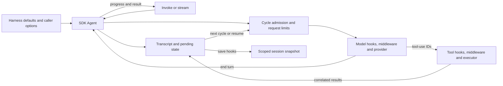

# Strands Agents Harness SDK core architecture review

## 1. Snapshot, scope, and fresh active time

| Item | Review record |
| --- | --- |
| Checkout | [strands-agents/harness-sdk](repos/strands-agents__harness-sdk) |
| Pinned commit | `9faf8a49a00081bcc96f596f0d73c7640f80784f`, detached HEAD. Commit subject `feat(catalog): add strands-acgs (#5259)`. |
| Fresh start | 2026-11-19 02:56:30 UTC. `git rev-parse HEAD` returned the pinned SHA and `git status --porcelain=v1 --untracked-files=all` returned no entries. |
| Review close | 2026-11-19 03:26:45 UTC. `git rev-parse HEAD` returned `9faf8a49a00081bcc96f596f0d73c7640f80784f`. Both porcelain status checks returned no entries, including the check for ignored files. Both diff checks passed. |
| Fresh active work | **30 minutes 15 seconds**, from the fresh UTC start through final checkout verification. The window covers source and evidence inspection, drafting, and verification. |

This independent review covers both harness factories and the sibling Python and TypeScript SDK paths behind a regular `Agent` invocation. It follows model and tool interfaces, lifecycle extensions, context and state, the scheduler and persistence boundaries, and both nested-agent and multi-agent APIs. MCP enters the review as a tool provider, registry and client lifecycle boundary. The work excludes the separate Python bidirectional entry point, UI, CLI presentation, documentation-site implementation, deployment wrappers, and hosted integrations. I read the full evaluation protocol, applicable ancestral, root and package AGENTS guides and their CLAUDE aliases, and relevant repository test guidance. [Repository scope](repos/strands-agents__harness-sdk/AGENTS.md:9) · [Python test conventions](repos/strands-agents__harness-sdk/strands-py/AGENTS.md:270) · [TypeScript test conventions](repos/strands-agents__harness-sdk/strands-ts/AGENTS.md:236) · [Evaluation protocol](./README.md:1) · [Python harness guide](repos/strands-agents__harness-sdk/harness-py/AGENTS.md:1) · [TypeScript harness guide](repos/strands-agents__harness-sdk/harness-ts/AGENTS.md:1) · [Python SDK guide](repos/strands-agents__harness-sdk/strands-py/AGENTS.md:1) · [TypeScript SDK guide](repos/strands-agents__harness-sdk/strands-ts/AGENTS.md:1)

The execution evidence comes from the completed local archive. I independently checked the pinned implementation, repository tests, archived commands where preserved, dependency and build provenance, fixture code, and logs. This review ran read-only Git and file inspection commands and edited this report. Its recorded active window excludes the prior pass and all archived execution durations. See §§7–8 and §10 for the distinction between suite results, local observations, and source-only conclusions.

UTC work phases began at 02:56:30 with checkout and rubric verification, then factory, runtime and fixture tracing. From 03:05:25 I reconciled setup failures, package builds, counters and saved snapshots. From 03:12:50 I worked through the context, Swarm, storage and extension source and their passing controls. From 03:18:41 I audited the report against the cancellation paths, suite boundaries and retained artifacts, then completed report and checkout verification.

**Assessment.** The harness is a useful policy layer over the regular SDK Agent. The model adapter, ordered tool-result protocol, and customizable context and storage boundaries are strong foundations. The largest correctness gaps occur where work can be suspended or handed to another owner. In the archived cases, TypeScript Graph either failed to settle or reported completion with a reachable branch omitted, a closed TypeScript agent stream could persist half a tool turn, and both harnesses lost parent request accounting at the built-in delegation boundary. Python also exhausted interpreter stack frames in a finite tool sequence. These outcomes inform the priorities in §9.

## 2. Core architecture and end-to-end control and data flow

### 2.1 Factories, defaults, and ownership

`create_harness` and `createHarness` resolve a provider/model string, prebuilt model, or router, normalize the enabled-tool configuration, and return an ordinary SDK `Agent`. For strings, resolution layers effort and caching preferences over provider-specific capabilities. Provider constructors load lazily where they require optional dependencies. A supplied instance keeps its own provider configuration. Both factories build the system prompt when absent, preserve SDK passthrough options, register known tools, and compose consumer and harness plugins. The normal distribution resolves compatible SDK releases. The test jobs can also build against the sibling SDK, which is the runtime evaluated here. [Python assembly](repos/strands-agents__harness-sdk/harness-py/src/strands_harness/agent.py:394) · [TypeScript assembly](repos/strands-agents__harness-sdk/harness-ts/src/agent.ts:349) · [Python model resolution](repos/strands-agents__harness-sdk/harness-py/src/strands_harness/models.py:546) · [TypeScript model resolution](repos/strands-agents__harness-sdk/harness-ts/src/models.ts:476) · [TypeScript local-SDK CI mode](repos/strands-agents__harness-sdk/.github/workflows/harness-ts-test-lint.yml:31)

Both use `bedrock/global.anthropic.claude-opus-5-5` when the caller omits a model, with automatic effort and caching. Their defaults include automatic context management, a generated file session, file memory, applicable skills discovery, the environment plugin, and the default built-in tool set. The default local session, skill and memory paths are under `.agent/`. Enabled tool sets are resolved before the factory creates an Agent. Model-native search is conditional on model support, and the todos plugin is opt-in. Explicit session IDs select saved state. The default session saves on message addition and at invocation completion, with stash storage sharing the configured storage root through runtime namespaces. A prebuilt session manager and explicit storage can define other lifetimes. Known tool collisions are checked during composition. Tools discovered by a provider enter the registry during initialization and use its own validation, typically with a server-name prefix for configured MCP servers. If eligible, the default `subagent` is marked for background execution and other admitted tools may expose the runtime's model-selectable background option. [Python defaults](repos/strands-agents__harness-sdk/harness-py/src/strands_harness/defaults.py:5) · [TypeScript defaults](repos/strands-agents__harness-sdk/harness-ts/src/defaults.ts:5) · [Python default storage and tool wiring](repos/strands-agents__harness-sdk/harness-py/src/strands_harness/agent.py:476) · [TypeScript default storage and tool wiring](repos/strands-agents__harness-sdk/harness-ts/src/agent.ts:440) · [TypeScript background defaults](repos/strands-agents__harness-sdk/harness-ts/src/agent.ts:309) · [Python default values](repos/strands-agents__harness-sdk/harness-py/src/strands_harness/defaults.py:5) · [TypeScript default values](repos/strands-agents__harness-sdk/harness-ts/src/defaults.ts:5)

Python performs registrations and session initialization during Agent construction and provides a sync entry point that bridges to the async implementation on a separate thread/event loop. TypeScript's harness factory is async, and the returned Agent defers async plugin/provider setup to its first invocation or a public `initialize()` call. At runtime an agent holds its transcript, application and model state, registries, cancellation state, and invocation admission guard. Explicit agents, storage objects, tool providers, and orchestrators can have different lifetimes. [Python construction](repos/strands-agents__harness-sdk/strands-py/src/strands/agent/agent.py:519) · [Python sync bridge](repos/strands-agents__harness-sdk/strands-py/src/strands/_async.py:17) · [TypeScript initialization](repos/strands-agents__harness-sdk/strands-ts/src/agent/agent.ts:883) · [TypeScript invocation admission](repos/strands-agents__harness-sdk/strands-ts/src/agent/agent.ts:1282)

### 2.2 Foreground invocation and extensions



1. **Admission and input.** `invoke_async` drains Python's `stream_async` and extracts its terminal result event. TypeScript `invoke` drains `stream` and returns the generator result. The entry point admits one ordinary invocation per agent and resolves accounting context, user invocation state, and cancellation state. It normalizes input into messages or handles a control resume. Before-invocation hooks run outside the AgentStream middleware. Fresh input enters history in the middleware terminal, so a middleware short circuit can leave history untouched. After-invocation hooks may provide continuation input, and the same request can run another pass. [Python public stream](repos/strands-agents__harness-sdk/strands-py/src/strands/agent/agent.py:1535) · [Python middleware terminal](repos/strands-agents__harness-sdk/strands-py/src/strands/agent/agent.py:1941) · [TypeScript invoke](repos/strands-agents__harness-sdk/strands-ts/src/agent/agent.ts:1186) · [TypeScript passes and continuations](repos/strands-agents__harness-sdk/strands-ts/src/agent/agent.ts:1306)
2. **Model attempt.** A cycle checks and records its turn. A pending interrupt can supply the saved assistant tool request instead of asking the model again. Otherwise the runtime estimates input size, fires before-model hooks, and passes the model, copied messages/prompt/specs, tool choice and request context to InvokeModel middleware. The middleware may revise the request, route to another model or supply a result. A separate provider-state copy writes back on successful middleware completion. The ModelProxy prepares provider-compatible summary and injected blocks and records reported usage. The model aggregator emits raw progress and completed content, reconstructs tool input blocks, and returns an assistant message, stop reason and optional usage. The application sees intermediate events before the final result is known. [Python turn and replay](repos/strands-agents__harness-sdk/strands-py/src/strands/event_loop/event_loop.py:206) · [Python model middleware context](repos/strands-agents__harness-sdk/strands-py/src/strands/event_loop/event_loop.py:698) · [TypeScript iterative cycle](repos/strands-agents__harness-sdk/strands-ts/src/agent/agent.ts:1762) · [TypeScript model-state copy and commit](repos/strands-agents__harness-sdk/strands-ts/src/agent/agent.ts:2628) · [TypeScript ModelProxy](repos/strands-agents__harness-sdk/strands-ts/src/models/model-proxy.ts:43) · [Python model stream processor](repos/strands-agents__harness-sdk/strands-py/src/strands/event_loop/streaming.py:443)
3. **Tool batch.** On tool use, the executor resolves the registry entry by name and carries the tool-use ID through hooks, middleware, interrupts, retries and result assembly. Decorated Python tools validate with Pydantic and call sync functions through a thread or async functions through their coroutine or generator. TypeScript offers Zod-backed tools and returns a tool result from the tool generator. Batch hooks frame execution, per-tool hooks and ExecuteTool middleware shape it, and ordinary tool failures become correlated error results the model can handle. The concurrent strategies interleave progress with at most one pending step per producer. Python uses tasks, a queue and producer acknowledgements. It collects newly executed tool results in request order and prepends any results saved from an interrupted turn. TypeScript races iterator steps and uses tool-use IDs to reconstruct source order across replay. Both support serial execution. TypeScript defers the assistant tool-use append until tool execution returns. The completed assistant/tool-result messages are committed with separate yields, which matters in §5. [Python execute loop](repos/strands-agents__harness-sdk/strands-py/src/strands/event_loop/event_loop.py:1024) · [Python per-tool boundary](repos/strands-agents__harness-sdk/strands-py/src/strands/tools/executors/_executor.py:174) · [Python concurrent executor](repos/strands-agents__harness-sdk/strands-py/src/strands/tools/executors/concurrent.py:24) · [TypeScript concurrent executor](repos/strands-agents__harness-sdk/strands-ts/src/tools/executors/concurrent.ts:45) · [TypeScript tool-pair append](repos/strands-agents__harness-sdk/strands-ts/src/agent/agent.ts:1965) · [Python replay merge](repos/strands-agents__harness-sdk/strands-py/src/strands/event_loop/event_loop.py:1019) · [TypeScript ordered merge](repos/strands-agents__harness-sdk/strands-ts/src/tools/executors/concurrent.ts:148) · [Python decorated tool dispatch](repos/strands-agents__harness-sdk/strands-py/src/strands/tools/decorator.py:624) · [TypeScript Zod tool contract](repos/strands-agents__harness-sdk/strands-ts/src/tools/zod-tool.ts:52)
4. **Continue, stop, or yield control.** With a complete batch the runtime applies stop, cancel, structured output and checkpoint policy before another inference. Structured-output requests add a schema-backed tool and can force that choice on a later turn. A forced text response can still satisfy the schema. When an attempt limit applies, failed forced responses count toward it. TypeScript uses an iterative cycle. Python follows another async-generator call chain and offers a legacy dictionary callback/stream facade over typed internal events. TypeScript uses discriminated events plus a final iterator return value. Hooks can run during cleanup without corresponding events reaching a closed consumer. The top-level turn, a provider retry attempt, and an after-invocation continuation are separate units. [Python continuation into next cycle](repos/strands-agents__harness-sdk/strands-py/src/strands/event_loop/event_loop.py:1250) · [Python typed result and callback conversion](repos/strands-agents__harness-sdk/strands-py/src/strands/agent/agent.py:1621) · [TypeScript stop after tools](repos/strands-agents__harness-sdk/strands-ts/src/agent/agent.ts:1997) · [TypeScript final result event](repos/strands-agents__harness-sdk/strands-ts/src/agent/agent.ts:1403) · [Python forced structured output](repos/strands-agents__harness-sdk/strands-py/src/strands/event_loop/event_loop.py:395) · [TypeScript forced structured output](repos/strands-agents__harness-sdk/strands-ts/src/agent/agent.ts:2158)

Plugins can register tools, hooks, and middleware on the SDK runtime. Hooks dispatch ordered mutable event decisions, with reversed registration order for paired after-hooks at the same priority. Model and tool stages accept input handlers, output handlers, and wrappers. The compositors nest them in that order, with wrappers closest to the terminal and registration order breaking ties within each phase. TypeScript carries the stage outcome as the generator's return value. Python communicates typed terminal events for the streaming stages. Extension ordering affects persistence, context transforms and task delivery. Intervention handlers also register through these hooks and can turn a request for confirmation into an SDK interrupt. A direct tool call bypasses inference and may be recorded in history. Python routes direct calls through the tool executor and holds the Agent lock while recording. TypeScript streams the registered tool and checks admission against an active invocation before a recorded call. A wrapper must preserve the stage's terminal value and close the iterator it drives. [Python hook dispatch](repos/strands-agents__harness-sdk/strands-py/src/strands/hooks/registry.py:322) · [TypeScript hook ordering](repos/strands-agents__harness-sdk/strands-ts/src/hooks/registry.ts:121) · [TypeScript middleware composition](repos/strands-agents__harness-sdk/strands-ts/src/middleware/registry.ts:102) · [Python model stage result contract](repos/strands-agents__harness-sdk/strands-py/src/strands/event_loop/event_loop.py:729) · [Python intervention hook dispatch](repos/strands-agents__harness-sdk/strands-py/src/strands/interventions/registry.py:65) · [Python direct calls](repos/strands-agents__harness-sdk/strands-py/src/strands/tools/_caller.py:97) · [TypeScript direct calls](repos/strands-agents__harness-sdk/strands-ts/src/agent/tool-caller.ts:199)

A `ModelRouter` uses InvokeModel input middleware to select the effective model and an ordered after-model hook to handle failures that the retry strategy leaves unclaimed. A new candidate gets a fresh retry budget. Both routers retain selection and attempt state in the invocation bag and clear it at invocation boundaries. The configured default remains visible through `agent.model`, which matters to token estimation and proactive context management before routing. The streamed events of a failed attempt may already have reached the caller when its replacement starts. Provider retries occur inside the cycle, so counting turns and counting actual model requests serve different purposes. Python passes a cooperative cancellation event to models and tools. TypeScript passes an `AbortSignal` and checks it between stages and before another model attempt. [Python routing contract and limits](repos/strands-agents__harness-sdk/strands-py/src/strands/models/routing/router.py:3) · [Python router hook ordering](repos/strands-agents__harness-sdk/strands-py/src/strands/models/routing/router.py:211) · [TypeScript routing contract](repos/strands-agents__harness-sdk/strands-ts/src/models/routing/router.ts:4) · [TypeScript retry admission](repos/strands-agents__harness-sdk/strands-ts/src/agent/agent.ts:2425) · [Python cancellation propagation](repos/strands-agents__harness-sdk/strands-py/src/strands/event_loop/event_loop.py:900)

### 2.3 Context, state, persistence, and usage

The transcript, serializable application state, provider model state, user invocation state, request accounting handle, and interrupt snapshot have different lifetimes. Python still places legacy internal data such as cycle IDs in the user-facing invocation bag. Both SDKs limit turns, total tokens, output tokens, and failed structured-output attempts. Request usage is live and can keep changing as related background work finishes. Nested SDK calls can receive the same request handle or a child handle with additional limits. The Python API validates positive integers for these limits, while TypeScript accepts positive finite numbers. Auxiliary calls using the SDK's auxiliary context fold token usage into the parent without spending the parent’s turns or inheriting its limits. Python serializes turn check-and-increment with a lock across threads. TypeScript has no suspension between its check and increment on the agent loop. Token limits inspect accumulated usage at cycle boundaries, so one call or concurrently admitted descendants may cross the target before the next check. Retries and auxiliary calls have separate cadence and failure policies. [Python request accounting contract](repos/strands-agents__harness-sdk/strands-py/src/strands/agent/invocation_context.py:33) · [Python atomic turn admission](repos/strands-agents__harness-sdk/strands-py/src/strands/agent/invocation_context.py:87) · [Python legacy keys](repos/strands-agents__harness-sdk/strands-py/src/strands/event_loop/event_loop.py:224) · [TypeScript types for limits and usage](repos/strands-agents__harness-sdk/strands-ts/src/types/agent.ts:141) · [TypeScript auxiliary context](repos/strands-agents__harness-sdk/strands-ts/src/agent/invocation-context.ts:152) · [Python limit dimensions](repos/strands-agents__harness-sdk/strands-py/src/strands/types/agent.py:168) · [TypeScript limit dimensions](repos/strands-agents__harness-sdk/strands-ts/src/types/agent.ts:189)

The default ContextManager adds proactive compression before a model call and recovery after a typed window-overflow error. The `auto` strategy offloads large tool results at 1,500 tokens and summarizes at 85% projected utilization, while preserving four recent messages in the summarize step. The final emergency truncate is lossy and can ignore pins. The `agentic` preset also gives the model summarize, truncate and pin tools. Changes in history cause re-estimation. Offload and trim steps preserve adjacent tool-use/result pairs when applicable. The stash backs retrieval with deterministic references keyed by tool-use ID or message tracking ID and block index. The proxy renders summary and injected forms to the provider's capabilities for each request. This adapter step leaves the live history's message representation in place. A context manager supersedes legacy conversation reduction when enabled. Stateful provider history is a distinct execution mode with its own restore rules and compatibility constraints. [Python context defaults](repos/strands-agents__harness-sdk/strands-py/src/strands/_context_manager/context_manager.py:83) · [TypeScript context defaults](repos/strands-agents__harness-sdk/strands-ts/src/context-manager/context-manager.ts:45) · [TypeScript overflow recovery](repos/strands-agents__harness-sdk/strands-ts/src/context-manager/context-manager.ts:159) · [Python strategy and auxiliary context](repos/strands-agents__harness-sdk/strands-py/src/strands/_context_manager/context_manager.py:278) · [Stateful model compatibility](repos/strands-agents__harness-sdk/strands-py/src/strands/agent/agent.py:444) · [Pair-aware trimming](repos/strands-agents__harness-sdk/strands-ts/src/context-manager/message-trimming.ts:42) · [Stash key allocation](repos/strands-agents__harness-sdk/strands-ts/src/context-manager/stash.ts:99) · [Emergency pins policy](repos/strands-agents__harness-sdk/strands-py/src/strands/_context_manager/strategies/offload/base.py:355) · [Agentic context tools](repos/strands-agents__harness-sdk/strands-ts/src/agent/agent.ts:631)

Session hooks capture versioned snapshots by session and agent or orchestrator ID. Agent scopes support a replaceable latest snapshot and optional immutable history. Orchestrators restore on first invocation and save after the run, with optional saves after node completion. Python serializes orchestrator latest writes within a loop. An ephemeral stash can be embedded in a snapshot. A durable stash is marked external, so restore relies on its configured backend and namespace. Local file writers use temporary files and replacement. The transaction boundary is one stored object. Tool callbacks, transcript updates, stash writes, and immutable and latest snapshots have independent completion points. [Python session save hooks](repos/strands-agents__harness-sdk/strands-py/src/strands/session/snapshot_session_manager.py:617) · [TypeScript session lifecycle](repos/strands-agents__harness-sdk/strands-ts/src/session/session-manager.ts:175) · [TypeScript stash markers](repos/strands-agents__harness-sdk/strands-ts/src/session/session-manager.ts:350) · [Python orchestrator save lock](repos/strands-agents__harness-sdk/strands-py/src/strands/session/snapshot_session_manager.py:394) · [TypeScript orchestrator restore and saves](repos/strands-agents__harness-sdk/strands-ts/src/session/session-manager.ts:422) · [Python file replacement](repos/strands-agents__harness-sdk/strands-py/src/strands/storage/local_file_storage.py:114) · [TypeScript snapshot file replacement](repos/strands-agents__harness-sdk/strands-ts/src/session/file-storage.ts:164)

Memory spans sessions and has its own store. Recall enters the model input through injection middleware and leaves the durable transcript untouched. The manager buffers message-add events for trigger-driven extraction. Per-store queues and watermarks track writes. Python's sync invocation flushes memory before its private event loop closes. Python async and TypeScript keep the trigger cadence and flush memory when their owner calls the shutdown API. The harness builds a default file store with a chosen extraction model and gives its stock delegates read-only recall. An explicitly supplied memory manager stays with the parent. [Python harness memory policy](repos/strands-agents__harness-sdk/harness-py/src/strands_harness/memory.py:38) · [TypeScript harness memory policy](repos/strands-agents__harness-sdk/harness-ts/src/memory.ts:53) · [TypeScript extraction and injection hooks](repos/strands-agents__harness-sdk/strands-ts/src/memory/memory-manager.ts:235) · [Python extraction watermarks](repos/strands-agents__harness-sdk/strands-py/src/strands/memory/extraction/coordinator.py:78) · [Python synchronous flush](repos/strands-agents__harness-sdk/strands-py/src/strands/agent/agent.py:1015) · [TypeScript shutdown](repos/strands-agents__harness-sdk/strands-ts/src/agent/agent.ts:1195)

### 2.4 Suspension and composition

- **Foreground interrupt and checkpoint.** User-supplied responses match stable interrupt IDs. The pending assistant request and completed sibling results let the tool path resume with the original tool IDs and skip finished siblings. A tool can re-enter to reach its interrupt site. A persistent effect before that site needs an application-aware replay policy. An experimental checkpoint carries a position, cycle index and schema version and needs matching agent state. Python preserves the planned tool at its after-model boundary. TypeScript re-infers this turn because its assistant request has yet to enter history. Both advance to the next cycle after an after-tools marker. [Python pending replay](repos/strands-agents__harness-sdk/strands-py/src/strands/event_loop/event_loop.py:261) · [TypeScript pending replay](repos/strands-agents__harness-sdk/strands-ts/src/agent/agent.ts:1822) · [TypeScript checkpoint semantics](repos/strands-agents__harness-sdk/strands-ts/src/experimental/checkpoint.ts:27) · [Python checkpoint schema](repos/strands-agents__harness-sdk/strands-py/src/strands/experimental/checkpoint/checkpoint.py:46)
- **Background tools.** The plugin modifies eligible tool specs, strips the background selector before running the tool, acknowledges a submission, and retains its tool/request context. The manager deduplicates submissions by pass identity and tool-use ID, queues execution with capacity and timeout policies, and distinguishes queued, working, `input_required` and terminal records. Matching interrupt responses route to the waiting task's recorded IDs. Synthetic management-tool call/result pairs deliver settled work before a model call or on a continuation. Retirement follows incorporation into history. A snapshot restores task metadata. Both runtimes mark previously nonterminal in-process work failed and remove its stale interrupts because the execution handles are process-local. Python has a scheduler loop on a daemon thread and may dispatch tool callbacks back to a live caller loop. TypeScript's engine is Promise-based with per-execution abort signals. [Python task admission and recovery](repos/strands-agents__harness-sdk/strands-py/src/strands/background_tasks/_background_tasks.py:202) · [Python synthetic delivery](repos/strands-agents__harness-sdk/strands-py/src/strands/background_tasks/_background_tasks.py:379) · [Python execution bridge](repos/strands-agents__harness-sdk/strands-py/src/strands/background_tasks/in_process/_manager.py:274) · [TypeScript synthetic delivery](repos/strands-agents__harness-sdk/strands-ts/src/background-tasks/background-tasks.ts:302) · [TypeScript in-process engine](repos/strands-agents__harness-sdk/strands-ts/src/background-tasks/in-process/engine.ts:186) · [TypeScript task response routing](repos/strands-agents__harness-sdk/strands-ts/src/background-tasks/background-tasks.ts:235) · [Python previous-process task recovery](repos/strands-agents__harness-sdk/strands-py/src/strands/background_tasks/_background_tasks.py:256) · [TypeScript previous-process task recovery](repos/strands-agents__harness-sdk/strands-ts/src/background-tasks/background-tasks.ts:343)
- **Agent-as-tool and delegation.** The SDK's AgentAsTool wraps an existing agent, optionally preserves its conversational context, and can store an interrupted child snapshot on the parent on its resettable path. The SDK delegation plugin handles a single marked tool call and can end the parent loop with the successful child's result. An ordinary agent-as-tool result returns control to the parent's tool loop. The harness's `subagent` instead builds a fresh Agent through the factory from a resolved spec, limits nesting with a depth marker, narrows the selectable tools and MCP clients, and relays child events/result to the parent tool. It supports an isolated prompt, textual context, or a history slice that respects tool pairs. The default child has no session and retains a pending child instance in a local map for interrupt replay. Both modes of SDK AgentAsTool forward the request handle. The harness's custom adapter omits that option in both languages. [Python SDK agent-as-tool](repos/strands-agents__harness-sdk/strands-py/src/strands/agent/_agent_as_tool.py:191) · [TypeScript SDK agent-as-tool](repos/strands-agents__harness-sdk/strands-ts/src/agent/agent-as-tool.ts:183) · [TypeScript delegation plugin](repos/strands-agents__harness-sdk/strands-ts/src/agent/agent-delegation.ts:131) · [Python harness adapter](repos/strands-agents__harness-sdk/harness-py/src/strands_harness/tools/subagent.py:486) · [TypeScript harness adapter](repos/strands-agents__harness-sdk/harness-ts/src/tools/subagent.ts:634) · [Python SDK delegation result handling](repos/strands-agents__harness-sdk/strands-py/src/strands/agent/_agent_delegation.py:166) · [TypeScript harness child interrupt test](repos/strands-agents__harness-sdk/harness-ts/test/tools/subagent.test.ts:919)
- **Graph.** Python's builder configures a ready-batch scheduler. Any traversable edge from a completed member of that batch can nominate a successor. The serialized resume frontier uses all traversable incoming live sources and excludes unreachable branches. In live interrupt resume the scheduler includes completed siblings in its batch bookkeeping. TypeScript Graph takes declarative nodes and edges, launches ready nodes individually up to a cap and requires all incoming sources and edge conditions for a successor. Both forward the request context to their node agents. TypeScript nodes wrapping concrete Agents default to snapshot/restore and separately save the suspended state of an interrupted child. Python retains node histories unless configured to reset on revisit. [Python batch and interrupt resume](repos/strands-agents__harness-sdk/strands-py/src/strands/multiagent/graph.py:814) · [Python live batch readiness](repos/strands-agents__harness-sdk/strands-py/src/strands/multiagent/graph.py:999) · [Python serialized join readiness](repos/strands-agents__harness-sdk/strands-py/src/strands/multiagent/graph.py:1489) · [Python restored fan-in test](repos/strands-agents__harness-sdk/strands-py/tests/strands/multiagent/test_graph.py:3685) · [TypeScript graph semantics](repos/strands-agents__harness-sdk/strands-ts/src/multiagent/graph.ts:115) · [TypeScript scheduler](repos/strands-agents__harness-sdk/strands-ts/src/multiagent/graph.ts:349) · [TypeScript node snapshots](repos/strands-agents__harness-sdk/strands-ts/src/multiagent/nodes.ts:273)
- **Swarm.** A model-directed handoff advances one participant at a time, with shared task context, execution limits and optional repetitive-transition checks. Python implements handoffs with a registered tool. It stages handoff and shared-context mutations, rolls them back on close or failure before the turn commits, and serializes a resume frontier. TypeScript validates structured handoff output, records it in node history so a restored invocation can select its destination, and retains interrupted state for same-instance resume. [Python handoff tool](repos/strands-agents__harness-sdk/strands-py/src/strands/multiagent/swarm.py:644) · [Python handoff rollback](repos/strands-agents__harness-sdk/strands-py/src/strands/multiagent/swarm.py:703) · [Python handoff commitment](repos/strands-agents__harness-sdk/strands-py/src/strands/multiagent/swarm.py:873) · [TypeScript Swarm loop](repos/strands-agents__harness-sdk/strands-ts/src/multiagent/swarm.ts:352) · [TypeScript handoff restore and schema](repos/strands-agents__harness-sdk/strands-ts/src/multiagent/swarm.ts:686)
- **MCP tool boundary.** A connected client lists and maps tools into the ordinary registry, then wraps calls and progress as SDK tool output. Configured clients can be forwarded into child registries. Negotiated MCP tasks carry a separate remote handle and can poll, resume with input, or cancel through the client, while the SDK background scheduler retains its own local task lifecycle. Python selects the installed MCP major's applicable mechanics and tracks consumer lifetimes through ToolProvider. TypeScript refresh replaces tools scoped to a particular registry in its callback, while the caller controls the live client's disconnect. The review evaluates local discovery and registration behavior. [Python tool-provider implementation](repos/strands-agents__harness-sdk/strands-py/src/strands/tools/mcp/mcp_client.py:672) · [Python task dispatch choice](repos/strands-agents__harness-sdk/strands-py/src/strands/tools/mcp/mcp_client.py:2287) · [TypeScript discovery refresh](repos/strands-agents__harness-sdk/strands-ts/src/mcp/client.ts:750) · [TypeScript MCP execution](repos/strands-agents__harness-sdk/strands-ts/src/mcp/client.ts:867) · [Python registry cleanup](repos/strands-agents__harness-sdk/strands-py/src/strands/tools/registry.py:712) · [TypeScript refresh replacement](repos/strands-agents__harness-sdk/strands-ts/src/agent/agent.ts:928)

## 3. Why the design works and governing invariants

| Invariant | Why it matters and where it holds |
| --- | --- |
| One foreground invocation owns one agent transcript | Ordinary entry points admit one writer. Python can coalesce requests with the same in-flight idempotency token and share a terminal result and also offers an explicit unsafe concurrent mode. Agent guards do not serialize a separate agent, task manager, shared extension, or independent session writer. |
| A tool result remains attributable throughout a cycle | Stable IDs connect model output, executable requests, streamed progress, result blocks and interrupt replay. Executors assemble results independently from the order in which progress arrives. IDs also correlate a replay batch that combines saved and newly executed results. A visible or saved history boundary needs either a matched pair or explicit replay state. |
| A model attempt has one semantic outcome | Deltas support live consumers. Stop reason and assembled blocks give the runtime an authoritative result from which to run tools, validate structured output, retry or stop. A failed/retried attempt can already have exposed provisional output. |
| A request budget follows its handle | Admission counts the cycle before starting work, including a cycle that resumes pending tools without model inference. Descendant accounting needs explicit propagation. The usage total is a sum of reported metadata under that handle and may grow after the initiating invocation returns. |
| A suspension must either settle or preserve runnable work | A response can resume a pending tool by ID. A graph must retain or reconstruct eligible work beyond the nodes with responses. A queued task remains process-local until a durable handoff exists. |
| Lifecycle ownership extends below the public generator | Closing an invocation frees its admission guard. Every started child iterator or task needs a matching completion/close action, and the teardown must complete before an owner advertises physical idleness. |

Keeping next-action selection in the model gives a small uniform protocol to both direct agents and specialized harnesses. The host still owns dispatch, lifecycle and state. Extensibility works because model, tool, hook and storage contracts sit at those boundaries. The design record for stage middleware and checkpointing articulates that separation. The pinned implementations distribute some of those transitions across generators and plugins, which makes composition coverage as important as local function coverage. [State-machine design](repos/strands-agents__harness-sdk/team/designs/0005-state-machine.md:1) · [Python concurrency ownership](repos/strands-agents__harness-sdk/strands-py/src/strands/agent/_concurrency.py:85) · [TypeScript tool-pair intent](repos/strands-agents__harness-sdk/strands-ts/src/agent/agent.ts:1232) · [TypeScript provider stream contract](repos/strands-agents__harness-sdk/strands-ts/src/models/model.ts:560)

## 4. Strengths

- **A useful default policy surface over a reusable execution engine.** Model replacement, default context and memory, opt-out flags, SDK hook/middleware contracts, and built-in tool selection let applications alter the initial composition while calling the same runtime. The published and sibling TypeScript package modes each completed the harness suite. [Python final composition](repos/strands-agents__harness-sdk/harness-py/src/strands_harness/agent.py:535) · [TypeScript final composition](repos/strands-agents__harness-sdk/harness-ts/src/agent.ts:513) · [Sibling harness suite]($HOME/agent-work/scratch/strands-runtime-20261119.OVfIqew7/harness-ts-unit-local.log:114)
- **Consistent model and tool seams.** The proxy and aggregator isolate vendor event formats, provider capabilities, and usage from scheduling. Executors preserve tool identity and allow siblings to settle independently. The normalized message representation can be tested with deterministic mock messages through the actual Agent and registry. [Python model-proxy contract](repos/strands-agents__harness-sdk/strands-py/src/strands/models/_model_proxy.py:46) · [TypeScript aggregation](repos/strands-agents__harness-sdk/strands-ts/src/models/model.ts:570) · [TypeScript fixture guidance](repos/strands-agents__harness-sdk/strands-ts/docs/TESTING.md:308)
- **Replay has concrete state.** Pending execution keeps an assistant request and completed tool results. The SDK models interruption separately from retry and normal completion, and storage supports scopes and versioned snapshots. The graph tests for ordinary restored-frontier resume and the wide-join interrupt control illustrate ordinary restore and deliberate interrupt/resume. Python Swarm's file-session tests also check recovery on opposite sides of a handoff commit. [TypeScript interrupt state](repos/strands-agents__harness-sdk/strands-ts/src/agent/agent.ts:1822) · [TypeScript restored graph frontier test](repos/strands-agents__harness-sdk/strands-ts/src/multiagent/__tests__/graph.test.ts:1058) · [Archived join control]($HOME/agent-work/scratch/strands-runtime-20261119.OVfIqew7/probe-ts-graph.log:2) · [Python Swarm handoff restore](repos/strands-agents__harness-sdk/strands-py/tests/strands/multiagent/test_swarm.py:1544)
- **Cross-cutting behavior has real extension contracts.** Context strategy, memory store, model routing, tool provider, session storage, and retry policy each have bounded responsibilities. Their built-in implementations exercise the same lifecycle seams embedders use. Ordered hooks and standardized model/tool results provide places to observe or change behavior without adding another agent loop. [Plugin lifecycle](repos/strands-agents__harness-sdk/strands-ts/src/plugins/registry.ts:24) · [Python model router](repos/strands-agents__harness-sdk/strands-py/src/strands/models/routing/router.py:199) · [TypeScript stage types](repos/strands-agents__harness-sdk/strands-ts/src/middleware/stages.ts:177)

## 5. Weaknesses and evidence status

### 5.1 TypeScript Graph loses progress across a node interrupt

**Reproduced in archived local runs, with two effects.** With two source nodes, an unconditional join and `maxConcurrency: 1`, the first source interrupted through its tool hook. The second source remained queued. Neither public `invoke` nor a drained public `stream` settled by the fixture's 350 ms deadline, after an 80 ms configured graph timeout and caller abort. The scheduler forbids further launches after a node interrupts while requiring queued targets to be exhausted before exit. With the last producer done, it waits on an empty queue that neither abort signal wakes. The same capped graph completed without the interrupt. At width two both sources started and the join completed after the user answered. [Graph target loop and launch gate](repos/strands-agents__harness-sdk/strands-ts/src/multiagent/graph.ts:349) · [Graph wait and interrupt handling](repos/strands-agents__harness-sdk/strands-ts/src/multiagent/graph.ts:391) · [Queue wait](repos/strands-agents__harness-sdk/strands-ts/src/queue.ts:57) · [Capped and wide graph results]($HOME/agent-work/scratch/strands-runtime-20261119.OVfIqew7/probe-ts-graph.log:1)

A separate unconditional two-branch graph at width two interrupted one source and recorded the other as complete. The sibling's successor was missing after a successful response-bearing resume. The scheduler skips readiness updates for sibling results once interrupted, then seeds the response-bearing invocation from response IDs alone. Aggregate completion considers the results that were produced, allowing a runnable missing node to escape the final status. The no-interrupt control visited all four nodes. These two effects need separate regression assertions for liveness and completeness. [Response-only scheduling](repos/strands-agents__harness-sdk/strands-ts/src/multiagent/graph.ts:312) · [Sibling readiness skipped during pause](repos/strands-agents__harness-sdk/strands-ts/src/multiagent/graph.ts:408) · [Aggregate status](repos/strands-agents__harness-sdk/strands-ts/src/multiagent/state.ts:263) · [Missing branch and control]($HOME/agent-work/scratch/strands-runtime-20261119.OVfIqew7/probe-ts-graph.log:4)

### 5.2 TypeScript can save an unmatched tool use after the tool already completed

**Reproduced in memory and through file-session restore.** The fixture consumed the public stream until the assistant `MessageAddedEvent` containing the tool-use ID and closed it. The ordinary tool had executed once. The transcript retained its request without the result, and a fresh Agent using the same disk session restored that prefix with either message-based or invocation-based latest saves. With sessions disabled the same gap remained in memory. Full drain and closure after the result event both kept the pair. The runtime intentionally defers appending until tool execution returns, then suspends after appending the assistant request, before appending the already available result. In that interval a caller can observe or persist a tool-use message without its result. Retrying from the snapshot would require information beyond that prefix to tell whether the tool ran. The evidence covers orderly stream closure and restored state, before any new model call. [Public history contract](repos/strands-agents__harness-sdk/strands-ts/src/agent/agent.ts:1232) · [Two separate yields](repos/strands-agents__harness-sdk/strands-ts/src/agent/agent.ts:1970) · [After-invocation save](repos/strands-agents__harness-sdk/strands-ts/src/session/session-manager.ts:304) · [History and disk controls]($HOME/agent-work/scratch/strands-runtime-20261119.OVfIqew7/probe-ts-lifecycle.log:5)

### 5.3 Provider and telemetry cleanup can outlive public stream closure

**TypeScript provider iterator closure gap reproduced.** The same instrumented model finalized on direct aggregation close and normal Agent drain. Its finalizer remained unrun when an Agent stream broke, returned explicitly, cancelled while streaming, or encountered a throwing model-stream hook. The public invocation guard released in all four cases. Both the model-stage terminal and the adapter-facing event wrapper manually advance child iterators, and their exit paths leave the underlying iterator unclosed. The timing sample extends through the next event-loop turn. A transport that independently responds to cancellation can have a different resource outcome. [Manual iteration in the model stage](repos/strands-agents__harness-sdk/strands-ts/src/agent/agent.ts:2665) · [Model wrapper cancellation and error handling](repos/strands-agents__harness-sdk/strands-ts/src/agent/agent.ts:2739) · [TypeScript provider counters]($HOME/agent-work/scratch/strands-runtime-20261119.OVfIqew7/probe-ts-lifecycle.log:1)

**Python close and span gap reproduced under archived OpenTelemetry versions.** The public `aclose()` returned before the provider finalizer. The later finalizer ran, but the cycle and model spans remained open at the observation point and the archive recorded two context-detach errors. Normal drain finalized before return and ended all three spans. In the cancellation control, eventual lower-level cleanup also occurred and all spans ended. The outer Agent explicitly closes its immediate child, while inner async-for boundaries rely on other teardown and the model/cycle spans use `end_on_exit=False` around suspended yields. Explicit generator close raises `GeneratorExit`, outside the `Exception`-only span error handlers. This evidence establishes a lifecycle/observability defect with the tested fixture and SDK version. [Outer Python close](repos/strands-agents__harness-sdk/strands-py/src/strands/agent/agent.py:1649) · [Cycle span across yield](repos/strands-agents__harness-sdk/strands-py/src/strands/event_loop/event_loop.py:259) · [Model span across yield](repos/strands-agents__harness-sdk/strands-py/src/strands/event_loop/event_loop.py:917) · [Python close and span log]($HOME/agent-work/scratch/strands-runtime-20261119.OVfIqew7/probe-py-close-retry.log:1) · [Explicit close and cancellation outcomes]($HOME/agent-work/scratch/strands-runtime-20261119.OVfIqew7/probe-py-close-retry.log:34)

### 5.4 Python retains stack frames across finite tool turns

**Reproduced in direct SDK and harness.** A deterministic model planned 400 distinct no-op tool requests followed by a text reply. CPython's recursion limit was 1,000. The direct Agent completed 322 tools and the harness with automatic context management completed 321, each raising `EventLoopException` with `RecursionError` beneath it. A 120-tool control completed, a 120-turn budget returned the explicit limit reason cleanly, and the same 400-tool sequence completed at a recursion limit of 2,000. The cycle re-enters itself through `_handle_tool_execution` and `recurse_event_loop`, holding previous generator frames. The observed threshold is specific to call depth, runtime options and instrumentation. Context compression modifies messages and does not reduce this host-language depth. [Python recursive call](repos/strands-agents__harness-sdk/strands-py/src/strands/event_loop/event_loop.py:523) · [Next-cycle edge](repos/strands-agents__harness-sdk/strands-py/src/strands/event_loop/event_loop.py:1250) · [Depth measurements and controls]($HOME/agent-work/scratch/strands-runtime-20261119.OVfIqew7/probe-py-lifecycle.log:13)

### 5.5 Both harness adapters break request accounting across the built-in subagent

**Reproduced in both harness packages, in foreground and with background dispatch enabled.** Here the adapter is the stock `subagent` in reduced harness fixtures with deterministic nonzero model usage. A one-turn parent cap admitted one parent call and an additional child call, and the public request returned one turn and seven tokens. At a three-turn cap, foreground used three physical model calls, reporting two turns and 14 of the fixture's 21 tokens. Background-enabled runs used four model calls, reporting three turns and 21 of 28 fixture tokens. The ordinary SDK AgentAsTool control at the one-turn cap made one model call total, with zero child calls, and at three turns made three model calls including the child and reported all 21 tokens. Harness adapter calls omit the request handle, so the child starts a separate budget. The background manager carries that handle up to the tool context, which locates the loss at the final child invocation. This finding concerns the adapter's request accounting. The SDK's documented accounting policy already allows separate auxiliary limits and cycle-granularity token overshoot. [Python child invocation](repos/strands-agents__harness-sdk/harness-py/src/strands_harness/tools/subagent.py:562) · [TypeScript child invocation](repos/strands-agents__harness-sdk/harness-ts/src/tools/subagent.ts:685) · [Python SDK forwarding control](repos/strands-agents__harness-sdk/strands-py/src/strands/agent/_agent_as_tool.py:244) · [TypeScript SDK forwarding control](repos/strands-agents__harness-sdk/strands-ts/src/agent/agent-as-tool.ts:223) · [TypeScript foreground counts]($HOME/agent-work/scratch/strands-runtime-20261119.OVfIqew7/probe-ts-delegation-limits.log:1) · [Python background counts]($HOME/agent-work/scratch/strands-runtime-20261119.OVfIqew7/probe-py-delegation-background.log:5)

### 5.6 TypeScript refreshes only the most recently registered consumer of a shared MCP client

**Reproduced at the local tool-discovery boundary.** A single registry followed an in-memory server's tool replacement. Two SDK consumers of the same client started with the same list and only the second updated. The same staleness appeared in the parent after a stock harness subagent inherited the live client. The client itself showed the new tool. Each Agent writes its registry-specific update into the client's single callback slot. The inherited-client path is intentional and exercises the issue without relying on a custom registry. Connection setup and a single consumer worked. The evidence is for discovery refresh, with no claim about subsequent tool-call results or the Python path. [Agent callback assignment](repos/strands-agents__harness-sdk/strands-ts/src/agent/agent.ts:888) · [Client callback slot](repos/strands-agents__harness-sdk/strands-ts/src/mcp/client.ts:745) · [Child inherits client object](repos/strands-agents__harness-sdk/harness-ts/src/builtin-tools.ts:292) · [Single and shared registries]($HOME/agent-work/scratch/strands-runtime-20261119.OVfIqew7/probe-ts-mcp-ownership.log:1)

### 5.7 Python releases background capacity before an origin-loop callback finishes unwinding

**Reproduced through the public async Agent.** With sequential dispatch and physical capacity one, a timed-out tool trapped cancellation and waited at an async cleanup gate before re-raising. The second task started and completion was delivered while the first callback was still live. Immediate cooperative exit showed no overlap. The engine retains a slot until its execution coroutine settles, but the manager's origin-loop bridge cancels its cross-thread future and returns without confirmation that the caller-loop coroutine exited. This contradicts the documented physical cap in the live-loop case. A stopped origin loop has a distinct reclaim requirement exercised by the repository tests. [Documented physical capacity](repos/strands-agents__harness-sdk/strands-py/src/strands/background_tasks/_types.py:16) · [Origin loop bridge](repos/strands-agents__harness-sdk/strands-py/src/strands/background_tasks/in_process/_manager.py:303) · [Early bridge acknowledgement](repos/strands-agents__harness-sdk/strands-py/src/strands/background_tasks/in_process/_manager.py:334) · [Stopped-loop reclaim control](repos/strands-agents__harness-sdk/strands-py/tests/strands/background_tasks/in_process/test_manager.py:355) · [Observed cleanup overlap]($HOME/agent-work/scratch/strands-runtime-20261119.OVfIqew7/probe-py-background.log:1)

**Related engine-level diagnostic reproduced.** Cancelling and removing a task record, then returning a delayed successful outcome, sent `BackgroundTaskNotFoundError` to the loop's exception handler. Retaining the record or ending the callback with cancellation avoided the error. The slot still released and the record stayed removed. The existing repository test for remove-before-return asserts those two outcomes and does not observe the loop handler. The observed defect is noisy late completion, with functioning queue progress. [Late outcome and done callback](repos/strands-agents__harness-sdk/strands-py/src/strands/background_tasks/in_process/_engine.py:230) · [Existing transition test](repos/strands-agents__harness-sdk/strands-py/tests/strands/background_tasks/in_process/test_engine_transitions.py:108) · [Four late-outcome controls]($HOME/agent-work/scratch/strands-runtime-20261119.OVfIqew7/probe-py-background.log:3)

### 5.8 Concurrent TypeScript initialization can emit duplicate initialized events

**Reproduced with a public initializer and a supported async plugin.** Two overlapping `initialize()` calls saw one actual plugin init and two initialized callbacks. A following sequential call left the count at two. The plugin registry memoizes its initialization Promise, while the agent guards the larger sequence with a Boolean set after the awaited initialization hook. Explicit initialization is outside normal invocation admission. The observed effect is duplicate notification. Other side effects depend on the registered observers and providers. [Agent initialization guard and hook](repos/strands-agents__harness-sdk/strands-ts/src/agent/agent.ts:883) · [Registry's shared initialization promise](repos/strands-agents__harness-sdk/strands-ts/src/plugins/registry.ts:24) · [Archived initialization result]($HOME/agent-work/scratch/strands-runtime-20261119.OVfIqew7/probe-ts-lifecycle.log:15)

### 5.9 Additional risks and deliberate boundaries

- **Python retry cancellation, reproduced behavior with limited consequence evidence.** Under `ModelRetryStrategy` with a shortened delay, a cancelled invocation entered the next mock model attempt with cancellation already set and eventually returned `cancelled`. An uncancelled control performed two attempts and returned `end_turn`. The strategy waits without observing the cancel signal, and the model-attempt boundary observes and passes it rather than suppressing the attempt. The tool retry path already tests for terminal cancellation. Actual I/O depends on the model implementation. [Python retry wait](repos/strands-agents__harness-sdk/strands-py/src/strands/event_loop/_retry.py:155) · [Python model terminal passes cancel signal](repos/strands-agents__harness-sdk/strands-py/src/strands/event_loop/event_loop.py:900) · [Python cancelled tool retry test](repos/strands-agents__harness-sdk/strands-py/tests/strands/tools/executors/test_executor.py:810) · [Local two-attempt controls]($HOME/agent-work/scratch/strands-runtime-20261119.OVfIqew7/probe-py-close-retry.log:36)
- **TypeScript Graph late consumer close, source-supported risk.** For a queued update while a node is still running, the graph shifts the entry and yields it before acknowledging it. When a consumer closes at that yield, disposal can acknowledge entries still in the queue. The removed entry's producer can remain pending while the graph awaits active producers. The repository test titled “cleans up running nodes” stops after the first orchestrator event, before any producer starts. The archived graph watchdog cases drained the stream and address §5.1. [Queue entry yield before acknowledgement](repos/strands-agents__harness-sdk/strands-ts/src/multiagent/graph.ts:391) · [Cleanup joins producers](repos/strands-agents__harness-sdk/strands-ts/src/multiagent/graph.ts:454) · [Queue disposal](repos/strands-agents__harness-sdk/strands-ts/src/queue.ts:74) · [Repository early-return test](repos/strands-agents__harness-sdk/strands-ts/src/multiagent/__tests__/graph.test.ts:1021)
- **TypeScript prebuilt ContextManager in a stock child, source-supported risk.** The factory accepts a live manager and the child builder copies the option unchanged. The SDK contract calls for one instance per Agent. An initialization replaces the manager's stash, while its cached retrieval tool closes over the stash from its creation. With the same live manager attached twice, previously attached hooks and the tool can therefore retain references that differ from the manager's active strategy stash. A preset or config resolves to a new instance. Python explicitly remaps a live instance to the default child strategy, and a harness test checks identity separation. The TypeScript runtime effect is unmeasured. [TypeScript forwarded option](repos/strands-agents__harness-sdk/harness-ts/src/agent.ts:413) · [Child config copy](repos/strands-agents__harness-sdk/harness-ts/src/builtin-tools.ts:259) · [Manager option contract](repos/strands-agents__harness-sdk/strands-ts/src/context-manager/context-manager.ts:57) · [Cached retrieval tool and new stash](repos/strands-agents__harness-sdk/strands-ts/src/context-manager/context-manager.ts:122) · [Python counterpart test](repos/strands-agents__harness-sdk/harness-py/tests/test_agent.py:1238)
- **Checkpoints, graph parity and storage tradeoffs.** Archived checkpoint controls confirm the documented after-model replay difference. A TypeScript after-model resume can make a new model call and adopt a different tool choice. The Python file-session fixture recovered the original planned call. TypeScript Graph's all-incoming live policy and Python Graph's live completed-batch policy predictably yield different behavior for conditional joins. Python uses a separate readiness predicate when serializing a frontier so a still-pending sibling can hold a fan-in on restore. In-process background work and file snapshots give useful state recovery with separate application responsibility for external effects and replay. Evidence for a process crash or cross-store transaction is outside the archived tests. [TypeScript checkpoint contract](repos/strands-agents__harness-sdk/strands-ts/src/experimental/checkpoint.ts:27) · [Graph semantic differences](repos/strands-agents__harness-sdk/strands-ts/src/multiagent/graph.ts:119) · [Python orphaned task restore](repos/strands-agents__harness-sdk/strands-py/src/strands/background_tasks/_background_tasks.py:256) · [TypeScript checkpoint]($HOME/agent-work/scratch/strands-runtime-20261119.OVfIqew7/probe-ts-lifecycle.log:14) · [Python checkpoint]($HOME/agent-work/scratch/strands-runtime-20261119.OVfIqew7/probe-py-lifecycle.log:10) · [Python live-source classification](repos/strands-agents__harness-sdk/strands-py/src/strands/multiagent/graph.py:1495)

## 6. Core code quality

| Dimension | Evaluation |
| --- | --- |
| Decomposition | The factory, model adapters/proxy, tool executors, context strategies, storage adapters and task engine have recognizable local responsibilities. The Agent is the busiest boundary, combining admission, stream ownership, mutable history, hook dispatch, retry and persistence timing. Python spreads the loop over two large modules and a recursive call chain. TypeScript has an iterative core with multiple generator adapters outside and inside it. Lifecycle correctness needs a path-level review even where each local helper has a focused role. |
| State | Typed messages, tracking IDs and the model's tool-use IDs form a useful data spine. Snapshot fields are versioned and scoped. Model-state copies and capability-specific history protect the live transcript from provider adaptation. Legacy Python cycle keys and routing state kept in caller invocation bags on both SDKs blur state ownership. Whole-history copies, token estimation and snapshot writes have input-dependent costs. The archive offers no comparative cost benchmark. |
| Concurrency | The single writer default and Python's shielded duplicate waiter are sound. Concurrent foreground executors keep completion order separate from result assembly. Background state machines distinguish result availability and idle. Node scheduling, explicit initialization, shared client subscriptions and the asynchronous bridge use different ownership rules. The observed failures concentrate at those transitions. |
| Errors and cancellation | Structured error results let a model recover from ordinary tool failures. Typed provider errors select retry strategies and window recovery. A hook can request a per-tool retry independently of its siblings. The standard Python retry policy covers throttling with exponential delay. TypeScript also treats classified network errors as retryable, supports abortable backoff, and checks cancellation before the next attempt. Deferred cancellation finishes the current tool batch. A cooperative signal depends on its recipient reaching a checkpoint. |
| Types and extensibility | Python uses TypedDict wire shapes, runtime objects, model-facing schemas and a compatibility callback format. TypeScript has discriminated event types, Zod tools, typed stage tokens and explicit generator returns. The SDK exports model and tool stages as extension points. The AgentStream stage is core plumbing marked internal in both packages. Plugin and storage contracts create room to extend the core without copying the loop, with a need to clarify which instances can be shared. |
| Observability | Agent, model, cycle and tool spans and metrics provide useful decomposition. Usage metadata is recorded on completed provider streams, and request usage differs from an agent's local metrics. Per-tool spans and metrics record attempt outcomes before after-tool hooks transform the model-facing result. TypeScript has an explicit once-only cycle span close helper. Its traced model close can pass while the backing iterator remains open. The Python close evidence shows why span and provider lifetime need separate assertions. |
| Tests and maintainability | The mock-message fixtures drive real SDK pipelines with deterministic results. Unit suites cover model adapters, type contracts, hooks, interrupt replay, task transitions and storage in reachable configurations. Scenario tests can strengthen handoff coverage by asserting settled producer state, durable transcript pairs, the full graph frontier, accounting handles and observer effects. The codebase's Python/TypeScript concept parity needs checks at those semantic boundaries. |

[Python concurrency controller](repos/strands-agents__harness-sdk/strands-py/src/strands/agent/_concurrency.py:26) · [Python foreground tool retry](repos/strands-agents__harness-sdk/strands-py/src/strands/tools/executors/_executor.py:53) · [TypeScript default retry classification](repos/strands-agents__harness-sdk/strands-ts/src/retry/default-model-retry-strategy.ts:85) · [TypeScript abortable retry wait](repos/strands-agents__harness-sdk/strands-ts/src/retry/model-retry-strategy.ts:68) · [TypeScript cycle span closure](repos/strands-agents__harness-sdk/strands-ts/src/agent/agent.ts:1784) · [TypeScript router state](repos/strands-agents__harness-sdk/strands-ts/src/models/routing/router.ts:237) · [Public middleware exports](repos/strands-agents__harness-sdk/strands-ts/src/index.ts:415) · [Python raw tool telemetry](repos/strands-agents__harness-sdk/strands-py/src/strands/tools/executors/_executor.py:657) · [TypeScript raw tool telemetry](repos/strands-agents__harness-sdk/strands-ts/src/tools/executors/executor.ts:388)

## 7. Executed repository tests and limits

The counts below are from completed archived executions. Repository test code and outputs were independently audited at the pinned revision. The TypeScript SDK Node command was `vitest run --project unit-node --maxWorkers=4`, the Chromium command was `vitest run --project unit-browser --maxWorkers=2`, and both harness TypeScript runs used `vitest run --maxWorkers=4` following a harness build. Python selected each package's `tests` unit tree for the full runs. The SDK XML confirms zero failures and errors and the total count including collection skips. The Python console logs preserve the results and environment selection, with evidence of xdist on the SDK runs. [Python SDK test selection](repos/strands-agents__harness-sdk/strands-py/pyproject.toml:316) · [Python harness test selection](repos/strands-agents__harness-sdk/harness-py/pyproject.toml:110) · [TypeScript project definitions](repos/strands-agents__harness-sdk/strands-ts/vitest.config.ts:34) · [Python SDK full JUnit]($HOME/agent-work/scratch/strands-runtime-20261119.OVfIqew7/sdk-py-full-junit.xml:1)

| Archived selection | Outcome | Qualification |
| --- | --- | --- |
| Python SDK broad unit suite | **9,391 passed, 43 skipped**, 210 warnings, 40.90 s | CPython 3.12.16, editable sibling SDK version stamp 1.999.0, MCP 2.3.0 and full archived SDK test dependencies. The 9,434 total includes the 43 skips. [Final console summary]($HOME/agent-work/scratch/strands-runtime-20261119.OVfIqew7/sdk-py-full-unit.log:636) · [SDK setup]($HOME/agent-work/scratch/strands-runtime-20261119.OVfIqew7/sdk-py-setup.log:177) · [Installed SDK dependency versions]($HOME/agent-work/scratch/strands-runtime-20261119.OVfIqew7/sdk-venv.requirements.txt:74) |
| TypeScript SDK Node unit project | **6,773 passed, 17 skipped**, 220 files, 13.75 s | Node.js 22.23.1, Vitest 5.0.5, and the corrected namespace runner with Linux capabilities dropped. The reported count includes 24 cases from two `.test-d.ts` files. Type errors reported as zero. [Type tests and final summary]($HOME/agent-work/scratch/strands-runtime-20261119.OVfIqew7/sdk-ts-unit-unprivileged.log:1915) |
| TypeScript SDK Chromium unit project | **5,607 passed, 11 skipped**, 181 files, 10.77 s | Vitest 5.0.5, headless Playwright Chromium. The setup log lists Chromium 156.0.8078.4, revision 1248, using Playwright's fallback Linux build. Browser-specific tests and shared runtime files contribute to the result. [Chromium summary]($HOME/agent-work/scratch/strands-runtime-20261119.OVfIqew7/sdk-ts-browser.log:2449) · [Browser setup]($HOME/agent-work/scratch/strands-runtime-20261119.OVfIqew7/sdk-ts-browser-install.log:1) |
| Python harness against editable sibling SDK | **914 passed, 2 skipped**, 14 warnings, 25.94 s | The corrected full run used MCP 1.30.0 because the harness fixtures depend on the MCP 1.x API. A focused MCP correction also passed 16 selected tests. [Harness summary]($HOME/agent-work/scratch/strands-runtime-20261119.OVfIqew7/harness-py-unit-corrected.log:57) · [Focused MCP results]($HOME/agent-work/scratch/strands-runtime-20261119.OVfIqew7/harness-py-mcp.log:1) · [Harness MCP test pin](repos/strands-agents__harness-sdk/harness-py/pyproject.toml:53) · [Installed harness MCP version]($HOME/agent-work/scratch/strands-runtime-20261119.OVfIqew7/harness-venv.requirements.txt:46) |
| TypeScript harness against published SDK | **750 passed**, 21 files, 2.81 s | Baseline with the SDK 1.25.0 from the standalone lock and built entry point. [Harness lockfile SDK pin](repos/strands-agents__harness-sdk/harness-ts/package-lock.json:3078) · [Baseline summary]($HOME/agent-work/scratch/strands-runtime-20261119.OVfIqew7/harness-ts-unit-published-built.log:114) |
| TypeScript harness against sibling SDK | **750 passed**, 21 files, 2.51 s | Packed SDK stamped 1.999.0 with Zod 4.6.7, harness rebuilt. This is the relevant package composition for the pinned runtime. [Sibling summary]($HOME/agent-work/scratch/strands-runtime-20261119.OVfIqew7/harness-ts-unit-local.log:114) · [Local package install command]($HOME/agent-work/scratch/strands-runtime-20261119.OVfIqew7/cache/npm/_logs/2026-11-19T02_39_27_697Z-debug-0.log:9) |
| Python SDK lean focused selection | **4,402 passed, 42 skipped**, 135 warnings, 24.89 s | MCP 2.3.0, lean dependency profile, optional A2A path omitted after import errors. This overlaps the broad suite and its test selection also differs from the initial lean run. [Focused summary]($HOME/agent-work/scratch/strands-runtime-20261119.OVfIqew7/sdk-py-core-corrected.log:491) · [Lean JUnit]($HOME/agent-work/scratch/strands-runtime-20261119.OVfIqew7/sdk-py-core-corrected-junit.xml:1) |
| TypeScript SDK focused Node rerun | **55 passed**, six files, 1.55 s | Retry, checkpoint, graph request context, MCP progress and in-process task transition/execution tests. Overlaps the broad Node project. [Focused selector]($HOME/agent-work/scratch/strands-runtime-20261119.OVfIqew7/sdk-ts-focused.log:1) · [Focused summary]($HOME/agent-work/scratch/strands-runtime-20261119.OVfIqew7/sdk-ts-focused.log:29) |

Per-file case counts sum to 6,790 in Node and 5,618 in Chromium, matching pass plus skip totals. Node and Chromium share 178 test files. Their selectors add environment-specific files, and Chromium has three of its own. The Node tally includes the 48 tracer cases whose result row is prefixed by interleaved fixture output, as well as 24 type-test assertions. [Interleaved tracer result]($HOME/agent-work/scratch/strands-runtime-20261119.OVfIqew7/sdk-ts-unit-unprivileged.log:582) · [Node type and runtime totals]($HOME/agent-work/scratch/strands-runtime-20261119.OVfIqew7/sdk-ts-unit-unprivileged.log:1915) · [Chromium totals]($HOME/agent-work/scratch/strands-runtime-20261119.OVfIqew7/sdk-ts-browser.log:2449)

Node skips are reported under platform-specific sandbox tests and adapter tests. Chromium skips are reported in the Anthropic, OpenAI Responses and decision-model groups. The Python SDK XML contains skips for the alternative MCP major, conditional platform/permission cases, a strategy case and one collection-level skip. Collection warnings also record named helper classes with constructors that Pytest did not collect. Vitest's SDK unit projects allow two retries. The reported counts are final suite outcomes. Shared scenarios contribute to both environment totals. Durations describe the measured runs. The evidence supports local mocked model/tool behavior, actual storage operations where used, Chromium runtime compatibility for the selected suite, and the particular recorded cases in §8. It leaves hosted model behavior, provider billing, external MCP deployments, database-backed production storage, operating system breadth and performance unmeasured. [Node and Chromium selectors and retries](repos/strands-agents__harness-sdk/strands-ts/vitest.config.ts:35) · [Python XML skip records]($HOME/agent-work/scratch/strands-runtime-20261119.OVfIqew7/sdk-py-full-junit.xml:1) · [Chromium runtime project log]($HOME/agent-work/scratch/strands-runtime-20261119.OVfIqew7/sdk-ts-browser.log:9) · [Python collection warnings]($HOME/agent-work/scratch/strands-runtime-20261119.OVfIqew7/sdk-py-full-unit.log:136)

The suite-level results also cover the ordinary paths relevant to the findings. The archived Node log records 61 Graph and 54 Swarm cases, 15 Agent checkpoint cases, 29 stash integration cases and 42 memory extraction cases. The Python full JUnit records the restored-fan-in, file-session handoff and auxiliary-memory-accounting controls as passing. These results establish that the narrower runtime findings coexist with passing unit coverage of the ordinary paths. [Graph unit results]($HOME/agent-work/scratch/strands-runtime-20261119.OVfIqew7/sdk-ts-unit-unprivileged.log:288) · [Swarm unit results]($HOME/agent-work/scratch/strands-runtime-20261119.OVfIqew7/sdk-ts-unit-unprivileged.log:97) · [Memory and context results]($HOME/agent-work/scratch/strands-runtime-20261119.OVfIqew7/sdk-ts-unit-unprivileged.log:1492) · [Stash and checkpoint results]($HOME/agent-work/scratch/strands-runtime-20261119.OVfIqew7/sdk-ts-unit-unprivileged.log:1544) · [Python full case records]($HOME/agent-work/scratch/strands-runtime-20261119.OVfIqew7/sdk-py-full-junit.xml:1)

## 8. Measurement audit

### 8.1 Setup effects and fixture corrections

| Signal | Check and disposition |
| --- | --- |
| TypeScript SDK storage test expected rejection and got success. | Both initial Node logs isolate the same permission test. It makes a directory mode `0555` and expects a rejected write. The namespace-runner version with a capability drop resolved all 31 tests in that file and all 220 files overall. The result tracks effective test privilege. The “rename failure” test may fail earlier at its temporary-file write, so the recovered pass demonstrates the asserted rejection and clean directory rather than fault injection precisely at the rename syscall. [Initial failure]($HOME/agent-work/scratch/strands-runtime-20261119.OVfIqew7/sdk-ts-unit.log:1967) · [Repeat failure]($HOME/agent-work/scratch/strands-runtime-20261119.OVfIqew7/sdk-ts-unit-confirm.log:1959) · [Test setup and assertions](repos/strands-agents__harness-sdk/strands-ts/src/storage/__tests__/local-file-storage.test.node.ts:61) · [Corrected runner]($HOME/agent-work/scratch/strands-runtime-20261119.OVfIqew7/run:8) · [Corrected storage results]($HOME/agent-work/scratch/strands-runtime-20261119.OVfIqew7/sdk-ts-unit-unprivileged.log:10) |
| Five TypeScript harness cases failed in baseline testing. | The error was a missing emitted harness entry point from package self-import, even after taking privileges away. The archived build produced that entry and all five returned to the normal pass count. This is a build-order artifact. [First harness test error]($HOME/agent-work/scratch/strands-runtime-20261119.OVfIqew7/harness-ts-unit-published.log:185) · [Build]($HOME/agent-work/scratch/strands-runtime-20261119.OVfIqew7/harness-ts-build-published.log:2) · [Corrected suite]($HOME/agent-work/scratch/strands-runtime-20261119.OVfIqew7/harness-ts-unit-published-built.log:114) |
| Local TypeScript tarball install reported `ERESOLVE`. | The logged offline command reported Zod undefined while evaluating the SDK peer range. A dependency-only retry supplied the compatible lock version, Zod 4.6.7, and installed the same SDK tarball before the successful build/test. The artifact explains the attempted solve without establishing a general package installation failure. [Failed solve]($HOME/agent-work/scratch/strands-runtime-20261119.OVfIqew7/harness-ts-local-install.log:1) · [Failed invocation arguments]($HOME/agent-work/scratch/strands-runtime-20261119.OVfIqew7/cache/npm/_logs/2026-11-19T02_37_32_712Z-debug-0.log:8) · [Corrected invocation arguments]($HOME/agent-work/scratch/strands-runtime-20261119.OVfIqew7/cache/npm/_logs/2026-11-19T02_39_27_697Z-debug-0.log:8) |
| Python harness had six failures and eight fixture errors. | Captured stderr from fixture children shows that the selected `python` could not import MCP. The fixtures name the interpreter in stdio configurations. Putting the test environment first on PATH is consistent with the archived corrected run, including the focused MCP pass. Parent imports and child interpreter selection are distinct setup concerns. [Child import failure]($HOME/agent-work/scratch/strands-runtime-20261119.OVfIqew7/harness-py-unit.log:139) · [Initial summary]($HOME/agent-work/scratch/strands-runtime-20261119.OVfIqew7/harness-py-unit.log:3319) · [Repository fixture selecting python by name](repos/strands-agents__harness-sdk/harness-py/tests/test_agent.py:1447) · [Corrected summary]($HOME/agent-work/scratch/strands-runtime-20261119.OVfIqew7/harness-py-unit-corrected.log:57) |
| Lean SDK selection initially had five Python collection errors. | The archived failures all identify an unavailable optional A2A import. The lean corrected selection excluded that path and the broad environment installed the optional package. The cache lock for Moto 5.2.5 recorded in setup attempts is distinct from collection or test behavior. The lean environment completed with Moto 5.2.4 and the full setup completed with 5.2.5. [Lean initial summary]($HOME/agent-work/scratch/strands-runtime-20261119.OVfIqew7/sdk-py-core-unit.log:566) · [Full optional dependency]($HOME/agent-work/scratch/strands-runtime-20261119.OVfIqew7/sdk-py-setup.log:27) · [Cache lock failure]($HOME/agent-work/scratch/strands-runtime-20261119.OVfIqew7/sdk-py-lean-setup.log:7) · [Full run]($HOME/agent-work/scratch/strands-runtime-20261119.OVfIqew7/sdk-py-full-unit.log:636) |
| Python logs reported unawaited coroutines. | The archived targeted allocation traces identify an `AsyncMock` used for a synchronous model/config lookup in the context test and an MCP test mocking the method that normally schedules the coroutine. The MCP warning appeared in a later test, consistent with delayed collection of the mock argument. These captures establish fixture effects for the sampled warnings. The ordinary `aclose()` and span outcome in §5.3 came from a different fixture and code path. [Allocation trace for AsyncMock]($HOME/agent-work/scratch/strands-runtime-20261119.OVfIqew7/sdk-py-warning-audit.log:3) · [Allocation trace for MCP coroutine]($HOME/agent-work/scratch/strands-runtime-20261119.OVfIqew7/sdk-py-warning-audit.log:23) · [Mocked MCP scheduler](repos/strands-agents__harness-sdk/strands-py/tests/strands/tools/mcp/test_mcp_client_tool_provider.py:655) |
| Early archive variants stopped before the intended checks. | The graph setup first compared lower-case to upper-case result statuses and later used a model hook without the requested interrupt method. The completed case uses the supported before-tool hook, asserted through a positive interrupt-and-resume control. A Python close attempt resolved `strands` through the tests package. A later attempt used a duplicate emitter argument. The completed fixture imports the installed SDK path and separates the tag from the action key. The first background engine variant omitted the update callback and produced unrelated warnings. The corrected file supplies an observer. Two background delegation variants exhausted scripted model turns and were replaced with fixtures that could accommodate scheduling continuations. [Graph status fixture]($HOME/agent-work/scratch/strands-runtime-20261119.OVfIqew7/probe-ts-graph-fixture-assertion.log:6) · [Graph hook fixture]($HOME/agent-work/scratch/strands-runtime-20261119.OVfIqew7/probe-ts-graph-fixture-hook.log:1) · [Python import path fixture]($HOME/agent-work/scratch/strands-runtime-20261119.OVfIqew7/probe-py-close.log:1) · [Python emitter fixture]($HOME/agent-work/scratch/strands-runtime-20261119.OVfIqew7/probe-py-close-retry-fixture-name.log:13) · [Background callback fixture]($HOME/agent-work/scratch/strands-runtime-20261119.OVfIqew7/probe-py-background-fixture-callback.log:3) · [Delegation script exhaustion]($HOME/agent-work/scratch/strands-runtime-20261119.OVfIqew7/probe-ts-delegation-background-exhausted-fixture.log:1) |

### 8.2 Runtime controls and attribution

| Claim | Independent audit and limit of inference |
| --- | --- |
| Graph hang and missing branch, §5.1 | The same capped join completed without interruption, the wide join genuinely paused then resumed, and the no-interrupt two-branch control reached both leaf nodes. The archived barrier follows the interrupted node's after-node event, which the scheduler enqueues after its result. The diagnostic Queue wrapper records size and calls the original method. The separate main-path log also shows the failing pattern. The nominal Node 24 output is byte-identical to the primary graph log and lacks an embedded version string. I count that duplicate content once and leave Node 24 attribution unverified. The watchdog records no settlement within its interval, while source explains the missing wakeup. Repository timeout and cap tests use active nodes without the suspended-ready combination. [Fixture barrier and timing]($HOME/agent-work/scratch/strands-runtime-20261119.OVfIqew7/probe-ts-graph.mjs:41) · [Main-path output]($HOME/agent-work/scratch/strands-runtime-20261119.OVfIqew7/probe-ts-graph-main.log:1) · [Queue-tail output]($HOME/agent-work/scratch/strands-runtime-20261119.OVfIqew7/probe-ts-graph.log:7) · [Repository timeout and capacity tests](repos/strands-agents__harness-sdk/strands-ts/src/multiagent/__tests__/graph.test.ts:719) |
| Half-committed tool turn, §5.2 | The stopping event is the authoritative message-add event, and the fixture asserts one completed tool callback. The no-storage case gives the same prefix, while full consumption and stopping at the next result event preserve the pair. The JSON file has the intended session identity and the rebuilt Agent confirms the actual restore. The normal early-close repository test breaks at `BeforeToolsEvent` before the affected mutation. The common TypeScript model proxy fills unsupported-only result content when a result already exists. Python's fresh-input path can synthesize a placeholder for a trailing unmatched request. The completed tool result in the TypeScript fixture remained outside both live history and the restored snapshot. The observation establishes a broken persisted pair under orderly closure. [Fixture save and restore assertions]($HOME/agent-work/scratch/strands-runtime-20261119.OVfIqew7/probe-ts-lifecycle.mjs:77) · [File session result]($HOME/agent-work/scratch/strands-runtime-20261119.OVfIqew7/probe-ts-lifecycle.log:8) · [Earlier close control](repos/strands-agents__harness-sdk/strands-ts/src/agent/__tests__/agent.test.ts:219) · [Model-facing normalization](repos/strands-agents__harness-sdk/strands-ts/src/models/model-proxy.ts:69) · [Existing TypeScript result-content repair](repos/strands-agents__harness-sdk/strands-ts/src/models/model-proxy.ts:151) · [Python fresh-input placeholder](repos/strands-agents__harness-sdk/strands-py/src/strands/agent/agent.py:2072) |
| Iterator and span ownership, §5.3 | The direct TypeScript aggregator and full invoke both run the same fixture finalizer. The early-close, cancellation and hook-error Agent paths leave its counter at zero. The existing TypeScript trace test asserts span end, a separate observable. For Python, direct provider close and drain finalized immediately. Public close delayed the finalizer in two recorded fixture versions, and the in-memory span processor observed open spans even after the provider finalized. A later cancellation path ended the spans. The OpenTelemetry detach stack traces point at the suspended SDK generator yields. [TypeScript direct and Agent controls]($HOME/agent-work/scratch/strands-runtime-20261119.OVfIqew7/probe-ts-lifecycle.mjs:32) · [Separate span assertion](repos/strands-agents__harness-sdk/strands-ts/src/agent/__tests__/agent.tracer.test.node.ts:415) · [Python direct provider control]($HOME/agent-work/scratch/strands-runtime-20261119.OVfIqew7/probe-py-lifecycle.py:43) · [Python telemetry result]($HOME/agent-work/scratch/strands-runtime-20261119.OVfIqew7/probe-py-close-retry.log:34) |
| Python loop depth, §5.4 | The finite fixture supplies 400 distinct tool IDs and a terminal text response. Independent model and tool counters, a smaller complete case, a clean explicit budget stop, and the changed recursion-limit control pinpoint stack depth. The harness uses the default context manager and omits other optional components to isolate the loop. The harness's approximate context-window warning concerns the mock model's absent window metadata. The direct SDK reproduction has no ContextManager and the 2,000-frame control changes only the interpreter limit. [Fixture construction and counters]($HOME/agent-work/scratch/strands-runtime-20261119.OVfIqew7/probe-py-lifecycle.py:104) · [Recursion-limit controls]($HOME/agent-work/scratch/strands-runtime-20261119.OVfIqew7/probe-py-lifecycle.log:13) · [Existing span-before-recursion test](repos/strands-agents__harness-sdk/strands-py/tests/strands/event_loop/test_event_loop.py:983) |
| Parent request accounting, §5.5 | Nonzero fixture usage allows counting both physical model entries and the parent handle. The count of physical calls increases with a child in both foreground and the background-enabled selection. The three-turn SDK control accounts for the child, and its one-turn control never calls the child model. Extra text replies in the corrected background selection rule out exhaustion during continuation. Both factories put an enabled stock subagent in the forced background set when background dispatch is enabled. The background manager retains the parent's handle. Child call sites provide the direct attribution. [Python foreground counts]($HOME/agent-work/scratch/strands-runtime-20261119.OVfIqew7/probe-py-delegation-limits.log:5) · [Python background counts]($HOME/agent-work/scratch/strands-runtime-20261119.OVfIqew7/probe-py-delegation-background.log:5) · [TypeScript foreground counts]($HOME/agent-work/scratch/strands-runtime-20261119.OVfIqew7/probe-ts-delegation-limits.log:1) · [TypeScript background counts]($HOME/agent-work/scratch/strands-runtime-20261119.OVfIqew7/probe-ts-delegation-background.log:1) · [Background context injection](repos/strands-agents__harness-sdk/strands-ts/src/background-tasks/in-process/manager.ts:199) · [Python background selection](repos/strands-agents__harness-sdk/harness-py/src/strands_harness/agent.py:215) · [TypeScript background selection](repos/strands-agents__harness-sdk/harness-ts/src/agent.ts:309) |
| Shared MCP registration, §5.6 | The fixture checked all registries initially, waited for the newest one to receive the actual list-change notification, and independently checked the client's new listing. The parent was already fully initialized, and the reduced harness really ran the built-in foreground delegate. A supported single-registry notification serves as a positive control. The archive demonstrates staleness after the completed refresh; the single stored callback explains why more wait time does not deliver that refresh to the first registry. [Initial and updated registry checks]($HOME/agent-work/scratch/strands-runtime-20261119.OVfIqew7/probe-ts-mcp-ownership.mjs:46) · [Client and registry results]($HOME/agent-work/scratch/strands-runtime-20261119.OVfIqew7/probe-ts-mcp-ownership.log:1) · [Repository notification test](repos/strands-agents__harness-sdk/strands-ts/src/mcp/__tests__/client.test.ts:901) |
| Python task capacity and diagnostics, §5.7 | Marker events show that the slow callback had already seen cancellation. It held a cooperative cleanup gate, then re-raised. When it exited on receipt, the next callback observed no overlap. The offline direct-engine tests retain capacity with a still-pending execution, locating the difference at origin-loop forwarding. The remove-versus-retain and cancelled-versus-returned controls isolate the event-loop callback exception. The passing transition test uses `wait_for_idle` and checks absence of the record. Its assertions can pass even though a late callback emits a diagnostic. [Public fixture and observed cleanup]($HOME/agent-work/scratch/strands-runtime-20261119.OVfIqew7/probe-py-background.py:13) · [Engine result controls]($HOME/agent-work/scratch/strands-runtime-20261119.OVfIqew7/probe-py-background.log:3) · [Direct engine capacity test](repos/strands-agents__harness-sdk/strands-py/tests/strands/background_tasks/in_process/test_engine_execution.py:223) · [Remove-before-completion test](repos/strands-agents__harness-sdk/strands-py/tests/strands/background_tasks/in_process/test_engine_transitions.py:108) |
| Duplicate initialization, §5.8 | The fixture's entry gate places the second call before the first can publish completion. The one plugin init distinguishes memoization inside the registry from duplicate Agent-level notification. Independent model calls, tool registrations and session I/O are unnecessary to trigger the observation. [Deterministic initialization barrier]($HOME/agent-work/scratch/strands-runtime-20261119.OVfIqew7/probe-ts-lifecycle.mjs:138) · [Observer counts]($HOME/agent-work/scratch/strands-runtime-20261119.OVfIqew7/probe-ts-lifecycle.log:15) |
| Retry, checkpoints, and source-only risks, §5.9 | Python's mock cancelled retry checks the signal at model entry, and the no-cancel case confirms the fixture responds on the second attempt. The TypeScript retry test verifies an abort during backoff stops a new attempt. The checkpoint fixture counts model attempts and tool IDs before and after both checkpoints, with Python rebuilding the session in the middle. The graph-close risk and live-context-manager sharing risk are grounded in the concrete owners traced in §5.9. Neither has a completed runtime observation in this archive. [Retry controls]($HOME/agent-work/scratch/strands-runtime-20261119.OVfIqew7/probe-py-close-retry.log:36) · [TypeScript retry cancellation test](repos/strands-agents__harness-sdk/strands-ts/src/agent/__tests__/agent.model-retry.test.ts:48) · [TypeScript checkpoint fixture]($HOME/agent-work/scratch/strands-runtime-20261119.OVfIqew7/probe-ts-lifecycle.mjs:113) · [Python disk reconstruction fixture]($HOME/agent-work/scratch/strands-runtime-20261119.OVfIqew7/probe-py-lifecycle.py:72) |

## 9. Post-mortem and prioritized improvements

The stack combines a small model/tool protocol with an increasingly capable in-process runtime. Streaming makes progress observable early, and hooks let extensions attach behavior without forking the loop. Sessions, background delivery, retry, and multi-agent resume give those same yield points more semantic weight. A message event can trigger a durable write, an after-node event can drive a frontier transition, and a tool extension can begin another request. The tests and source indicate that the most expensive tradeoff is distributing who owns commit, resume, and cleanup across these boundaries. The repository's proposed step model describes the intended separation, and the shipped stage contracts already provide a place to strengthen it incrementally. [State-machine design status and goals](repos/strands-agents__harness-sdk/team/designs/0005-state-machine.md:3) · [Layered hook and extension decision](repos/strands-agents__harness-sdk/team/DECISIONS.md:5) · [Continuation commitment example](repos/strands-agents__harness-sdk/strands-ts/src/agent/agent.ts:3000)

1. **P0 · Make Graph interruption a complete scheduler transition.** Separate the pending frontier from active producers, let interrupted invocations settle after in-flight work, and persist or reconstruct eligible successors from completed sibling work. Make queue waits respond to both timeout and cancellation and acknowledge dequeued events during teardown. Verify a capped two-source join and two independent branches across same-instance and restored resume. Assert the exact visited nodes, resolved return/abort, and completion of every producer. Add a stream-close case after an actual node event to check the source-only cleanup risk. [Graph wait and interruption](repos/strands-agents__harness-sdk/strands-ts/src/multiagent/graph.ts:349) · [Ordinary restored-frontier selection](repos/strands-agents__harness-sdk/strands-ts/src/multiagent/graph.ts:824)
2. **P0 · Commit a completed tool batch before exposing a saveable boundary.** Place the correlated assistant request and user results in history as a coherent change before the first public event or save hook can observe that batch. Preserve event ordering and stable IDs, and define the pending state for genuine interrupts. Assert the file-backed restore at either notification boundary and verify tool counts for those variants. The existing continuation append paths already mutate all continuation messages before their append notifications, which offers a pattern to reuse. Treat application-side effects as separately durable and document their replay boundary. [Current adjacent yields](repos/strands-agents__harness-sdk/strands-ts/src/agent/agent.ts:1970) · [TypeScript continuation append](repos/strands-agents__harness-sdk/strands-ts/src/agent/agent.ts:3000) · [Python continuation append](repos/strands-agents__harness-sdk/strands-py/src/strands/agent/agent.py:2213)
3. **P1 · Give every stage an explicit resource owner.** Pair each manually advanced iterator with a finalizer and give the invoker one teardown path that runs on early return, callback error, cancellation and normal drain. End spans and unwind context in the owning task. Make the Python main cycle iterative, preserving the compatibility events and resume positions. Check finite long turns under default interpreter limits and assertions for the provider's finalizer, span closure, and next invocation at representative yield boundaries. Stop Python retry admission after cancellation and ensure abortable waiting does not alter ordinary throttling behavior. [TypeScript model stage](repos/strands-agents__harness-sdk/strands-ts/src/agent/agent.ts:2665) · [Python recursive cycle](repos/strands-agents__harness-sdk/strands-py/src/strands/event_loop/event_loop.py:1250) · [Python retry sleep](repos/strands-agents__harness-sdk/strands-py/src/strands/event_loop/_retry.py:167)
4. **P1 · Forward the request identity through both harness child adapters.** Use the SDK's shared accounting handle as AgentAsTool already does. Preserve explicit separate limits when requested, define the child outcome when the parent budget is already spent, and cover both foreground and background delivery. Compare the physical model-call count to live request totals and ensure independently scoped auxiliary work retains its documented behavior. [Python regular SDK forwarding](repos/strands-agents__harness-sdk/strands-py/src/strands/agent/_agent_as_tool.py:244) · [TypeScript regular SDK forwarding](repos/strands-agents__harness-sdk/strands-ts/src/agent/agent-as-tool.ts:223)
5. **P1 · Track physical background completion and logical task settlement independently.** In Python, observe coroutine termination for a live origin loop before releasing the physical slot. Keep the existing reclaim behavior for a stopped loop on a defined fallback path. Discard late outcomes for already-retired records and test the loop exception channel in addition to status and idle. [Python cross-loop wait](repos/strands-agents__harness-sdk/strands-py/src/strands/background_tasks/in_process/_manager.py:334) · [Python engine completion and capacity](repos/strands-agents__harness-sdk/strands-py/src/strands/background_tasks/in_process/_engine.py:241)
6. **P2 · Align initialization and extension attachment contracts.** Memoize the full TypeScript Agent initialization, including its settled failure policy. Track tool-list subscriptions per consuming registry and define their disposal with the shared client lifetime. Give child agents their own per-agent context manager and make supported instance sharing explicit in plugin and factory contracts. Add focused public-entry tests for attachment overlap. Broad health checks remain useful alongside targeted composition assertions. [TypeScript initialize sequence](repos/strands-agents__harness-sdk/strands-ts/src/agent/agent.ts:883) · [TypeScript client refresh callback](repos/strands-agents__harness-sdk/strands-ts/src/mcp/client.ts:745) · [Python child context isolation](repos/strands-agents__harness-sdk/harness-py/src/strands_harness/tools/subagent.py:732)

A first maintenance pass should concentrate on Graph settlement and durable transcript integrity. They can fail with normal SDK inputs and leave a caller either without a result or with an ambiguous saved turn. The later changes address repeated owner boundaries across both SDKs. The evidence favors focused fixes and contract tests around existing stages over replacing the public Agent model.

## 10. Evidence appendix

### 10.1 Pinned-source and repository-test crosswalk

| Area | Primary source and discriminating test |
| --- | --- |
| Factories, defaults and overrides | [Python create_harness](repos/strands-agents__harness-sdk/harness-py/src/strands_harness/agent.py:243) · [TypeScript createHarness](repos/strands-agents__harness-sdk/harness-ts/src/agent.ts:349) · [Python explicit context test](repos/strands-agents__harness-sdk/harness-py/tests/test_agent.py:750) · [TypeScript explicit context test](repos/strands-agents__harness-sdk/harness-ts/test/agent.test.ts:636) |
| Invocation, hooks and middleware | [Python main public stream](repos/strands-agents__harness-sdk/strands-py/src/strands/agent/agent.py:1454) · [Python middleware composition and teardown](repos/strands-agents__harness-sdk/strands-py/src/strands/middleware/_registry.py:104) · [TypeScript invocation and cleanup](repos/strands-agents__harness-sdk/strands-ts/src/agent/agent.ts:1282) · [TypeScript phase ordering](repos/strands-agents__harness-sdk/strands-ts/src/middleware/registry.ts:106) |
| Tool and interrupt semantics | [Python pending-state model](repos/strands-agents__harness-sdk/strands-py/src/strands/interrupt.py:49) · [TypeScript pending-state model](repos/strands-agents__harness-sdk/strands-ts/src/interrupt.ts:153) · [Python per-tool attempt tracing test](repos/strands-agents__harness-sdk/strands-py/tests/strands/tools/executors/test_executor.py:330) · [TypeScript completed-sibling resume test](repos/strands-agents__harness-sdk/strands-ts/src/agent/__tests__/agent.interrupt.test.ts:150) · [TypeScript independent retry test](repos/strands-agents__harness-sdk/strands-ts/src/agent/__tests__/agent.concurrent.test.ts:307) |
| Context, memory and sessions | [Python context strategy passes](repos/strands-agents__harness-sdk/strands-py/src/strands/_context_manager/context_manager.py:278) · [TypeScript context strategy passes](repos/strands-agents__harness-sdk/strands-ts/src/context-manager/context-manager.ts:207) · [Python memory attachment](repos/strands-agents__harness-sdk/strands-py/src/strands/memory/memory_manager.py:589) · [TypeScript extraction coordinator](repos/strands-agents__harness-sdk/strands-ts/src/memory/extraction/coordinator.ts:139) · [Python session capture](repos/strands-agents__harness-sdk/strands-py/src/strands/session/snapshot_session_manager.py:685) · [TypeScript snapshot fields and restore](repos/strands-agents__harness-sdk/strands-ts/src/agent/snapshot.ts:85) · [Stash after history edits test](repos/strands-agents__harness-sdk/strands-ts/src/context-manager/__tests__/stash-integration.test.ts:72) · [Flush after store recovery test](repos/strands-agents__harness-sdk/strands-py/tests/strands/memory/test_extraction.py:464) |
| Request budgets, routing and delegation | [Python context and turn lock](repos/strands-agents__harness-sdk/strands-py/src/strands/agent/invocation_context.py:79) · [TypeScript timeout/cancellation contract](repos/strands-agents__harness-sdk/strands-ts/src/types/agent.ts:111) · [Python SDK AgentAsTool usage test](repos/strands-agents__harness-sdk/strands-py/tests/strands/agent/test_agent_as_tool.py:1331) · [TypeScript SDK AgentAsTool usage tests](repos/strands-agents__harness-sdk/strands-ts/src/agent/__tests__/agent-as-tool.invocation-context.test.ts:8) · [TypeScript nested graph controls](repos/strands-agents__harness-sdk/strands-ts/src/multiagent/__tests__/graph.invocation-context.test.ts:136) |
| Orchestration | [Python graph batch scheduling](repos/strands-agents__harness-sdk/strands-py/src/strands/multiagent/graph.py:814) · [TypeScript graph scheduling](repos/strands-agents__harness-sdk/strands-ts/src/multiagent/graph.ts:278) · [Python swarm loop](repos/strands-agents__harness-sdk/strands-py/src/strands/multiagent/swarm.py:829) · [TypeScript swarm loop](repos/strands-agents__harness-sdk/strands-ts/src/multiagent/swarm.ts:369) · [Restored Graph frontier test](repos/strands-agents__harness-sdk/strands-ts/src/multiagent/__tests__/graph.test.ts:1058) · [Python file-session handoff test](repos/strands-agents__harness-sdk/strands-py/tests/strands/multiagent/test_swarm.py:1583) · [TypeScript restored handoff test](repos/strands-agents__harness-sdk/strands-ts/src/multiagent/__tests__/swarm.test.ts:646) |
| Background and MCP ownership | [Python background admission context](repos/strands-agents__harness-sdk/strands-py/src/strands/background_tasks/in_process/_manager.py:121) · [TypeScript background admission context](repos/strands-agents__harness-sdk/strands-ts/src/background-tasks/in-process/manager.ts:77) · [Python background slot retention test](repos/strands-agents__harness-sdk/strands-py/tests/strands/background_tasks/in_process/test_engine_execution.py:223) · [Python provider contract](repos/strands-agents__harness-sdk/strands-py/src/strands/tools/tool_provider.py:11) · [TypeScript MCP single-subscriber refresh test](repos/strands-agents__harness-sdk/strands-ts/src/mcp/__tests__/client.test.ts:901) |
| Observable runtime state | [Python cycle and usage metrics](repos/strands-agents__harness-sdk/strands-py/src/strands/telemetry/metrics.py:207) · [TypeScript invocation meter](repos/strands-agents__harness-sdk/strands-ts/src/telemetry/meter.ts:395) · [TypeScript model span close test](repos/strands-agents__harness-sdk/strands-ts/src/agent/__tests__/agent.tracer.test.node.ts:415) · [Auxiliary memory request accounting test](repos/strands-agents__harness-sdk/strands-py/tests/strands/memory/test_model_extractor.py:242) |

### 10.2 Archive provenance and retained controls

The archive's `src/` copy is separate from the checkout. Read-only recursive comparisons found matching Python SDK source and unit tests, TypeScript SDK source and co-located unit tests, and both harness source/test trees, after excluding generated model-data files and local build/cache directories. The generated model metadata in the four packages matches the pinned shared file byte for byte. The archived TypeScript SDK package manifest differs by its version stamp. Editable Python install pointers identify the archived sibling source. A recursive comparison of the emitted TypeScript SDK and the harness's installed SDK found the same 1,238 packaged output files byte for byte. The sibling build also contains emitted tests and fixtures that the packed copy excludes. The broad Node log precedes the version stamp, which accounts for its `0.0.1-development` banner. The package manifest and build provenance describe the pinned sibling code even when the version labels differ. [Python SDK editable import path]($HOME/agent-work/scratch/strands-runtime-20261119.OVfIqew7/sdk-venv/lib/python3.12/site-packages/_editable_impl_strands_agents.pth:1) · [Python harness sibling import path]($HOME/agent-work/scratch/strands-runtime-20261119.OVfIqew7/harness-venv/lib/python3.12/site-packages/_editable_impl_strands_agents.pth:1) · [TypeScript package version log]($HOME/agent-work/scratch/strands-runtime-20261119.OVfIqew7/sdk-ts-version.log:1) · [Pack log]($HOME/agent-work/scratch/strands-runtime-20261119.OVfIqew7/sdk-ts-pack.log:1) · [Node 22 runner setup]($HOME/agent-work/scratch/strands-runtime-20261119.OVfIqew7/run:6) · [Browser runtime and command record]($HOME/agent-work/scratch/strands-runtime-20261119.OVfIqew7/cache/npm/_logs/2026-11-19T02_42_32_253Z-debug-0.log:1) · [Pinned shared model metadata](repos/strands-agents__harness-sdk/shared/model-info.json:1) · [Archived installed Agent]($HOME/agent-work/scratch/strands-runtime-20261119.OVfIqew7/src/harness-ts/node_modules/@strands-agents/sdk/dist/src/agent/agent.js:1)

The archived runner specifies an isolated home, cache and temporary directory, an empty inherited test environment, and a loopback-only namespace for offline mode with a capability drop. The npm/Playwright setup logs describe prior dependency installation. The broad TypeScript JSON and XML reporter paths are reused by later runs. Their current files are from the focused rerun, so broad counts are taken from retained console logs. The two Python JUnit files cited in §7 preserve the distinct suite totals. Prior fixture code is retained for inspection and attribution. [Runner setup]($HOME/agent-work/scratch/strands-runtime-20261119.OVfIqew7/run:6) · [Reusable reporter configuration]($HOME/agent-work/scratch/strands-runtime-20261119.OVfIqew7/src/strands-ts/vitest.config.ts:20) · [Focused run reporter paths]($HOME/agent-work/scratch/strands-runtime-20261119.OVfIqew7/sdk-ts-focused.log:35)

The retained Graph and lifecycle fixtures import the sibling TypeScript build. The harness delegation and MCP fixtures import the installed SDK alongside the harness's compiled entry point. The Python lifecycle fixture uses the SDK's repository mock provider and imports the editable runtime through `strands`. [Graph fixture imports]($HOME/agent-work/scratch/strands-runtime-20261119.OVfIqew7/probe-ts-graph.mjs:1) · [TypeScript lifecycle imports]($HOME/agent-work/scratch/strands-runtime-20261119.OVfIqew7/probe-ts-lifecycle.mjs:1) · [Harness delegation imports]($HOME/agent-work/scratch/strands-runtime-20261119.OVfIqew7/probe-ts-delegation-limits.mjs:1) · [Harness MCP imports]($HOME/agent-work/scratch/strands-runtime-20261119.OVfIqew7/probe-ts-mcp-ownership.mjs:1) · [Python lifecycle imports]($HOME/agent-work/scratch/strands-runtime-20261119.OVfIqew7/probe-py-lifecycle.py:9)

| Retained material | Precise starting locations |
| --- | --- |
| Graph setup, event order, liveness and resumed results | [Fixture topology and barrier]($HOME/agent-work/scratch/strands-runtime-20261119.OVfIqew7/probe-ts-graph.mjs:21) · [Watchdog and public entrypoints]($HOME/agent-work/scratch/strands-runtime-20261119.OVfIqew7/probe-ts-graph.mjs:70) · [Primary log]($HOME/agent-work/scratch/strands-runtime-20261119.OVfIqew7/probe-ts-graph.log:1) · [Main-path log]($HOME/agent-work/scratch/strands-runtime-20261119.OVfIqew7/probe-ts-graph-main.log:1) |
| TypeScript provider close, session commit, checkpoint and init | [Provider-finalizer fixture and controls]($HOME/agent-work/scratch/strands-runtime-20261119.OVfIqew7/probe-ts-lifecycle.mjs:19) · [Storage round-trip fixture]($HOME/agent-work/scratch/strands-runtime-20261119.OVfIqew7/probe-ts-lifecycle.mjs:77) · [All TypeScript lifecycle outcomes]($HOME/agent-work/scratch/strands-runtime-20261119.OVfIqew7/probe-ts-lifecycle.log:1) · [Saved half-commit]($HOME/agent-work/scratch/strands-runtime-20261119.OVfIqew7/tmp/pair-commit-VkZ5ot/pair/scopes/agent/stable-agent/snapshots/snapshot_latest.json:15) · [Saved matched result control]($HOME/agent-work/scratch/strands-runtime-20261119.OVfIqew7/tmp/pair-commit-Bq2MUc/pair/scopes/agent/stable-agent/snapshots/snapshot_latest.json:28) |
| Python provider closure, spans and retry | [In-memory span processor and model fixture]($HOME/agent-work/scratch/strands-runtime-20261119.OVfIqew7/probe-py-close-retry.py:15) · [Close and retry controls]($HOME/agent-work/scratch/strands-runtime-20261119.OVfIqew7/probe-py-close-retry.py:50) · [Completed log]($HOME/agent-work/scratch/strands-runtime-20261119.OVfIqew7/probe-py-close-retry.log:1) |
| Python recursion and checkpoint | [Checkpoint fixture]($HOME/agent-work/scratch/strands-runtime-20261119.OVfIqew7/probe-py-lifecycle.py:72) · [Finite tool sequence fixture]($HOME/agent-work/scratch/strands-runtime-20261119.OVfIqew7/probe-py-lifecycle.py:104) · [Recorded cases and counts]($HOME/agent-work/scratch/strands-runtime-20261119.OVfIqew7/probe-py-lifecycle.log:10) |
| Delegation request accounting | [Python fixture and mode switch]($HOME/agent-work/scratch/strands-runtime-20261119.OVfIqew7/probe-py-delegation-limits.py:19) · [TypeScript fixture and mode switch]($HOME/agent-work/scratch/strands-runtime-20261119.OVfIqew7/probe-ts-delegation-limits.mjs:9) · [Python foreground]($HOME/agent-work/scratch/strands-runtime-20261119.OVfIqew7/probe-py-delegation-limits.log:5) · [Python background]($HOME/agent-work/scratch/strands-runtime-20261119.OVfIqew7/probe-py-delegation-background.log:5) · [TypeScript foreground]($HOME/agent-work/scratch/strands-runtime-20261119.OVfIqew7/probe-ts-delegation-limits.log:1) · [TypeScript background]($HOME/agent-work/scratch/strands-runtime-20261119.OVfIqew7/probe-ts-delegation-background.log:1) |
| Local MCP client reuse and Python background | [MCP setup and discovery assertions]($HOME/agent-work/scratch/strands-runtime-20261119.OVfIqew7/probe-ts-mcp-ownership.mjs:35) · [MCP list results]($HOME/agent-work/scratch/strands-runtime-20261119.OVfIqew7/probe-ts-mcp-ownership.log:1) · [Python live-loop and late-completion fixture]($HOME/agent-work/scratch/strands-runtime-20261119.OVfIqew7/probe-py-background.py:13) · [Python task results]($HOME/agent-work/scratch/strands-runtime-20261119.OVfIqew7/probe-py-background.log:1) |

The following SHA-256 fingerprints identify the completed artifacts used in the review.

| Artifact | SHA-256 |
| --- | --- |
| `sdk-py-full-unit.log` | `e511c844d9eddf165aa2df303ce33e592e82dc579ec035fb20c65263d1890625` |
| `sdk-ts-unit-unprivileged.log` | `c9bb4f7ff778bf32318680507f93edc4f4d5d22b54c17544ad98a0e2d439aedf` |
| `sdk-ts-browser.log` | `4f87283adf54eacf47ca275c25b973c4ef7c8f4be0e372a07e2a5fb2a6b9c5f3` |
| `probe-ts-graph.log` | `2c5877c5b66f7137b6e05d3dd5cc9ec46877ebbe3dc582fb5f165e6a65264e76` |
| `probe-ts-lifecycle.log` | `42c032d65a3895ff5cb93ba4571b6a5ecd4886a9f2b70696257b25b1a72c867c` |
| `probe-py-lifecycle.log` | `443ebec83d30c2aa4626ab5057c92395719f8a806905205ee607e11ea3fa86ea` |
| `probe-py-close-retry.log` | `f6c62715bf14e1c04c7cbfed5c4040b206d7c40b42b3e77c654b91d7fec55474` |
| `probe-py-background.log` | `4dd0af00f726e3c7123ca83c73a1c586bbb24e2cbef3181441392d5b6576c1f0` |
| `probe-ts-mcp-ownership.log` | `07460ca54d443f24b79be1fc3fe71862a27240e325f88ee2c0e3fc352b96b3a0` |
| `strands-agents-sdk-1.999.0.tgz` | `0e098e50aecd01de9549ef453edad6e0d7e7962fb4bef73f31b10753227fb708` |

The review ran these read-only verification commands from the checkout.

```bash
date -u '+%Y-%m-%dT%H:%M:%SZ'
git rev-parse HEAD
git status --porcelain=v1 --untracked-files=all
GIT_OPTIONAL_LOCKS=0 git status --porcelain=v1 --untracked-files=all --ignored=matching
git diff --check
git diff --cached --check
```

The source comparisons used `diff -qr` on the archived source/test trees and `cmp` on generated model data. Archive verification used `rg`, `nl`, `sed`, `stat`, and `sha256sum` over completed files. The historical Node and Chromium commands are preserved in the console headers. The Chromium and focused Node runs also have npm argument logs. [Node project command]($HOME/agent-work/scratch/strands-runtime-20261119.OVfIqew7/sdk-ts-unit-unprivileged.log:2) · [Chromium project command]($HOME/agent-work/scratch/strands-runtime-20261119.OVfIqew7/sdk-ts-browser.log:2) · [SDK focused command]($HOME/agent-work/scratch/strands-runtime-20261119.OVfIqew7/sdk-ts-focused.log:2) · [Focused Node npm argument record]($HOME/agent-work/scratch/strands-runtime-20261119.OVfIqew7/cache/npm/_logs/2026-11-19T02_55_10_482Z-debug-0.log:9)
